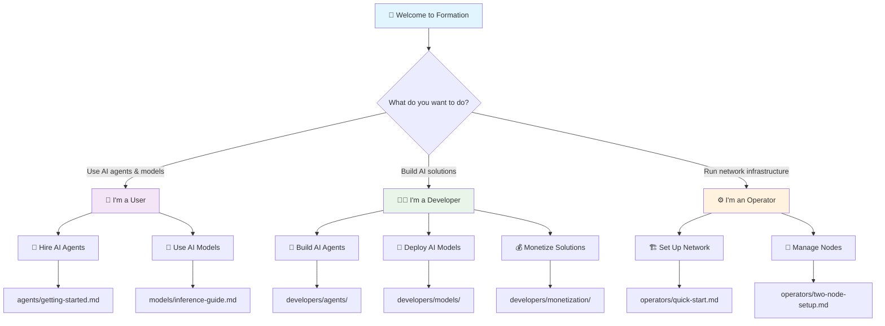
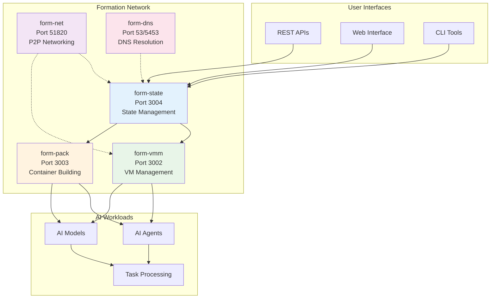

# Formation Documentation

Welcome to Formation - the decentralized AI infrastructure that enables developers to build, deploy, and monetize AI agents and models while providing users with access to specialized AI capabilities.

## 🚀 Quick Start

**New to Formation?** Choose your path:

## 📚 Documentation by User Type

### 📱 [Users](users/) - Use AI Agents & Models

**Perfect for:** End users, businesses, and developers who want to use AI capabilities

- **[Getting Started](users/agents/getting-started.md)** - Your first AI agent hire
- **[Model Inference Guide](users/models/inference-guide.md)** - Direct AI model access
- **[API Reference](users/models/api-reference.md)** - Complete technical documentation
- **[Code Examples](users/agents/examples.md)** - Working examples in multiple languages

**⏱️ Time to first result:** 5 minutes

---

### 👨‍💻 [Developers](developers/) - Build & Monetize AI Solutions

**Perfect for:** AI developers, ML engineers, and entrepreneurs building AI products

#### 🤖 AI Agents
- **[Building Agents](developers/agents/building-agents.md)** - Architecture and requirements
- **[Deployment Guide](developers/agents/deployment.md)** - Deploy with `form-pack`
- **[Agent Examples](developers/agents/examples.md)** - Complete working examples

#### 🧠 AI Models  
- **[Model Requirements](developers/models/model-requirements.md)** - OpenAI-compatible specs
- **[Deployment Guide](developers/models/deployment.md)** - Containerization and registration

#### 💰 Monetization
- **[Pricing Models](developers/monetization/pricing-models.md)** - Revenue strategies
- **[Billing Integration](developers/monetization/billing-integration.md)** - Payment processing

**⏱️ Time to first deployment:** 2-3 hours

---

### ⚙️ [Operators](operators/) - Run Network Infrastructure

**Perfect for:** DevOps engineers, infrastructure providers, and network contributors

- **[Quick Start](operators/quick-start.md)** - Single node setup
- **[Two-Node Setup](operators/two-node-setup.md)** - Multi-node networking
- **[Troubleshooting](operators/troubleshooting.md)** - Common issues and solutions

**⏱️ Time to running node:** 30 minutes

## 🎯 Popular Use Cases

### For Users
- **Content Creation**: Hire writing agents for blogs, marketing copy, documentation
- **Code Assistance**: Get programming help, code review, debugging support  
- **Data Analysis**: Process spreadsheets, generate insights, create visualizations
- **Research**: Information gathering, fact-checking, competitive analysis

### For Developers
- **AI Agent Marketplace**: Build and sell specialized AI agents
- **Custom Model Hosting**: Deploy your trained models for inference
- **API Integration**: Add AI capabilities to existing applications
- **Revenue Generation**: Earn from your AI solutions (70% revenue share)

### For Operators
- **Network Participation**: Contribute to decentralized AI infrastructure
- **Resource Monetization**: Earn from providing compute resources
- **Local Development**: Run private Formation networks for testing
- **Enterprise Deployment**: Host Formation for organizational use

## 🔗 Quick Links

### Essential Resources
- **[Formation vs OpenAI](users/models/inference-guide.md#formation-vs-openai-api)** - Migration guide
- **[Authentication Guide](users/agents/getting-started.md#authentication)** - ECDSA signatures
- **[Pricing Overview](users/README.md#account--billing)** - Credits and subscription tiers
- **[API Compatibility](users/models/api-reference.md#openai-compatibility)** - 100% OpenAI-compatible

### Development Tools
- **form-config-wizard** - Generate Formation configuration
- **form-pack** - Build and package agents/models  
- **Docker Compose** - Local development environment
- **API Testing** - Postman collections and cURL examples

### Community & Support
- **GitHub**: [formation-ai/formation](https://github.com/formation-ai/formation)
- **Discord**: [discord.gg/formation](https://discord.gg/formation)
- **Documentation Issues**: [Report here](https://github.com/formation-ai/formation/issues)

## 🏗️ Formation Architecture

Formation consists of five core services working together:

## 🚦 Getting Started Checklist

### For Users
- [ ] Read the [User Guide](users/README.md)
- [ ] Try [hiring your first agent](users/agents/getting-started.md)
- [ ] Make a [model inference request](users/models/inference-guide.md)
- [ ] Explore [code examples](users/agents/examples.md)

### For Developers  
- [ ] Review [developer overview](developers/README.md)
- [ ] Choose: [Build agents](developers/agents/) or [deploy models](developers/models/)
- [ ] Set up [local development environment](developers/README.md#development-tools)
- [ ] Configure [monetization](developers/monetization/)

### For Operators
- [ ] Check [system requirements](operators/README.md#prerequisites)
- [ ] Follow [quick start guide](operators/quick-start.md)
- [ ] Set up [multi-node network](operators/two-node-setup.md)
- [ ] Configure [monitoring and maintenance](operators/troubleshooting.md)

## 📖 Documentation Standards

This documentation follows these principles:

- **User-Focused**: Organized by user type and use case
- **Example-Driven**: Working code examples for every concept
- **Production-Ready**: All examples can be used in production
- **OpenAI-Compatible**: Seamless migration from existing AI tools
- **Security-First**: Proper authentication and best practices

## 🤝 Contributing

Help improve Formation's documentation:

1. **Found an issue?** [Open a GitHub issue](https://github.com/formation-ai/formation/issues)
2. **Have a suggestion?** Join our [Discord community](https://discord.gg/formation)
3. **Want to contribute?** Check our [contribution guidelines](https://github.com/formation-ai/formation/blob/main/CONTRIBUTING.md)

---

## 🎉 Ready to Start?

**Choose your journey:**

<table>
<tr>
<td align="center" width="33%">

### 📱 **Users**
**Use AI agents and models**

[**Get Started →**](users/README.md)

*Perfect for businesses and developers who want to use AI capabilities*

</td>
<td align="center" width="33%">

### 👨‍💻 **Developers**  
**Build and monetize AI solutions**

[**Get Started →**](developers/README.md)

*Perfect for AI developers and ML engineers building products*

</td>
<td align="center" width="33%">

### ⚙️ **Operators**
**Run network infrastructure**

[**Get Started →**](operators/README.md)

*Perfect for DevOps engineers and infrastructure providers*

</td>
</tr>
</table>

---

**Welcome to Formation - let's build the future of decentralized AI together!** 🚀 