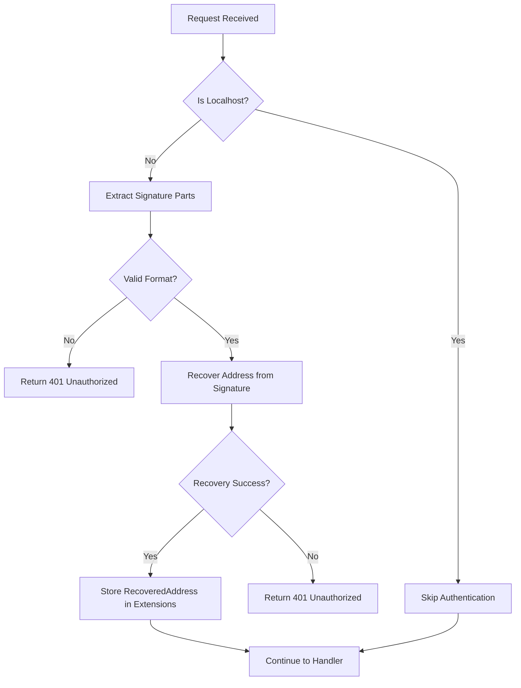

# Analysis: Existing `ecdsa_auth_middleware` Implementation

**Sub-sub-task 3.1.1.1: Review existing `ecdsa_auth_middleware` implementation**

## Overview

This document provides a comprehensive analysis of the current `ecdsa_auth_middleware` implementation across the Formation codebase. The middleware is currently implemented in multiple services with slight variations, providing ECDSA signature-based authentication for API endpoints.

## Current Implementation Locations

### 1. form-state/src/auth/ecdsa.rs (Primary Implementation)
- **Lines 172-211**: Main `ecdsa_auth_middleware` function
- **Purpose**: Authenticates requests to the Formation state management service
- **Usage**: Applied to account_api, instance_api, and api_routes routers

### 2. form-pack/src/auth/ecdsa.rs
- **Lines 171-228**: Similar implementation with minor variations
- **Purpose**: Authenticates requests to the Formation package management service
- **Usage**: Applied to package management endpoints

### 3. form-vmm/vmm-service/src/api/auth.rs
- **Lines 138-175**: Specialized implementation using X-headers instead of Authorization header
- **Purpose**: Authenticates requests to the VM management service
- **Usage**: Applied to VM operation endpoints

## Core Authentication Flow

### 1. Request Format
The middleware expects requests with ECDSA signatures in one of two formats:

#### Standard Format (form-state, form-pack):
```
Authorization: Signature <signature_hex>.<recovery_id>.<message_hex>
```

#### X-Headers Format (form-vmm):
```
X-Signature: <signature_hex>
X-Recovery-Id: <recovery_id>
X-Message: <message_hash_hex>
```

### 2. Authentication Process



### 3. Key Components

#### Signature Extraction (`extract_signature_parts`)
- Parses Authorization header or X-headers
- Validates format and structure
- Returns signature bytes, recovery ID, and message

#### Address Recovery (`recover_address`)
- Uses k256 ECDSA library for signature verification
- Performs SHA-256 hashing of the message
- Recovers Ethereum-style address from public key

#### Localhost Bypass
- **form-state**: Checks `ConnectInfo<SocketAddr>` for loopback addresses
- **form-pack**: Similar localhost detection
- **form-vmm**: Health/ping endpoint bypass only

## Current Usage Patterns

### 1. form-state/src/api.rs Router Configuration

```rust
// Account operations - requires ECDSA auth
let account_api = Router::new()
    .route("/account/:address/get", get(get_account))
    .route("/account/list", get(list_accounts))
    .route("/account/create", post(create_account))
    // ... more routes
    .layer(middleware::from_fn_with_state(state.clone(), ecdsa_auth_middleware));

// Instance operations - requires ECDSA auth  
let instance_api = Router::new()
    .route("/instance/create", post(create_instance))
    .route("/instance/update", post(update_instance))
    // ... more routes
    .layer(middleware::from_fn_with_state(state.clone(), ecdsa_auth_middleware));

// Agent/Model operations - requires ECDSA auth
let api_routes = Router::new()
    .route("/agents/create", post(create_agent))
    .route("/models/create", post(create_model))
    // ... more routes
    .layer(middleware::from_fn_with_state(state.clone(), ecdsa_auth_middleware));

// Network writers - uses node_auth_middleware instead
let network_writers_api = Router::new()
    .route("/user/create", post(create_user))
    .route("/node/create", post(create_node))
    // ... more routes
    .layer(middleware::from_fn_with_state(state.clone(), node_auth_middleware));
```

### 2. Public Endpoints (No Authentication)
- Health check endpoints (`/health`, `/ping`)
- Bootstrap endpoints (`/bootstrap/*`)
- Read-only endpoints (`/agents`, `/models`, `/node/list`)

### 3. Special Authentication Types

#### Active Node Authentication
```rust
// form-state/src/auth/ecdsa.rs:212-289
pub async fn active_node_auth_middleware(...)
```
- Validates ECDSA signature AND checks if address belongs to active network peer
- Used for devnet gossip operations

#### Node Authentication (Admin-only)
```rust
// form-state/src/api.rs:66-136
async fn node_auth_middleware(...)
```
- Allows localhost requests
- Checks if recovered address belongs to a global system admin
- Used for network writer operations

## Current Localhost Bypass Implementation

### form-state Implementation
```rust
// Check for localhost connection
let is_localhost = {
    let connection_info = request.extensions().get::<ConnectInfo<SocketAddr>>();
    let remote_addr = connection_info.map(|c| c.0.to_string()).unwrap_or("".to_string());
    remote_addr.starts_with("127.0.0.1") || remote_addr.starts_with("::1")
};

if is_localhost {
    // Skip auth for localhost connections
    request.extensions_mut().insert(None::<RecoveredAddress>);
    return Ok(next.run(request).await);
}
```

### form-pack Implementation
```rust
let is_localhost = {
    let connection_info = request.extensions().get::<ConnectInfo<SocketAddr>>();
    let remote_addr = connection_info.map(|c| c.0.to_string()).unwrap_or("".to_string());
    let is_loopback = remote_addr.starts_with("127.0.0.1") || remote_addr.starts_with("::1");
    is_loopback
};

// Skip authentication for specific endpoints
if request.uri().path() == "/health" || request.uri().path() == "/ping" || is_localhost {
    return Ok(next.run(request).await);
}
```

## Key Observations for Admin Key Implementation

### 1. Consistency Patterns
- All implementations use the same ECDSA signature verification logic
- All use localhost bypass for development/admin access
- All store `RecoveredAddress` in request extensions for handlers

### 2. Variation Points
- **Header format**: Authorization vs X-headers
- **Endpoint bypasses**: Health/ping vs broader localhost access
- **State management**: Some store None for localhost, others skip storage

### 3. Extension Points for Admin Keys
- Current localhost bypass logic provides a template for admin bypass
- The precedence pattern (localhost → signature verification) can be extended to (localhost → admin → normal)
- Request extension storage mechanism can accommodate admin context

### 4. Security Considerations
- Localhost bypass is currently binary (allow all vs require auth)
- No audit logging for authentication events
- No rate limiting or brute force protection

## Current Admin Account System

### Admin Account Storage
- Stored in `datastore.account_state` with `is_global_admin: bool` flag
- Created via `/bootstrap/ensure_admin_account` endpoint
- Checked in `node_auth_middleware` for network writer operations

### Admin Verification Pattern
```rust
// From form-state/src/api.rs:124-135
let is_system_admin = datastore.account_state.get_account(&address_hex)
    .map_or(false, |acc| acc.is_global_admin);

if is_system_admin {
    log::info!("Node authentication successful: Address 0x{} is a global system admin", address_hex);
    Ok(next.run(req).await)
} else {
    log::warn!("Authentication failed: Address 0x{} is not a global system admin", address_hex);
    Err(StatusCode::UNAUTHORIZED)
}
```

## Recommendations for Admin Key Enhancement

### 1. Centralized Admin Middleware
- Create a unified `global_admin_auth_middleware` that combines localhost + admin + normal auth
- Apply consistently across all services (form-state, form-pack, form-vmm)

### 2. Precedence Order
1. **Localhost**: Allow all operations (development)
2. **Admin Key**: Allow all operations (production admin)
3. **Normal Auth**: Standard ECDSA authentication with authorization checks

### 3. Configuration Management
- Store admin keys in centralized configuration
- Support multiple admin keys for redundancy
- Enable runtime admin key rotation

### 4. Audit and Security
- Log all admin key usage with detailed context
- Implement admin key expiration/rotation
- Add rate limiting for admin operations

## Next Steps

Based on this analysis, the implementation plan should:

1. **Extend existing pattern**: Build on the localhost bypass mechanism
2. **Maintain backward compatibility**: Ensure existing auth flows continue working
3. **Centralize admin logic**: Create shared admin verification functions
4. **Apply consistently**: Update all three services (form-state, form-pack, form-vmm)
5. **Add proper logging**: Implement comprehensive audit trails for admin operations 