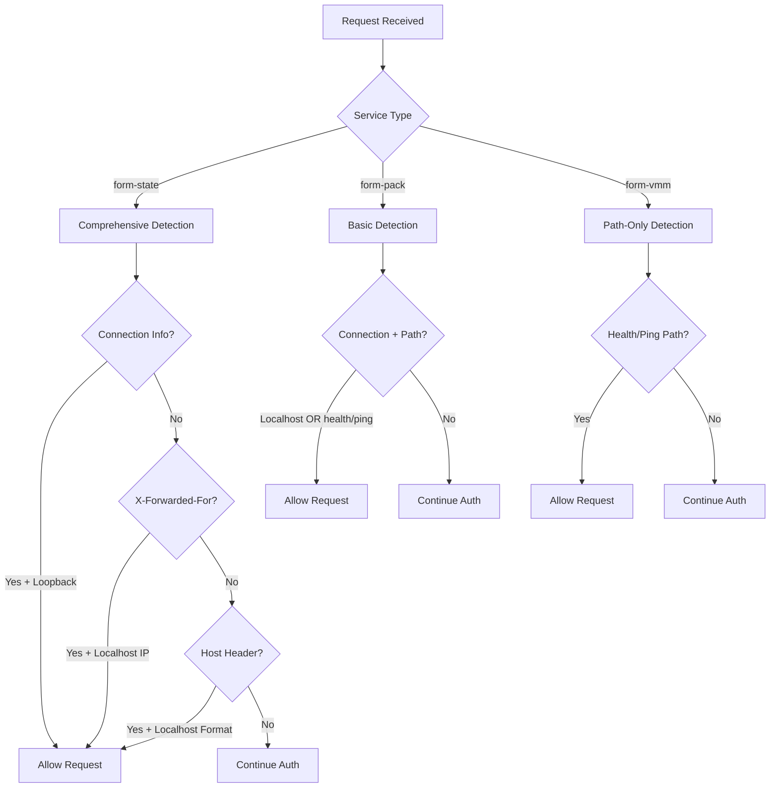

# Analysis: Current Localhost Bypass Implementation Pattern

**Sub-sub-task 3.1.1.4: Document current localhost bypass implementation pattern**

## Overview

This document provides a comprehensive analysis of the current localhost bypass implementation patterns across all Formation services. Localhost bypass allows local development and administrative access by detecting localhost connections and skipping authentication requirements.

## Core Implementation Patterns

### Pattern 1: Comprehensive Localhost Detection (form-state)

**Location**: `form-state/src/api.rs` (Lines 136-180)

```rust
pub fn is_localhost_request(req: &Request<Body>) -> bool {
    log::info!("Checking if request is from localhost");
    
    // Stage 1: Check connection info (direct connections)
    if let Some(addr) = req.extensions().get::<axum::extract::ConnectInfo<std::net::SocketAddr>>() {
        let ip = addr.ip();
        log::info!("  Connection info IP: {}", ip);
        if ip.is_loopback() {
            log::info!("  Localhost detected via connection info (loopback)");
            return true;
        }
    }
    
    // Stage 2: Check X-Forwarded-For header (proxy scenarios)
    if let Some(forwarded) = req.headers().get("x-forwarded-for") {
        if let Ok(addr) = forwarded.to_str() {
            let first_ip = addr.split(',').next().unwrap_or("").trim();
            log::info!("  X-Forwarded-For header: {}", first_ip);
            if first_ip == "127.0.0.1" || first_ip == "::1" || first_ip.starts_with("localhost") {
                log::info!("  Localhost detected via X-Forwarded-For");
                return true;
            }
        }
    }
    
    // Stage 3: Check Host header
    if let Some(host) = req.headers().get("host") {
        if let Ok(host_str) = host.to_str() {
            log::info!("  Host header: {}", host_str);
            if host_str.starts_with("localhost:") || host_str == "localhost" ||
               host_str.starts_with("127.0.0.1") || host_str.starts_with("::1") {
                log::info!("  Localhost detected via Host header");
                return true;
            }
        }
    }
    
    log::info!("  Not a localhost request");
    false
}
```

**Usage in node_auth_middleware**:
```rust
async fn node_auth_middleware(
    State(state): State<Arc<Mutex<DataStore>>>,
    req: Request<Body>,
    next: middleware::Next,
) -> Result<Response, StatusCode> {
    // Stage 1: Localhost bypass (highest precedence)
    if is_localhost_request(&req) {
        log::info!("Allowing localhost request without authentication");
        return Ok(next.run(req).await);
    }
    
    // Continue with normal authentication...
}
```

### Pattern 2: Basic Connection Info Bypass (form-pack)

**Location**: `form-pack/src/auth/ecdsa.rs` (Lines 170-185)

```rust
pub async fn ecdsa_auth_middleware(
    mut request: Request,
    next: axum::middleware::Next,
) -> Result<Response, SignatureError> {
    let is_localhost = {
        let connection_info = request.extensions().get::<ConnectInfo<SocketAddr>>();
        let remote_addr = connection_info.map(|c| c.0.to_string()).unwrap_or("".to_string());
        let is_loopback = remote_addr.starts_with("127.0.0.1") || remote_addr.starts_with("::1");
        log::info!("Connection from: {}, is_loopback: {}", remote_addr, is_loopback);
        is_loopback
    };
    
    // Combined path and localhost check
    if request.uri().path() == "/health" || request.uri().path() == "/ping" || is_localhost {
        log::info!("Bypassing authentication for {} (localhost: {})", 
                   request.uri().path(), is_localhost);
        return Ok(next.run(request).await);
    }
    
    // Continue with signature verification...
}
```

### Pattern 3: Path-Based Bypass (form-vmm)

**Location**: `form-vmm/vmm-service/src/api/auth.rs` (Lines 137-145)

```rust
pub async fn ecdsa_auth_middleware_x_headers(
    request: Request,
    next: axum::middleware::Next,
) -> Result<AxumResponse, SignatureError> {
    let path = request.uri().path().to_owned();
    
    // Simple path-based bypass (no explicit localhost check)
    if path == "/health" || path == "/ping" {
        return Ok(next.run(request).await);
    }
    
    // Continue with X-Headers signature verification...
}
```

## Detection Methods Comparison

| Service | Connection Info | X-Forwarded-For | Host Header | Path-Based | Logging Level |
|---------|----------------|-----------------|-------------|------------|---------------|
| **form-state** | ✅ `ip.is_loopback()` | ✅ Parse first IP | ✅ Multiple formats | ❌ | Verbose |
| **form-pack** | ✅ String-based check | ❌ | ❌ | ✅ health/ping | Basic |
| **form-vmm** | ❌ | ❌ | ❌ | ✅ health/ping | Minimal |

## Localhost Detection Capabilities

### form-state (Most Comprehensive)

**Connection Detection**:
- Uses `ConnectInfo<SocketAddr>` extension
- Calls `ip.is_loopback()` for IPv4/IPv6 detection
- Handles both `127.0.0.1` and `::1`

**Proxy Awareness**:
- Parses `X-Forwarded-For` header
- Extracts first IP from comma-separated list
- Supports `127.0.0.1`, `::1`, and `localhost` strings

**Host Header Analysis**:
- Checks exact matches: `localhost`, `127.0.0.1`, `::1`
- Supports port variations: `localhost:3004`, `127.0.0.1:3004`

### form-pack (Basic but Functional)

**Connection Detection**:
- Uses `ConnectInfo<SocketAddr>` extension
- String-based comparison with `.starts_with()` 
- Covers `127.0.0.1` and `::1` prefixes

**Combined Logic**:
- Merges localhost detection with health/ping path bypass
- Single conditional for efficiency

### form-vmm (Path-Only)

**Path-Based Only**:
- Only bypasses `/health` and `/ping` endpoints
- No explicit localhost detection
- Relies on service-level access controls

## Current Precedence Patterns

### form-state (node_auth_middleware)
```
localhost → dev_mode → signature verification → admin account check
```

### form-pack (ecdsa_auth_middleware) 
```
(localhost OR health/ping) → signature verification
```

### form-vmm (ecdsa_auth_middleware_x_headers)
```
(health/ping) → X-Headers signature verification
```

## Implementation Architecture

### Request Flow Analysis



### Security Considerations

| Aspect | form-state | form-pack | form-vmm |
|--------|------------|-----------|-----------|
| **Spoofing Resistance** | High | Medium | Low |
| **Proxy Support** | Yes | No | No |
| **Development UX** | Excellent | Good | Limited |
| **Production Safety** | Safe | Safe | Requires firewall |

## Code Patterns and Utilities

### Shared Utilities

**form-state provides reusable helpers**:
```rust
// Available for reuse across services
pub fn is_localhost_request(req: &Request<Body>) -> bool { /* ... */ }
pub fn is_public_endpoint(path: &str) -> bool { /* ... */ }
```

### Authentication Extension Storage

**All services use similar patterns**:
```rust
// Store authentication context in request extensions
request.extensions_mut().insert(RecoveredAddress { /* ... */ });

// Skip storage for localhost (varies by service)
if is_localhost {
    // form-state: No extension inserted
    // form-pack: No extension inserted  
    // form-vmm: Not applicable (path-only)
}
```

## Integration with Admin Bypass Design

### Current Template for Enhancement

The localhost bypass pattern provides the ideal template for admin key bypass:

```rust
// Current pattern (form-state)
if is_localhost_request(&req) {
    return Ok(next.run(req).await);
}

// Proposed enhanced pattern
if is_localhost_request(&req) {
    return Ok(next.run(req).await);
}

if let Ok(admin_address) = verify_admin_key(&req) {
    req.extensions_mut().insert(AdminContext { address: admin_address });
    return Ok(next.run(req).await);
}

// Continue with normal authentication...
```

### Precedence Order Design

Based on current implementations, the ideal precedence order is:

1. **Localhost** (existing behavior, highest precedence)
2. **Admin Key** (new addition, bypasses all normal auth)
3. **Normal Authentication** (existing signature verification)
4. **Authorization** (existing resource-specific checks)

## Standardization Opportunities

### Unified Helper Functions

Create a shared authentication utility library:

```rust
// Proposed shared utilities
pub fn is_localhost_request(req: &Request<Body>) -> bool { /* comprehensive detection */ }
pub fn is_admin_key_request(req: &Request<Body>, admin_config: &AdminConfig) -> Result<Address, AuthError> { /* admin verification */ }
pub fn is_public_endpoint(path: &str) -> bool { /* endpoint classification */ }
```

### Consistent Middleware Pattern

```rust
// Proposed standard middleware signature
pub async fn universal_auth_middleware<T>(
    state: State<T>,
    req: Request<Body>,
    next: middleware::Next,
) -> Result<Response, StatusCode>
where T: AuthenticationState
{
    // 1. Localhost bypass
    // 2. Admin key bypass  
    // 3. Service-specific authentication
    // 4. Continue to authorization
}
```

## Current Limitations

### Service Inconsistencies

1. **Detection Depth**: form-state comprehensive, others basic
2. **Proxy Support**: Only form-state handles proxies
3. **Logging**: Inconsistent verbosity levels
4. **Error Handling**: Different error types and responses

### Security Gaps

1. **Partial Coverage**: Some services lack localhost detection
2. **Header Spoofing**: Not all services validate connection info
3. **Development vs Production**: No environment-aware behavior

## Admin Bypass Implementation Recommendations

### 1. Extend Existing Pattern

Build admin bypass using the successful form-state pattern:
- Reuse `is_localhost_request()` function
- Add parallel `verify_admin_key()` function
- Maintain same precedence order

### 2. Standardize Across Services

- Adopt form-state's comprehensive detection in all services
- Create shared authentication utilities
- Unify error handling and logging

### 3. Maintain Backward Compatibility

- Keep existing localhost bypass behavior
- Add admin bypass as additional layer
- Preserve development workflow

## Conclusion

The current localhost bypass implementation provides an excellent foundation for admin key bypass. The form-state service demonstrates the most robust pattern with comprehensive detection, proper logging, and secure precedence handling. This pattern should be:

1. **Extended** with admin key verification
2. **Standardized** across all services
3. **Enhanced** with unified utilities
4. **Maintained** for backward compatibility

The localhost bypass pattern validates the architectural approach of authentication middleware handling precedence rules, making admin key bypass a natural extension rather than a fundamental redesign. 