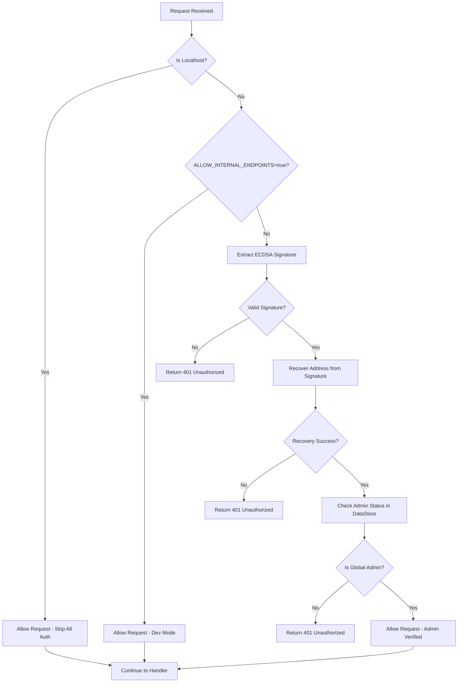

# Analysis: `node_auth_middleware` Admin Checking Logic

**Sub-sub-task 3.1.1.2: Review `node_auth_middleware` admin checking logic**

## Overview

This document provides a detailed analysis of the current `node_auth_middleware` implementation in Formation, which handles admin authentication for network writer operations. This middleware demonstrates the existing admin key checking pattern that can be extended for global admin authentication.

## Current Implementation Location

### form-state/src/api.rs (Lines 66-136)
- **Function**: `node_auth_middleware`
- **Purpose**: Authenticates requests to network writer endpoints requiring admin privileges
- **Usage**: Applied to `network_writers_api` router for admin-only operations

## Authentication Flow

### 1. Precedence Order
The current middleware follows a clear precedence pattern:



### 2. Detailed Flow Analysis

#### Stage 1: Localhost Bypass
```rust
if is_localhost_request(&req) {
    log::info!("Allowing localhost request without authentication");
    return Ok(next.run(req).await);
}
```
- Uses comprehensive localhost detection via `is_localhost_request()` helper
- Checks connection info, X-Forwarded-For headers, and Host headers
- Provides full bypass for development and bootstrap operations

#### Stage 2: Development Mode Bypass
```rust
let allow_internal = std::env::var("ALLOW_INTERNAL_ENDPOINTS")
    .unwrap_or_default()
    .to_lowercase() == "true";
    
if allow_internal {
    log::info!("Dev mode: Skipping authentication");
    return Ok(next.run(req).await);
}
```
- Environment variable controlled bypass for development environments
- Allows internal endpoint access without authentication

#### Stage 3: ECDSA Signature Verification
```rust
let (signature_bytes, recovery_id, message) = match extract_signature_parts(&headers) {
    Ok(parts) => parts,
    Err(SignatureError::MissingSignature) => {
        log::warn!("Authentication failed: Missing signature");
        return Err(StatusCode::UNAUTHORIZED);
    },
    Err(_) => {
        log::warn!("Authentication failed: Invalid signature format");
        return Err(StatusCode::UNAUTHORIZED);
    }
};

let address = match recover_address(&signature_bytes, recovery_id, &message) {
    Ok(addr) => addr,
    Err(_) => {
        log::warn!("Authentication failed: Could not recover address from signature");
        return Err(StatusCode::UNAUTHORIZED);
    }
};
```
- Reuses the same ECDSA verification logic as `ecdsa_auth_middleware`
- Validates signature format and recovers Ethereum address

#### Stage 4: Admin Status Verification
```rust
let datastore = state.lock().await;

let is_system_admin = datastore.account_state.get_account(&address_hex)
    .map_or(false, |acc| acc.is_global_admin);

if is_system_admin {
    log::info!("Node authentication successful: Address 0x{} is a global system admin", address_hex);
    Ok(next.run(req).await)
} else {
    log::warn!("Authentication failed: Address 0x{} is not a global system admin", address_hex);
    Err(StatusCode::UNAUTHORIZED)
}
```
- Queries `datastore.account_state` for account information
- Checks the `is_global_admin` boolean field on the Account struct
- Only allows access if the account has global admin privileges

## Admin Account System

### 1. Account Structure
From `form-state/src/accounts.rs`:

```rust
#[derive(Clone, Debug, Serialize, Deserialize, PartialEq, Eq, PartialOrd, Ord, Hash)]
pub struct Account {
    pub address: String,
    pub name: Option<String>,
    #[serde(default)]
    pub is_global_admin: bool,  // ← Admin flag
    #[serde(default)]
    pub owned_instances: BTreeSet<String>,
    #[serde(default)]
    pub owned_agents: BTreeSet<String>,
    #[serde(default)]
    pub owned_models: BTreeSet<String>,
    // ... other fields
}
```

### 2. Admin Account Creation
Via `/bootstrap/ensure_admin_account` endpoint:

```rust
async fn ensure_admin_account(
    State(state): State<Arc<Mutex<DataStore>>>,
    Json(payload): Json<EnsureAdminPayload>,
) -> impl IntoResponse {
    let admin_key = payload.admin_public_key;
    
    let mut account_to_save = if account_exists {
        let mut acc = datastore.account_state.get_account(&admin_key).unwrap();
        acc.is_global_admin = true;  // ← Set admin flag
        acc.updated_at = chrono::Utc::now().timestamp();
        acc
    } else {
        let mut new_acc = crate::accounts::Account::new(admin_key.clone());
        new_acc.is_global_admin = true;  // ← Set admin flag for new account
        new_acc
    };

    let op = datastore.account_state.update_account_local(account_to_save);
    datastore.handle_account_op(op).await
}
```

### 3. Admin Status Checking
Via `/account/{address}/is_global_admin` endpoint:

```rust
async fn is_global_admin_handler(
    State(state): State<Arc<Mutex<DataStore>>>,
    Path(address): Path<String>,
) -> impl IntoResponse {
    let datastore = state.lock().await;
    match datastore.account_state.get_account(&address) {
        Some(account) => (StatusCode::OK, Json(json!({ 
            "address": address, 
            "is_global_admin": account.is_global_admin 
        }))),
        None => (StatusCode::NOT_FOUND, Json(json!({ "error": "Account not found" }))),
    }
}
```

## Network Writer Endpoints Protected

The `node_auth_middleware` currently protects these critical operations:

### Network Management
- `/user/create`, `/user/update`, `/user/disable`, `/user/delete`
- `/cidr/create`, `/cidr/update`, `/cidr/delete`
- `/assoc/create`, `/assoc/delete`
- `/dns/create`, `/dns/update`, `/dns/:domain/delete`

### Node Management
- `/node/create`, `/node/update`, `/node/:id/delete`
- `/node/:id/report_metrics`

### Task Management
- `/task/update_status`

### User Management
- `/user/redeem` (invite redemption)

## Localhost Detection Implementation

The `is_localhost_request()` helper provides comprehensive localhost detection:

```rust
pub fn is_localhost_request(req: &Request<Body>) -> bool {
    // Check from connection info (direct connections)
    if let Some(addr) = req.extensions().get::<axum::extract::ConnectInfo<std::net::SocketAddr>>() {
        let ip = addr.ip();
        if ip.is_loopback() {
            return true;
        }
    }
    
    // Check headers for proxy info
    if let Some(forwarded) = req.headers().get("x-forwarded-for") {
        if let Ok(addr) = forwarded.to_str() {
            let first_ip = addr.split(',').next().unwrap_or("").trim();
            if first_ip == "127.0.0.1" || first_ip == "::1" || first_ip.starts_with("localhost") {
                return true;
            }
        }
    }
    
    // Check if host header indicates localhost
    if let Some(host) = req.headers().get("host") {
        if let Ok(host_str) = host.to_str() {
            if host_str.starts_with("localhost:") || host_str == "localhost" || 
               host_str.starts_with("127.0.0.1") || host_str.starts_with("::1") {
                return true;
            }
        }
    }
    
    false
}
```

## Key Observations for Global Admin Implementation

### 1. Proven Admin Pattern
- **Working precedence**: localhost → dev mode → signature verification → admin check
- **Successful admin storage**: Uses `is_global_admin` boolean in Account struct
- **Reliable admin lookup**: `datastore.account_state.get_account()` with admin check

### 2. Reusable Components
- **ECDSA verification**: Same logic as `ecdsa_auth_middleware`
- **Localhost detection**: Comprehensive `is_localhost_request()` implementation
- **Admin verification**: Proven `is_global_admin` field checking

### 3. Security Considerations
- **Comprehensive logging**: All authentication events logged with context
- **Clear error messages**: Differentiated error responses for debugging
- **State consistency**: Uses datastore lock for atomic admin status checking

### 4. Extension Points
- **Environment variables**: `ALLOW_INTERNAL_ENDPOINTS` pattern for configuration
- **Admin account management**: Bootstrap endpoint for admin creation
- **Admin status API**: Endpoint for checking admin status

## Differences from `ecdsa_auth_middleware`

| Aspect | `ecdsa_auth_middleware` | `node_auth_middleware` |
|--------|------------------------|----------------------|
| **Scope** | User operations | Admin-only operations |
| **Auth Level** | Any valid ECDSA signature | Valid signature + admin status |
| **Localhost Handling** | Basic bypass | Comprehensive detection |
| **Dev Mode** | Not supported | Environment variable controlled |
| **Admin Check** | None | Required global admin status |
| **Error Handling** | Generic unauthorized | Admin-specific error messages |

## Integration with Admin Key System

### Current Admin Verification Flow
```rust
// 1. Extract address from signature
let address_hex = hex::encode(address.as_slice());

// 2. Look up account in datastore
let datastore = state.lock().await;
let is_system_admin = datastore.account_state.get_account(&address_hex)
    .map_or(false, |acc| acc.is_global_admin);

// 3. Allow if admin, deny if not
if is_system_admin {
    Ok(next.run(req).await)
} else {
    Err(StatusCode::UNAUTHORIZED)
}
```

### Proposed Extension for Global Admin Keys
```rust
// Add before existing admin check:

// Check if recovered address matches configured admin keys
if let Some(admin_config) = &datastore.admin_config {
    if admin_config.is_admin_key(&address_hex) {
        log::info!("Global admin key verified: 0x{}", address_hex);
        return Ok(next.run(req).await);
    }
}

// Then continue with existing account-based admin check...
```

## Recommendations for Global Admin Implementation

### 1. Build on Existing Pattern
- Extend `node_auth_middleware` logic rather than replacing it
- Maintain the same precedence order: localhost → admin key → account admin → reject
- Keep existing logging and error handling patterns

### 2. Configuration Integration
- Add admin key configuration to datastore or separate config system
- Support multiple admin keys for redundancy
- Enable runtime admin key rotation

### 3. Consistent Application
- Apply the enhanced middleware to all endpoint categories
- Replace `ecdsa_auth_middleware` with enhanced version
- Maintain backward compatibility with existing account admin system

### 4. Security Enhancements
- Add audit logging for all admin key usage
- Implement admin key expiration/rotation
- Add rate limiting for admin operations

## Next Steps

Based on this analysis, the global admin key implementation should:

1. **Extend the proven pattern**: Use `node_auth_middleware` as the template
2. **Add admin key checking**: Insert admin key verification before account admin checking
3. **Maintain compatibility**: Keep existing account-based admin system working
4. **Apply consistently**: Update all authentication middleware to use the enhanced version
5. **Add configuration**: Implement admin key storage and management system 