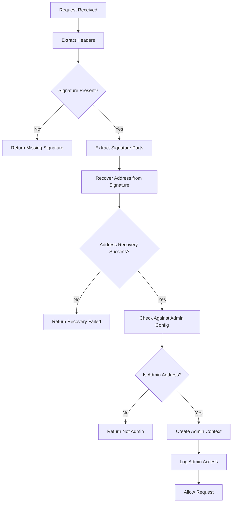
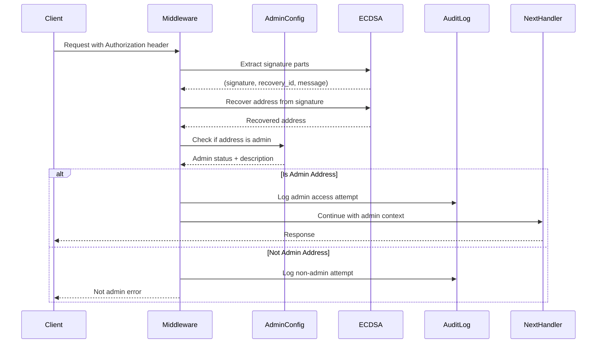

# Design: Admin Signature Verification Flow

**Sub-sub-task 3.1.2.2: Design signature verification flow for admin requests**

## Overview

This document defines the signature verification flow for admin requests in Formation. The design builds on the existing ECDSA authentication infrastructure while providing admin-specific verification logic that integrates with the admin key configuration system.

## Design Principles

### 1. Reuse Existing Infrastructure
- **ECDSA Compatibility**: Leverage existing signature extraction and verification functions
- **Request Flow Integration**: Integrate seamlessly with current middleware patterns
- **Error Handling**: Use existing error types and response patterns

### 2. Admin-Specific Enhancements
- **Admin Context**: Create admin-specific authentication context
- **Audit Integration**: Built-in audit logging for all admin operations
- **Configuration Integration**: Direct integration with AdminConfig system

### 3. Security-First Design
- **Address Verification**: Verify signatures against configured admin addresses only
- **Timing Attack Prevention**: Constant-time admin verification where possible
- **Comprehensive Logging**: Log all admin verification attempts (success and failure)

## Signature Verification Architecture

### High-Level Flow



### Detailed Verification Process



## Data Structures and Types

### Admin Authentication Context

```rust
use alloy_primitives::Address;
use serde::{Deserialize, Serialize};
use std::time::SystemTime;

/// Context for admin-authenticated requests
#[derive(Debug, Clone, Serialize, Deserialize)]
pub struct AdminContext {
    /// Admin address that signed the request
    pub address: Address,
    
    /// Human-readable description of the admin
    pub description: Option<String>,
    
    /// Timestamp when admin authentication occurred
    pub authenticated_at: SystemTime,
    
    /// The original message that was signed
    pub signed_message: Vec<u8>,
    
    /// Service that performed the authentication
    pub service_name: String,
}

impl AdminContext {
    /// Create new admin context
    pub fn new(
        address: Address,
        description: Option<String>,
        signed_message: Vec<u8>,
        service_name: String,
    ) -> Self {
        Self {
            address,
            description,
            authenticated_at: SystemTime::now(),
            signed_message,
            service_name,
        }
    }
    
    /// Get address as hex string
    pub fn address_hex(&self) -> String {
        format!("0x{}", hex::encode(self.address.as_slice()))
    }
    
    /// Get description or fallback
    pub fn display_description(&self) -> &str {
        self.description.as_deref().unwrap_or("unknown admin")
    }
}
```

### Admin Verification Result

```rust
/// Result of admin signature verification
#[derive(Debug, Clone)]
pub enum AdminVerificationResult {
    /// Successfully verified as admin
    Verified(AdminContext),
    
    /// Signature is valid but not from an admin address
    NotAdmin(Address),
    
    /// Signature verification failed
    InvalidSignature(AdminVerificationError),
    
    /// No signature provided
    NoSignature,
}

/// Errors specific to admin verification
#[derive(Debug, thiserror::Error)]
pub enum AdminVerificationError {
    #[error("Signature extraction failed: {0}")]
    SignatureExtraction(String),
    
    #[error("Address recovery failed: {0}")]
    AddressRecovery(String),
    
    #[error("Admin configuration error: {0}")]
    ConfigError(String),
    
    #[error("Internal verification error: {0}")]
    Internal(String),
}
```

## Core Verification Functions

### Primary Admin Verification Function

```rust
use axum::{extract::Request, http::HeaderMap};
use crate::auth::ecdsa::{extract_signature_parts, recover_address};
use crate::config::AdminConfig;

/// Verify if a request is signed by an admin key
pub async fn verify_admin_signature(
    headers: &HeaderMap,
    admin_config: &AdminConfig,
    service_name: &str,
) -> AdminVerificationResult {
    // Step 1: Check if admin authentication is enabled
    if !admin_config.enabled {
        log::debug!("Admin authentication disabled");
        return AdminVerificationResult::NoSignature;
    }
    
    // Step 2: Extract signature parts from headers
    let (signature_bytes, recovery_id, message) = match extract_signature_parts(headers) {
        Ok(parts) => parts,
        Err(e) => {
            log::debug!("Failed to extract signature parts: {:?}", e);
            return AdminVerificationResult::NoSignature;
        }
    };
    
    // Step 3: Recover address from signature
    let recovered_address = match recover_address(&signature_bytes, recovery_id, &message) {
        Ok(addr) => addr,
        Err(e) => {
            log::warn!("Address recovery failed during admin verification: {:?}", e);
            return AdminVerificationResult::InvalidSignature(
                AdminVerificationError::AddressRecovery(format!("{:?}", e))
            );
        }
    };
    
    // Step 4: Check if recovered address is an admin
    if admin_config.is_admin_address(&recovered_address) {
        let description = admin_config.get_admin_description(&recovered_address).map(|s| s.to_string());
        
        let admin_context = AdminContext::new(
            recovered_address,
            description,
            message,
            service_name.to_string(),
        );
        
        log::info!("Admin signature verified: {} ({})", 
                   admin_context.address_hex(), 
                   admin_context.display_description());
                   
        AdminVerificationResult::Verified(admin_context)
    } else {
        log::debug!("Valid signature but not from admin address: 0x{}", 
                    hex::encode(recovered_address.as_slice()));
        AdminVerificationResult::NotAdmin(recovered_address)
    }
}

/// Alternative verification using Request directly
pub async fn verify_admin_request(
    request: &Request,
    admin_config: &AdminConfig,
    service_name: &str,
) -> AdminVerificationResult {
    verify_admin_signature(request.headers(), admin_config, service_name).await
}
```

### Service-Specific Verification Patterns

```rust
/// Verification pattern for form-state style services
pub async fn verify_admin_for_form_state(
    headers: &HeaderMap,
    admin_config: &AdminConfig,
) -> AdminVerificationResult {
    verify_admin_signature(headers, admin_config, "form-state").await
}

/// Verification pattern for form-vmm X-Headers style
pub async fn verify_admin_x_headers(
    headers: &HeaderMap, 
    admin_config: &AdminConfig,
) -> AdminVerificationResult {
    use crate::auth::vmm::{extract_x_signature_parts, recover_address_from_hash};
    
    if !admin_config.enabled {
        return AdminVerificationResult::NoSignature;
    }
    
    // Extract X-Headers signature parts  
    let (signature_bytes, recovery_id, message_hash) = match extract_x_signature_parts(headers) {
        Ok(parts) => parts,
        Err(e) => {
            log::debug!("Failed to extract X-Headers signature: {:?}", e);
            return AdminVerificationResult::NoSignature;
        }
    };
    
    // Recover address from hash (VMM style)
    let recovered_address = match recover_address_from_hash(&signature_bytes, recovery_id, &message_hash) {
        Ok(addr) => addr,
        Err(e) => {
            return AdminVerificationResult::InvalidSignature(
                AdminVerificationError::AddressRecovery(format!("X-Headers recovery failed: {:?}", e))
            );
        }
    };
    
    // Check admin status
    if admin_config.is_admin_address(&recovered_address) {
        let description = admin_config.get_admin_description(&recovered_address).map(|s| s.to_string());
        let admin_context = AdminContext::new(
            recovered_address,
            description,
            message_hash,
            "form-vmm".to_string(),
        );
        AdminVerificationResult::Verified(admin_context)
    } else {
        AdminVerificationResult::NotAdmin(recovered_address)
    }
}
```

## Integration with Existing Middleware

### Enhanced ECDSA Middleware Pattern

```rust
use axum::{middleware::Next, response::Response};
use std::sync::Arc;

/// Enhanced ECDSA middleware with admin bypass capability
pub async fn ecdsa_auth_middleware_with_admin(
    admin_config: Arc<AdminConfig>,
    service_name: String,
    mut request: Request,
    next: Next,
) -> Result<Response, StatusCode> {
    
    // Step 1: Check for admin signature first
    match verify_admin_signature(request.headers(), &admin_config, &service_name).await {
        AdminVerificationResult::Verified(admin_context) => {
            log::warn!("ADMIN ACCESS: {} accessing {} {}", 
                      admin_context.display_description(),
                      request.method(),
                      request.uri().path());
                      
            // Store admin context in request extensions
            request.extensions_mut().insert(admin_context);
            
            // Allow request to proceed with admin privileges
            return Ok(next.run(request).await);
        }
        AdminVerificationResult::NotAdmin(_) => {
            // Valid signature but not admin - continue with normal auth
            log::debug!("Valid signature but not admin, continuing with normal auth");
        }
        AdminVerificationResult::InvalidSignature(e) => {
            // Invalid signature - this might be normal auth attempt
            log::debug!("Invalid signature during admin check: {}", e);
        }
        AdminVerificationResult::NoSignature => {
            // No signature - continue with normal auth flow
            log::debug!("No signature for admin verification");
        }
    }
    
    // Step 2: Continue with normal ECDSA authentication
    // (existing ecdsa_auth_middleware logic here)
    match RecoveredAddress::from_request_parts(&mut request.into_parts().0, &()).await {
        Ok(recovered) => {
            request.extensions_mut().insert(recovered);
            Ok(next.run(request).await)
        }
        Err(e) => {
            log::warn!("Normal ECDSA authentication failed: {:?}", e);
            Err(StatusCode::UNAUTHORIZED)
        }
    }
}
```

### Node Auth Middleware Enhancement

```rust
/// Enhanced node_auth_middleware with admin support
pub async fn node_auth_middleware_with_admin(
    State(state): State<Arc<Mutex<DataStore>>>,
    admin_config: Arc<AdminConfig>,
    req: Request<Body>,
    next: middleware::Next,
) -> Result<Response, StatusCode> {
    
    // Step 1: Localhost bypass (existing behavior)
    if is_localhost_request(&req) {
        log::info!("Allowing localhost request without authentication");
        return Ok(next.run(req).await);
    }
    
    // Step 2: Admin bypass (NEW)
    match verify_admin_request(&req, &admin_config, "form-state").await {
        AdminVerificationResult::Verified(admin_context) => {
            log::warn!("ADMIN ACCESS: {} bypassing node auth for {} {}", 
                      admin_context.display_description(),
                      req.method(),
                      req.uri().path());
                      
            // Store admin context and allow request
            req.extensions_mut().insert(admin_context);
            return Ok(next.run(req).await);
        }
        AdminVerificationResult::NotAdmin(_) => {
            log::debug!("Valid signature but not admin");
        }
        AdminVerificationResult::InvalidSignature(_) | 
        AdminVerificationResult::NoSignature => {
            log::debug!("No valid admin signature");
        }
    }
    
    // Step 3: Continue with existing node auth logic
    // ... (existing node_auth_middleware implementation)
}
```

## Audit and Logging Integration

### Admin Access Audit System

```rust
/// Audit logging for admin access
pub struct AdminAuditLogger {
    service_name: String,
}

impl AdminAuditLogger {
    pub fn new(service_name: String) -> Self {
        Self { service_name }
    }
    
    /// Log successful admin access
    pub fn log_admin_access(&self, admin_context: &AdminContext, endpoint: &str, method: &str) {
        log::warn!(
            target: "admin_audit",
            "ADMIN_ACCESS service={} admin={} description=\"{}\" method={} endpoint={} timestamp={}",
            self.service_name,
            admin_context.address_hex(),
            admin_context.display_description(),
            method,
            endpoint,
            admin_context.authenticated_at.duration_since(std::time::UNIX_EPOCH)
                .unwrap_or_default().as_secs()
        );
    }
    
    /// Log failed admin verification attempt
    pub fn log_admin_attempt_failed(&self, address: Option<&Address>, endpoint: &str, reason: &str) {
        let addr_str = address.map(|a| format!("0x{}", hex::encode(a.as_slice())))
                             .unwrap_or_else(|| "unknown".to_string());
        
        log::warn!(
            target: "admin_audit",
            "ADMIN_ATTEMPT_FAILED service={} address={} endpoint={} reason=\"{}\"",
            self.service_name,
            addr_str,
            endpoint,
            reason
        );
    }
    
    /// Log non-admin signature attempt
    pub fn log_non_admin_signature(&self, address: &Address, endpoint: &str) {
        log::info!(
            target: "admin_audit", 
            "NON_ADMIN_SIGNATURE service={} address={} endpoint={}",
            self.service_name,
            format!("0x{}", hex::encode(address.as_slice())),
            endpoint
        );
    }
}
```

### Integration with Verification Flow

```rust
/// Enhanced verification with audit logging
pub async fn verify_admin_signature_with_audit(
    headers: &HeaderMap,
    admin_config: &AdminConfig,
    service_name: &str,
    endpoint: &str,
) -> AdminVerificationResult {
    let auditor = AdminAuditLogger::new(service_name.to_string());
    
    let result = verify_admin_signature(headers, admin_config, service_name).await;
    
    match &result {
        AdminVerificationResult::Verified(admin_context) => {
            auditor.log_admin_access(admin_context, endpoint, "unknown");
        }
        AdminVerificationResult::NotAdmin(address) => {
            auditor.log_non_admin_signature(address, endpoint);
        }
        AdminVerificationResult::InvalidSignature(e) => {
            auditor.log_admin_attempt_failed(None, endpoint, &e.to_string());
        }
        AdminVerificationResult::NoSignature => {
            // Don't log missing signatures as failed admin attempts
        }
    }
    
    result
}
```

## Performance Considerations

### Caching and Optimization

```rust
use std::collections::HashMap;
use std::sync::RwLock;
use std::time::{Duration, Instant};

/// Cache for admin verification results to improve performance
pub struct AdminVerificationCache {
    cache: RwLock<HashMap<String, (bool, Instant)>>,
    ttl: Duration,
}

impl AdminVerificationCache {
    pub fn new(ttl_seconds: u64) -> Self {
        Self {
            cache: RwLock::new(HashMap::new()),
            ttl: Duration::from_secs(ttl_seconds),
        }
    }
    
    /// Check cache for admin status
    pub fn is_admin_cached(&self, address: &Address) -> Option<bool> {
        let cache = self.cache.read().ok()?;
        let key = hex::encode(address.as_slice());
        
        if let Some((is_admin, timestamp)) = cache.get(&key) {
            if timestamp.elapsed() < self.ttl {
                return Some(*is_admin);
            }
        }
        None
    }
    
    /// Cache admin verification result
    pub fn cache_admin_result(&self, address: &Address, is_admin: bool) {
        if let Ok(mut cache) = self.cache.write() {
            let key = hex::encode(address.as_slice());
            cache.insert(key, (is_admin, Instant::now()));
            
            // Clean expired entries periodically
            cache.retain(|_, (_, timestamp)| timestamp.elapsed() < self.ttl);
        }
    }
}

/// Optimized admin verification with caching
pub async fn verify_admin_signature_cached(
    headers: &HeaderMap,
    admin_config: &AdminConfig,
    cache: &AdminVerificationCache,
    service_name: &str,
) -> AdminVerificationResult {
    
    if !admin_config.enabled {
        return AdminVerificationResult::NoSignature;
    }
    
    // Extract and recover address first
    let recovered_address = match extract_and_recover_address(headers) {
        Ok(addr) => addr,
        Err(e) => return AdminVerificationResult::InvalidSignature(e),
    };
    
    // Check cache first
    if let Some(is_admin_cached) = cache.is_admin_cached(&recovered_address) {
        if is_admin_cached {
            let description = admin_config.get_admin_description(&recovered_address).map(|s| s.to_string());
            let admin_context = AdminContext::new(
                recovered_address,
                description,
                vec![], // We don't cache the original message
                service_name.to_string(),
            );
            return AdminVerificationResult::Verified(admin_context);
        } else {
            return AdminVerificationResult::NotAdmin(recovered_address);
        }
    }
    
    // Not in cache, perform full verification
    let is_admin = admin_config.is_admin_address(&recovered_address);
    cache.cache_admin_result(&recovered_address, is_admin);
    
    if is_admin {
        let description = admin_config.get_admin_description(&recovered_address).map(|s| s.to_string());
        let admin_context = AdminContext::new(
            recovered_address,
            description,
            vec![], // Original message not preserved in cached path
            service_name.to_string(),
        );
        AdminVerificationResult::Verified(admin_context)
    } else {
        AdminVerificationResult::NotAdmin(recovered_address)
    }
}

/// Helper function to extract and recover address
fn extract_and_recover_address(headers: &HeaderMap) -> Result<Address, AdminVerificationError> {
    let (signature_bytes, recovery_id, message) = extract_signature_parts(headers)
        .map_err(|e| AdminVerificationError::SignatureExtraction(format!("{:?}", e)))?;
        
    recover_address(&signature_bytes, recovery_id, &message)
        .map_err(|e| AdminVerificationError::AddressRecovery(format!("{:?}", e)))
}
```

## Testing Support

### Test Utilities for Admin Verification

```rust
#[cfg(test)]
pub mod test_utils {
    use super::*;
    use k256::ecdsa::SigningKey;
    use rand::thread_rng;
    
    /// Test admin signature creation
    pub struct TestAdminSigner {
        signing_key: SigningKey,
        address: Address,
    }
    
    impl TestAdminSigner {
        pub fn new() -> Self {
            let signing_key = SigningKey::random(&mut thread_rng());
            let verifying_key = k256::ecdsa::VerifyingKey::from(&signing_key);
            let address = Address::from_public_key(&verifying_key);
            
            Self { signing_key, address }
        }
        
        pub fn address(&self) -> Address {
            self.address
        }
        
        pub fn address_hex(&self) -> String {
            format!("0x{}", hex::encode(self.address.as_slice()))
        }
        
        /// Create signed headers for testing
        pub fn create_signed_headers(&self, message: &[u8]) -> HeaderMap {
            use k256::sha2::{Sha256, Digest};
            
            let mut hasher = Sha256::new();
            hasher.update(message);
            let message_hash = hasher.finalize();
            
            let (signature, recovery_id) = self.signing_key
                .sign_prehash_recoverable(message_hash.as_slice())
                .unwrap();
                
            let mut headers = HeaderMap::new();
            let auth_value = format!("Signature {}.{}.{}", 
                                   hex::encode(signature.to_bytes()),
                                   recovery_id.to_byte(),
                                   hex::encode(message));
            headers.insert("authorization", auth_value.parse().unwrap());
            headers
        }
    }
    
    /// Create test admin configuration with known signers
    pub fn create_test_admin_config_with_signers(signers: &[&TestAdminSigner]) -> AdminConfig {
        let addresses: Vec<&str> = signers.iter().map(|s| s.address_hex().as_str()).collect();
        AdminConfig::test_config(addresses).unwrap()
    }
}

#[cfg(test)]
mod tests {
    use super::*;
    use super::test_utils::*;
    
    #[tokio::test]
    async fn test_admin_signature_verification() {
        let admin_signer = TestAdminSigner::new();
        let user_signer = TestAdminSigner::new();
        
        let admin_config = create_test_admin_config_with_signers(&[&admin_signer]);
        
        let message = b"test message";
        let admin_headers = admin_signer.create_signed_headers(message);
        let user_headers = user_signer.create_signed_headers(message);
        
        // Test admin verification
        let admin_result = verify_admin_signature(&admin_headers, &admin_config, "test").await;
        assert!(matches!(admin_result, AdminVerificationResult::Verified(_)));
        
        // Test non-admin verification
        let user_result = verify_admin_signature(&user_headers, &admin_config, "test").await;
        assert!(matches!(user_result, AdminVerificationResult::NotAdmin(_)));
    }
    
    #[tokio::test]
    async fn test_admin_verification_caching() {
        let admin_signer = TestAdminSigner::new();
        let admin_config = create_test_admin_config_with_signers(&[&admin_signer]);
        let cache = AdminVerificationCache::new(60); // 60 second TTL
        
        let message = b"test message";
        let headers = admin_signer.create_signed_headers(message);
        
        // First verification (cache miss)
        let result1 = verify_admin_signature_cached(&headers, &admin_config, &cache, "test").await;
        assert!(matches!(result1, AdminVerificationResult::Verified(_)));
        
        // Second verification (cache hit)
        let result2 = verify_admin_signature_cached(&headers, &admin_config, &cache, "test").await;
        assert!(matches!(result2, AdminVerificationResult::Verified(_)));
        
        // Verify cache contains the result
        assert_eq!(cache.is_admin_cached(&admin_signer.address()), Some(true));
    }
}
```

## Security Considerations

### Timing Attack Prevention

```rust
/// Constant-time admin address checking to prevent timing attacks
pub fn is_admin_address_constant_time(
    admin_config: &AdminConfig,
    address: &Address,
) -> bool {
    use subtle::ConstantTimeEq;
    
    if !admin_config.enabled {
        return false;
    }
    
    let mut is_admin = false;
    
    // Check against all admin addresses in constant time
    for admin_addr in &admin_config.admin_addresses {
        let matches = admin_addr.as_slice().ct_eq(address.as_slice());
        is_admin |= matches.into();
    }
    
    is_admin
}
```

### Rate Limiting for Admin Verification

```rust
use std::collections::HashMap;
use std::sync::Mutex;
use std::time::{Duration, Instant};

/// Rate limiter for admin verification attempts
pub struct AdminVerificationRateLimit {
    attempts: Mutex<HashMap<Address, Vec<Instant>>>,
    max_attempts: usize,
    window: Duration,
}

impl AdminVerificationRateLimit {
    pub fn new(max_attempts: usize, window_seconds: u64) -> Self {
        Self {
            attempts: Mutex::new(HashMap::new()),
            max_attempts,
            window: Duration::from_secs(window_seconds),
        }
    }
    
    /// Check if address is rate limited
    pub fn is_rate_limited(&self, address: &Address) -> bool {
        let mut attempts = self.attempts.lock().unwrap();
        let now = Instant::now();
        
        let addr_attempts = attempts.entry(*address).or_insert_with(Vec::new);
        
        // Remove old attempts outside the window
        addr_attempts.retain(|&timestamp| now.duration_since(timestamp) < self.window);
        
        // Check if rate limit exceeded
        if addr_attempts.len() >= self.max_attempts {
            true
        } else {
            // Add current attempt
            addr_attempts.push(now);
            false
        }
    }
}
```

## Error Handling and Response Types

### Admin-Specific HTTP Responses

```rust
use axum::{response::IntoResponse, Json};
use serde_json::json;

impl IntoResponse for AdminVerificationResult {
    fn into_response(self) -> Response {
        match self {
            AdminVerificationResult::Verified(_) => {
                // This shouldn't be used as a response - admin verification success
                // should continue to the next middleware/handler
                StatusCode::INTERNAL_SERVER_ERROR.into_response()
            }
            AdminVerificationResult::NotAdmin(_) => {
                (StatusCode::FORBIDDEN, Json(json!({
                    "error": "Access denied",
                    "message": "Valid signature but not from an admin key"
                }))).into_response()
            }
            AdminVerificationResult::InvalidSignature(e) => {
                (StatusCode::UNAUTHORIZED, Json(json!({
                    "error": "Invalid signature",
                    "message": e.to_string()
                }))).into_response()
            }
            AdminVerificationResult::NoSignature => {
                (StatusCode::UNAUTHORIZED, Json(json!({
                    "error": "Missing signature",
                    "message": "Admin authentication requires a valid ECDSA signature"
                }))).into_response()
            }
        }
    }
}

impl IntoResponse for AdminVerificationError {
    fn into_response(self) -> Response {
        let (status, message) = match self {
            AdminVerificationError::SignatureExtraction(msg) => 
                (StatusCode::BAD_REQUEST, format!("Signature extraction failed: {}", msg)),
            AdminVerificationError::AddressRecovery(msg) => 
                (StatusCode::UNAUTHORIZED, format!("Address recovery failed: {}", msg)),
            AdminVerificationError::ConfigError(msg) => 
                (StatusCode::INTERNAL_SERVER_ERROR, format!("Configuration error: {}", msg)),
            AdminVerificationError::Internal(msg) => 
                (StatusCode::INTERNAL_SERVER_ERROR, format!("Internal error: {}", msg)),
        };
        
        (status, Json(json!({
            "error": "Admin verification failed",
            "message": message
        }))).into_response()
    }
}
```

## Integration Examples

### Complete Middleware Integration Example

```rust
/// Complete example of admin-enabled middleware for form-state
pub async fn enhanced_ecdsa_middleware_form_state(
    State(admin_config): State<Arc<AdminConfig>>,
    mut request: Request,
    next: Next,
) -> Result<Response, StatusCode> {
    
    let service_name = "form-state";
    let endpoint = request.uri().path();
    let method = request.method();
    
    // Admin verification with full audit logging
    match verify_admin_signature_with_audit(
        request.headers(),
        &admin_config, 
        service_name,
        endpoint
    ).await {
        AdminVerificationResult::Verified(admin_context) => {
            log::warn!("ADMIN_ACCESS: {} {} {} by {}", 
                      method, endpoint, service_name, admin_context.display_description());
            
            request.extensions_mut().insert(admin_context);
            return Ok(next.run(request).await);
        }
        AdminVerificationResult::NotAdmin(address) => {
            log::info!("Valid signature from non-admin: 0x{}", hex::encode(address.as_slice()));
        }
        AdminVerificationResult::InvalidSignature(_) | 
        AdminVerificationResult::NoSignature => {
            // Continue to normal authentication
        }
    }
    
    // Fall back to normal ECDSA authentication
    match RecoveredAddress::from_request_parts(&mut request.into_parts().0, &()).await {
        Ok(recovered) => {
            request.extensions_mut().insert(recovered);
            Ok(next.run(request).await)
        }
        Err(e) => {
            log::debug!("Normal ECDSA auth failed: {:?}", e);
            Err(StatusCode::UNAUTHORIZED)
        }
    }
}
```

## Conclusion

This admin signature verification flow design provides:

1. **ECDSA Compatibility**: Full integration with existing signature infrastructure
2. **Admin-Specific Context**: Rich admin context with audit information
3. **Performance Optimized**: Caching and constant-time verification options
4. **Security Focused**: Rate limiting, timing attack prevention, comprehensive logging
5. **Service Agnostic**: Works with all Formation service authentication patterns
6. **Testing Support**: Complete test utilities for verification and integration testing

The design ensures admin signature verification integrates seamlessly with existing authentication flows while providing the additional security, audit, and performance features required for production admin access control. 