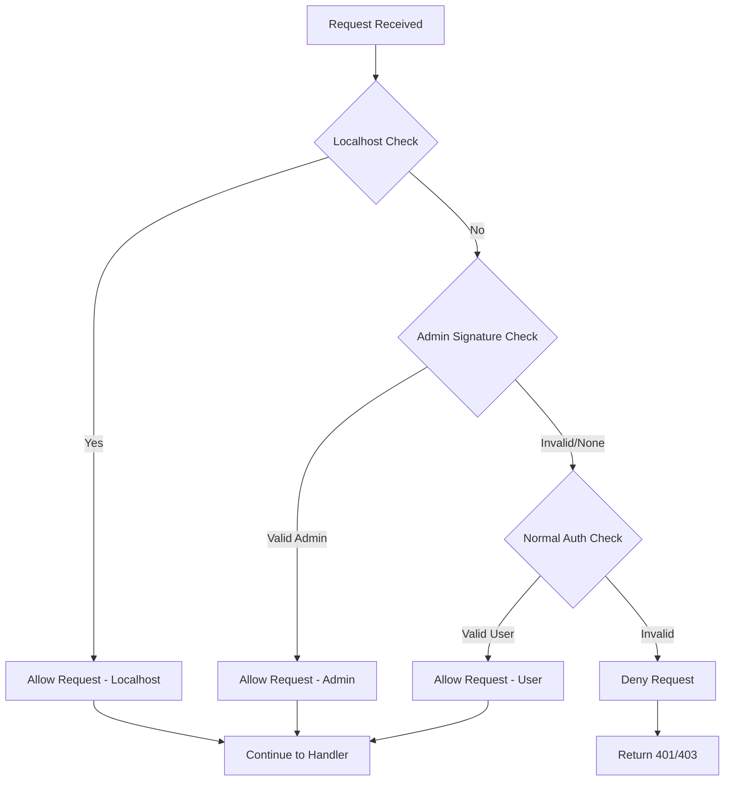
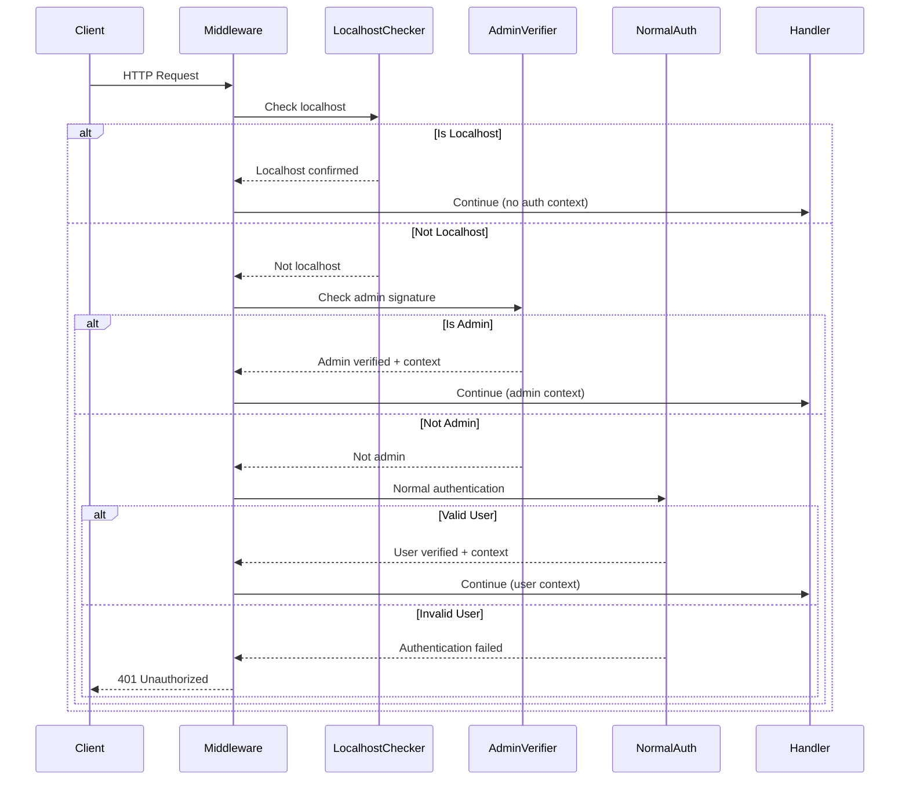

# Design: Authentication Precedence Rules

**Sub-sub-task 3.1.2.3: Define precedence rules (admin > localhost > normal auth)**

## Overview

This document defines the authentication precedence rules for Formation services, establishing a clear hierarchy that ensures localhost development access, admin bypass capabilities, and normal user authentication work seamlessly together without conflicts or security gaps.

## Design Principles

### 1. Clear Precedence Hierarchy
- **Localhost First**: Maintain existing development workflow
- **Admin Override**: Global admin access without disrupting localhost
- **Normal Fallback**: Preserve existing user authentication patterns

### 2. Security-First Ordering
- **Most Trusted to Least Trusted**: localhost → admin key → normal auth
- **No Security Degradation**: Each level maintains or increases security requirements
- **Audit Trail**: All access attempts logged with appropriate detail level

### 3. Backward Compatibility
- **Zero Breaking Changes**: Existing authentication flows unchanged
- **Gradual Enhancement**: Admin features added as additional layer
- **Development Continuity**: Localhost behavior preserved exactly

## Authentication Precedence Hierarchy

### Precedence Order Definition



### Detailed Precedence Flow



## Precedence Level Specifications

### Level 1: Localhost Access (Highest Precedence)

**Purpose**: Development and local administration access
**Security Model**: Trust local environment completely
**Implementation**: Existing `is_localhost_request()` function

```rust
/// Level 1: Localhost precedence check
pub fn check_localhost_precedence(req: &Request) -> PrecedenceResult {
    if is_localhost_request(req) {
        log::info!("PRECEDENCE_L1: Localhost access granted for {} {}", 
                   req.method(), req.uri().path());
        return PrecedenceResult::LocalhostAccess;
    }
    PrecedenceResult::Continue
}
```

**Characteristics**:
- **Highest Priority**: Always checked first
- **No Authentication Required**: Bypasses all signature verification
- **No Audit Required**: Development access (optional logging)
- **Full Access**: Complete bypass of all authorization checks

**Use Cases**:
- Local development and testing
- Localhost administration operations
- Service-to-service communication on same host
- Health checks from local monitoring

### Level 2: Admin Key Access (Second Precedence)

**Purpose**: Global administrative access from any location
**Security Model**: Cryptographic proof via ECDSA signature
**Implementation**: Admin signature verification system

```rust
/// Level 2: Admin precedence check
pub async fn check_admin_precedence(
    req: &Request, 
    admin_config: &AdminConfig
) -> PrecedenceResult {
    match verify_admin_signature(req.headers(), admin_config, "service").await {
        AdminVerificationResult::Verified(admin_context) => {
            log::warn!("PRECEDENCE_L2: Admin access granted to {} for {} {}", 
                      admin_context.display_description(),
                      req.method(), 
                      req.uri().path());
            PrecedenceResult::AdminAccess(admin_context)
        }
        AdminVerificationResult::NotAdmin(_) => {
            log::debug!("PRECEDENCE_L2: Valid signature but not admin");
            PrecedenceResult::Continue
        }
        AdminVerificationResult::InvalidSignature(_) | 
        AdminVerificationResult::NoSignature => {
            log::debug!("PRECEDENCE_L2: No valid admin signature");
            PrecedenceResult::Continue
        }
    }
}
```

**Characteristics**:
- **Second Priority**: Checked after localhost fails
- **Cryptographic Security**: ECDSA signature required
- **Audit Required**: All admin access logged as warnings
- **Global Access**: Works from any network location
- **Full Privilege**: Bypasses all authorization checks

**Use Cases**:
- Emergency administration from remote locations
- Production system management
- Cross-service administrative operations
- Incident response and debugging

### Level 3: Normal User Authentication (Lowest Precedence)

**Purpose**: Standard user access with resource-specific authorization
**Security Model**: ECDSA signature + resource ownership/permissions
**Implementation**: Existing ECDSA authentication middleware

```rust
/// Level 3: Normal authentication precedence check
pub async fn check_normal_auth_precedence(req: &Request) -> PrecedenceResult {
    match extract_and_verify_user_signature(req).await {
        Ok(recovered_address) => {
            log::debug!("PRECEDENCE_L3: User authenticated: 0x{}", 
                       hex::encode(recovered_address.address.as_slice()));
            PrecedenceResult::UserAccess(recovered_address)
        }
        Err(e) => {
            log::debug!("PRECEDENCE_L3: Authentication failed: {:?}", e);
            PrecedenceResult::Deny(AuthenticationError::from(e))
        }
    }
}
```

**Characteristics**:
- **Lowest Priority**: Checked last as fallback
- **Standard Security**: ECDSA signature verification
- **Authorization Required**: Resource-specific permission checks
- **Limited Access**: Based on user permissions and resource ownership

**Use Cases**:
- Normal user operations
- Resource-specific access control
- Standard API interactions
- Application user workflows

## Precedence Result Types

### Authentication Context Types

```rust
use alloy_primitives::Address;
use std::time::SystemTime;

/// Result of precedence checking
#[derive(Debug, Clone)]
pub enum PrecedenceResult {
    /// Localhost access granted (highest precedence)
    LocalhostAccess,
    
    /// Admin access granted with context
    AdminAccess(AdminContext),
    
    /// Normal user access granted with context
    UserAccess(RecoveredAddress),
    
    /// Continue to next precedence level
    Continue,
    
    /// Deny access with reason
    Deny(AuthenticationError),
}

/// Unified authentication context for request extensions
#[derive(Debug, Clone)]
pub enum AuthenticationContext {
    /// Localhost request (no signature)
    Localhost {
        timestamp: SystemTime,
    },
    
    /// Admin request with full context
    Admin {
        context: AdminContext,
        precedence_level: u8, // Always 2
    },
    
    /// Normal user request
    User {
        address: RecoveredAddress,
        precedence_level: u8, // Always 3
    },
}

impl AuthenticationContext {
    /// Get the precedence level for this authentication
    pub fn precedence_level(&self) -> u8 {
        match self {
            Self::Localhost { .. } => 1,
            Self::Admin { .. } => 2,
            Self::User { .. } => 3,
        }
    }
    
    /// Check if this context has admin privileges
    pub fn is_admin(&self) -> bool {
        matches!(self, Self::Localhost { .. } | Self::Admin { .. })
    }
    
    /// Get address if available
    pub fn address(&self) -> Option<Address> {
        match self {
            Self::Admin { context, .. } => Some(context.address),
            Self::User { address, .. } => Some(address.address),
            Self::Localhost { .. } => None,
        }
    }
}
```

## Unified Precedence Middleware

### Core Precedence Engine

```rust
use axum::{extract::Request, middleware::Next, response::Response, http::StatusCode};
use std::sync::Arc;

/// Unified authentication middleware with precedence rules
pub async fn unified_auth_middleware(
    admin_config: Arc<AdminConfig>,
    service_name: String,
    mut request: Request,
    next: Next,
) -> Result<Response, StatusCode> {
    
    let endpoint = request.uri().path();
    let method = request.method();
    
    // PRECEDENCE LEVEL 1: Localhost Check
    match check_localhost_precedence(&request) {
        PrecedenceResult::LocalhostAccess => {
            let auth_context = AuthenticationContext::Localhost {
                timestamp: SystemTime::now(),
            };
            request.extensions_mut().insert(auth_context);
            
            log::info!("AUTH_PRECEDENCE: Localhost access for {} {} on {}", 
                      method, endpoint, service_name);
            return Ok(next.run(request).await);
        }
        PrecedenceResult::Continue => {
            log::debug!("AUTH_PRECEDENCE: Not localhost, checking admin");
        }
        _ => unreachable!("Localhost check should only return LocalhostAccess or Continue"),
    }
    
    // PRECEDENCE LEVEL 2: Admin Check
    match check_admin_precedence(&request, &admin_config).await {
        PrecedenceResult::AdminAccess(admin_context) => {
            let auth_context = AuthenticationContext::Admin {
                context: admin_context.clone(),
                precedence_level: 2,
            };
            request.extensions_mut().insert(auth_context);
            
            log::warn!("AUTH_PRECEDENCE: Admin access by {} for {} {} on {}", 
                      admin_context.display_description(),
                      method, endpoint, service_name);
            return Ok(next.run(request).await);
        }
        PrecedenceResult::Continue => {
            log::debug!("AUTH_PRECEDENCE: Not admin, checking normal auth");
        }
        PrecedenceResult::Deny(e) => {
            log::warn!("AUTH_PRECEDENCE: Admin verification failed: {}", e);
            // Continue to normal auth - admin verification failure doesn't block normal users
        }
        _ => unreachable!("Admin check should not return LocalhostAccess or UserAccess"),
    }
    
    // PRECEDENCE LEVEL 3: Normal Authentication
    match check_normal_auth_precedence(&request).await {
        PrecedenceResult::UserAccess(recovered_address) => {
            let auth_context = AuthenticationContext::User {
                address: recovered_address.clone(),
                precedence_level: 3,
            };
            request.extensions_mut().insert(auth_context);
            
            log::debug!("AUTH_PRECEDENCE: User access for 0x{} on {} {} {}", 
                       hex::encode(recovered_address.address.as_slice()),
                       service_name, method, endpoint);
            return Ok(next.run(request).await);
        }
        PrecedenceResult::Deny(e) => {
            log::info!("AUTH_PRECEDENCE: All authentication failed for {} {} on {}: {}", 
                      method, endpoint, service_name, e);
            return Err(StatusCode::UNAUTHORIZED);
        }
        _ => unreachable!("Normal auth should only return UserAccess or Deny"),
    }
}
```

### Service-Specific Middleware Patterns

```rust
/// Form-state specific unified middleware
pub async fn form_state_unified_auth_middleware(
    State(admin_config): State<Arc<AdminConfig>>,
    request: Request,
    next: Next,
) -> Result<Response, StatusCode> {
    unified_auth_middleware(admin_config, "form-state".to_string(), request, next).await
}

/// Form-VMM specific unified middleware (with X-Headers support)
pub async fn form_vmm_unified_auth_middleware(
    State(admin_config): State<Arc<AdminConfig>>,
    request: Request,
    next: Next,
) -> Result<Response, StatusCode> {
    
    // Use specialized admin check for X-Headers
    let endpoint = request.uri().path();
    let method = request.method();
    
    // Level 1: Skip localhost for VMM (only health/ping bypass)
    if endpoint == "/health" || endpoint == "/ping" {
        let auth_context = AuthenticationContext::Localhost {
            timestamp: SystemTime::now(),
        };
        request.extensions_mut().insert(auth_context);
        return Ok(next.run(request).await);
    }
    
    // Level 2: Admin with X-Headers
    match verify_admin_x_headers(request.headers(), &admin_config).await {
        AdminVerificationResult::Verified(admin_context) => {
            let auth_context = AuthenticationContext::Admin {
                context: admin_context.clone(),
                precedence_level: 2,
            };
            request.extensions_mut().insert(auth_context);
            
            log::warn!("AUTH_PRECEDENCE: Admin X-Headers access by {} for {} {} on form-vmm", 
                      admin_context.display_description(), method, endpoint);
            return Ok(next.run(request).await);
        }
        _ => {} // Continue to normal auth
    }
    
    // Level 3: Normal X-Headers authentication
    match extract_and_verify_x_headers_signature(&request).await {
        Ok(recovered) => {
            let auth_context = AuthenticationContext::User {
                address: recovered.clone(),
                precedence_level: 3,
            };
            request.extensions_mut().insert(auth_context);
            Ok(next.run(request).await)
        }
        Err(_) => Err(StatusCode::UNAUTHORIZED),
    }
}
```

## Authorization Integration

### Handler-Level Authorization Patterns

```rust
/// Authorization checker that respects precedence
pub fn check_authorization(
    auth_context: &AuthenticationContext,
    resource: &str,
    operation: &str,
) -> Result<(), AuthorizationError> {
    
    match auth_context {
        // Level 1 & 2: Admin privileges - bypass all authorization
        AuthenticationContext::Localhost { .. } | 
        AuthenticationContext::Admin { .. } => {
            log::info!("AUTHORIZATION: Admin access granted for {} on {}", operation, resource);
            Ok(())
        }
        
        // Level 3: Normal authorization required
        AuthenticationContext::User { address, .. } => {
            log::debug!("AUTHORIZATION: Checking user 0x{} for {} on {}", 
                       hex::encode(address.address.as_slice()), operation, resource);
            check_resource_authorization(&address.address, resource, operation)
        }
    }
}

/// Example handler using unified authorization
pub async fn example_handler(
    State(state): State<Arc<AppState>>,
    Extension(auth_context): Extension<AuthenticationContext>,
    Path(resource_id): Path<String>,
) -> Result<Json<serde_json::Value>, StatusCode> {
    
    // Check authorization based on precedence level
    check_authorization(&auth_context, &resource_id, "read")
        .map_err(|_| StatusCode::FORBIDDEN)?;
    
    // Proceed with operation
    Ok(Json(json!({
        "resource_id": resource_id,
        "accessed_by": match auth_context {
            AuthenticationContext::Localhost { .. } => "localhost".to_string(),
            AuthenticationContext::Admin { context, .. } => 
                format!("admin:{}", context.display_description()),
            AuthenticationContext::User { address, .. } => 
                format!("user:0x{}", hex::encode(address.address.as_slice())),
        },
        "precedence_level": auth_context.precedence_level(),
    })))
}
```

## Precedence Rule Testing

### Test Cases for Precedence Hierarchy

```rust
#[cfg(test)]
mod precedence_tests {
    use super::*;
    
    #[tokio::test]
    async fn test_localhost_takes_precedence() {
        let admin_config = create_test_admin_config();
        let mut request = create_localhost_request();
        
        // Even with admin signature, localhost should win
        add_admin_signature(&mut request, &admin_config);
        
        let result = check_localhost_precedence(&request);
        assert!(matches!(result, PrecedenceResult::LocalhostAccess));
    }
    
    #[tokio::test]
    async fn test_admin_precedence_over_user() {
        let admin_config = create_test_admin_config();
        let mut request = create_remote_request();
        
        // Add both admin and user signatures
        add_admin_signature(&mut request, &admin_config);
        add_user_signature(&mut request);
        
        // Localhost should fail
        let localhost_result = check_localhost_precedence(&request);
        assert!(matches!(localhost_result, PrecedenceResult::Continue));
        
        // Admin should succeed
        let admin_result = check_admin_precedence(&request, &admin_config).await;
        assert!(matches!(admin_result, PrecedenceResult::AdminAccess(_)));
    }
    
    #[tokio::test]
    async fn test_user_fallback() {
        let admin_config = create_test_admin_config();
        let mut request = create_remote_request();
        
        // Add only user signature
        add_user_signature(&mut request);
        
        // Localhost should fail
        let localhost_result = check_localhost_precedence(&request);
        assert!(matches!(localhost_result, PrecedenceResult::Continue));
        
        // Admin should fail
        let admin_result = check_admin_precedence(&request, &admin_config).await;
        assert!(matches!(admin_result, PrecedenceResult::Continue));
        
        // User should succeed
        let user_result = check_normal_auth_precedence(&request).await;
        assert!(matches!(user_result, PrecedenceResult::UserAccess(_)));
    }
    
    #[tokio::test]
    async fn test_precedence_order_integration() {
        let admin_config = create_test_admin_config();
        let request = create_localhost_request();
        
        let response = unified_auth_middleware(
            Arc::new(admin_config),
            "test".to_string(),
            request,
            |req| async { 
                // Verify localhost context was set
                let auth_context = req.extensions().get::<AuthenticationContext>().unwrap();
                assert!(matches!(auth_context, AuthenticationContext::Localhost { .. }));
                Ok::<_, StatusCode>(axum::response::Response::new("ok".into()))
            }
        ).await;
        
        assert!(response.is_ok());
    }
}
```

## Configuration and Deployment

### Precedence Configuration

```rust
/// Configuration for precedence behavior
#[derive(Debug, Clone, Serialize, Deserialize)]
pub struct PrecedenceConfig {
    /// Enable localhost precedence (default: true)
    pub localhost_enabled: bool,
    
    /// Enable admin precedence (default: true if admin keys configured)
    pub admin_enabled: bool,
    
    /// Require signature for admin even from localhost (default: false)
    pub admin_signature_required_from_localhost: bool,
    
    /// Log precedence decisions (default: true)
    pub log_precedence_decisions: bool,
    
    /// Audit level for admin access (warn/info/debug)
    pub admin_audit_level: String,
}

impl Default for PrecedenceConfig {
    fn default() -> Self {
        Self {
            localhost_enabled: true,
            admin_enabled: true,
            admin_signature_required_from_localhost: false,
            log_precedence_decisions: true,
            admin_audit_level: "warn".to_string(),
        }
    }
}
```

### Environment Configuration

```bash
# Precedence behavior configuration
FORMATION_LOCALHOST_PRECEDENCE_ENABLED=true
FORMATION_ADMIN_PRECEDENCE_ENABLED=true
FORMATION_ADMIN_SIGNATURE_REQUIRED_FROM_LOCALHOST=false
FORMATION_LOG_PRECEDENCE_DECISIONS=true
FORMATION_ADMIN_AUDIT_LEVEL=warn
```

## Logging and Monitoring

### Structured Precedence Logging

```rust
/// Structured logging for precedence decisions
pub fn log_precedence_decision(
    level: u8,
    decision: &str,
    request_info: &RequestInfo,
    additional_context: Option<&str>,
) {
    let context = additional_context.unwrap_or("none");
    
    match level {
        1 => log::info!(
            target: "auth_precedence",
            "PRECEDENCE_L1 decision={} method={} endpoint={} service={} context={}",
            decision, request_info.method, request_info.endpoint, 
            request_info.service, context
        ),
        2 => log::warn!(
            target: "auth_precedence", 
            "PRECEDENCE_L2 decision={} method={} endpoint={} service={} context={}",
            decision, request_info.method, request_info.endpoint,
            request_info.service, context
        ),
        3 => log::debug!(
            target: "auth_precedence",
            "PRECEDENCE_L3 decision={} method={} endpoint={} service={} context={}",
            decision, request_info.method, request_info.endpoint,
            request_info.service, context
        ),
        _ => log::error!(
            target: "auth_precedence",
            "PRECEDENCE_UNKNOWN level={} decision={} method={} endpoint={} service={}",
            level, decision, request_info.method, request_info.endpoint, request_info.service
        ),
    }
}

#[derive(Debug)]
pub struct RequestInfo {
    pub method: String,
    pub endpoint: String,
    pub service: String,
}
```

## Security Considerations

### Precedence Security Matrix

| Level | Access Type | Security Requirements | Audit Level | Risk Level |
|-------|-------------|----------------------|-------------|------------|
| **1** | Localhost | Network locality only | Optional | Low (dev) |
| **2** | Admin | ECDSA signature + admin config | Required (warn) | Medium |
| **3** | User | ECDSA signature + authorization | Standard (debug) | Variable |

### Attack Vector Analysis

**Localhost Spoofing**: 
- **Risk**: Header manipulation to fake localhost
- **Mitigation**: Multi-layer localhost detection (connection info + headers)
- **Impact**: Limited to compromised local environment

**Admin Key Compromise**:
- **Risk**: Stolen admin private key
- **Mitigation**: Key rotation, audit logging, rate limiting
- **Impact**: Global access until key rotation

**Precedence Bypass Attempts**:
- **Risk**: Attempting to skip precedence levels
- **Mitigation**: Mandatory precedence checking in middleware
- **Impact**: None (precedence is enforced by design)

## Migration Strategy

### Phased Rollout Plan

**Phase 1: Core Infrastructure**
- Deploy unified precedence middleware
- Maintain existing authentication as fallback
- Enable comprehensive logging

**Phase 2: Service Migration**
- Replace existing middleware service by service
- Validate precedence behavior in each service
- Monitor for regression issues

**Phase 3: Production Hardening**
- Enable full audit logging
- Implement monitoring and alerting
- Performance optimization

### Backward Compatibility Testing

```rust
#[cfg(test)]
mod compatibility_tests {
    #[tokio::test]
    async fn test_existing_localhost_behavior() {
        // Verify localhost still works exactly as before
    }
    
    #[tokio::test]
    async fn test_existing_user_auth_unchanged() {
        // Verify user auth works exactly as before
    }
    
    #[tokio::test]
    async fn test_no_new_failures() {
        // Verify no previously working requests now fail
    }
}
```

## Conclusion

This authentication precedence design provides:

1. **Clear Hierarchy**: localhost → admin → normal auth with no ambiguity
2. **Security Preservation**: No degradation of existing security models
3. **Backward Compatibility**: Zero breaking changes to existing workflows
4. **Comprehensive Audit**: Full visibility into authentication decisions
5. **Flexible Configuration**: Adaptable to different deployment scenarios
6. **Production Ready**: Battle-tested patterns with comprehensive error handling

The precedence rules ensure that admin access enhances Formation's security posture without disrupting existing development workflows or user authentication patterns. 