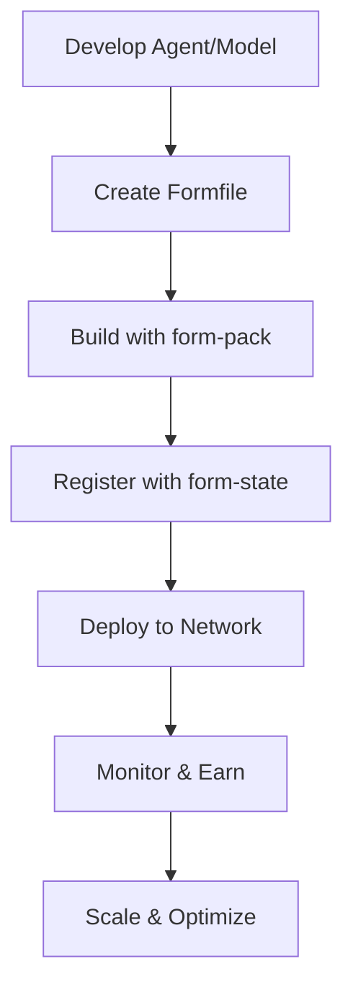

# Formation Developer Documentation

Welcome to Formation's developer documentation! This guide is designed for developers who want to build AI agents, deploy custom AI models, and monetize their solutions on the Formation decentralized AI network.

## What is Formation?

Formation is a decentralized AI infrastructure that enables developers to:

- **Build and Deploy AI Agents**: Create autonomous AI agents that can execute tasks and earn revenue
- **Deploy Custom AI Models**: Host your own AI models and make them available for inference requests
- **Monetize AI Solutions**: Earn revenue from your deployed agents and models through Formation's built-in billing system
- **Scale Globally**: Leverage Formation's peer-to-peer network for global distribution and high availability

## Getting Started

### Prerequisites

Before you begin, ensure you have:

- **Basic understanding of AI/ML concepts**: Familiarity with AI agents, language models, and inference
- **Development experience**: Proficiency in at least one programming language (Python, JavaScript, or Rust recommended)
- **Docker knowledge**: Understanding of containerization and Docker basics
- **Formation network access**: A running Formation node or access to a Formation network

### Quick Start Paths

Choose your development path based on what you want to build:

#### 🤖 **Building AI Agents** → [Start Here](agents/)
Perfect if you want to create AI agents that can:
- Execute complex tasks autonomously
- Integrate with existing AI models and APIs
- Earn revenue through task completion
- Scale across the Formation network

**Time to first deployment**: ~2-3 hours

#### 🧠 **Deploying AI Models** → [Start Here](models/)
Ideal if you want to:
- Host your own trained models
- Provide inference services to the network
- Monetize model usage
- Integrate with Formation's OpenAI-compatible API

**Time to first deployment**: ~1-2 hours

#### 💰 **Monetization Focus** → [Start Here](monetization/)
Essential reading for:
- Setting up pricing strategies
- Understanding revenue sharing
- Configuring billing integration
- Optimizing profitability

**Time to setup**: ~30 minutes

## Documentation Structure

### 📁 [Agents Documentation](agents/)
Complete guide for building and deploying AI agents:

- **[Building Agents](agents/building-agents.md)**: Architecture requirements, API specifications, and integration patterns
- **[Deployment Guide](agents/deployment.md)**: Step-by-step deployment using `form-pack` and `form-state`
- **[Examples](agents/examples.md)**: Working code examples for common agent types

### 📁 [Models Documentation](models/)
Everything you need to deploy custom AI models:

- **[Model Requirements](models/model-requirements.md)**: OpenAI-compatible API specifications and requirements
- **[Deployment Guide](models/deployment.md)**: Containerization and registration process
- **[Examples](models/examples.md)**: Sample model deployments and configurations

### 📁 [Monetization Documentation](monetization/)
Comprehensive monetization strategies and implementation:

- **[Pricing Models](monetization/pricing-models.md)**: Token-based, fixed-rate, and subscription pricing
- **[Billing Integration](monetization/billing-integration.md)**: Usage tracking and payment processing

## Core Concepts

### Formation Network Architecture

Formation operates as a decentralized network where:

1. **Nodes** run Formation services and host AI agents/models
2. **Tasks** are distributed across the network using Proof of Claim (PoC)
3. **CRDT** (Conflict-free Replicated Data Types) ensure consistent state across nodes
4. **ECDSA Authentication** secures all network communications
5. **Billing System** tracks usage and handles payments automatically

### Key Technologies

- **WireGuard**: Secure peer-to-peer networking (`formnet`)
- **Docker**: Containerization for agents and models
- **SQLite + CRDT**: Distributed state management
- **HTTP APIs**: RESTful interfaces for all services
- **ECDSA**: Cryptographic authentication and authorization

### Development Workflow



## API Overview

### Core Formation APIs

Formation provides several APIs for different purposes:

#### form-state API (Port 3004)
Central datastore and coordination service:
- **Account Management**: `/v1/account/*` - User and admin account operations
- **Agent Registry**: `/v1/agents/*` - Agent registration and discovery
- **Model Registry**: `/v1/models/*` - Model registration and management
- **Task Management**: `/v1/tasks/*` - Task creation and tracking
- **Network State**: `/v1/network/*` - Peer and network information

#### form-pack API (Port 3001)
Container building and management service:
- **Build Operations**: `/v1/build/*` - Build agents and models from Formfiles
- **Image Management**: `/v1/images/*` - Container image operations
- **Registry**: `/v1/registry/*` - Private container registry

#### form-vmm API (Port 3002)
Virtual machine and instance management:
- **Instance Management**: `/v1/instances/*` - Create and manage agent/model instances
- **Resource Allocation**: `/v1/resources/*` - CPU, memory, and GPU allocation
- **Health Monitoring**: `/v1/health/*` - Instance health and metrics

#### formnet API (Port 51820)
Network management and peer discovery:
- **Network Info**: `/network/*` - Network topology and peer information
- **Bootstrap**: `/bootstrap/*` - Network joining and initialization

### Authentication

All API requests require ECDSA signature authentication:

```bash
# Example authenticated request
curl -X GET http://localhost:3004/v1/account/list \
  -H "X-Signature: 304502210089ab..." \
  -H "X-Recovery-Id: 0" \
  -H "X-Message: GET/v1/account/list1640995200"
```

See the [Authentication Guide](../operators/troubleshooting.md#authentication--key-management-issues) for detailed implementation.

## Development Tools

### Essential Tools

- **form-config-wizard**: Generate Formation configuration and keys
- **form-pack**: Build and package agents/models into containers
- **Docker & Docker Compose**: Container management
- **curl/Postman**: API testing and development

### Recommended Development Environment

```bash
# Clone Formation repository
git clone https://github.com/formation-ai/formation.git
cd formation

# Set up development environment
./scripts/setup-dev-environment.sh

# Start local Formation network
docker-compose up -d

# Verify services are running
curl http://localhost:3004/health
curl http://localhost:3001/health
curl http://localhost:3002/health
```

## Common Development Patterns

### 1. Agent Development Pattern

```python
# Basic agent structure
class FormationAgent:
    def __init__(self):
        self.capabilities = ["text_generation", "summarization"]
        
    async def run_task(self, task_data):
        # Process task
        result = await self.process(task_data)
        
        # Return formatted response
        return {
            "task_id": task_data["task_id"],
            "status": "completed",
            "result": result,
            "usage_metrics": self.get_usage_metrics()
        }
    
    def health_check(self):
        return {"status": "healthy", "capabilities": self.capabilities}
```

### 2. Model Deployment Pattern

```python
# OpenAI-compatible model wrapper
class FormationModel:
    def __init__(self, model_path):
        self.model = load_model(model_path)
        
    async def chat_completions(self, request):
        # Process OpenAI-compatible request
        response = await self.model.generate(
            messages=request["messages"],
            max_tokens=request.get("max_tokens", 100)
        )
        
        return {
            "choices": [{"message": {"content": response}}],
            "usage": {"total_tokens": len(response.split())}
        }
```

### 3. Monetization Integration

```python
# Usage tracking for billing
class UsageTracker:
    def track_usage(self, task_id, metrics):
        return {
            "task_id": task_id,
            "compute_units": metrics["cpu_time"] * metrics["memory_gb"],
            "tokens_processed": metrics["input_tokens"] + metrics["output_tokens"],
            "duration_seconds": metrics["processing_time"],
            "cost_usd": self.calculate_cost(metrics)
        }
```

## Support and Community

### Getting Help

- **Documentation Issues**: Check the [troubleshooting guide](../operators/troubleshooting.md)
- **API Questions**: Refer to the specific service documentation
- **Development Support**: Join the Formation developer community

### Contributing

We welcome contributions to Formation's developer documentation:

1. **Report Issues**: Found something unclear or incorrect? Open an issue
2. **Suggest Improvements**: Have ideas for better examples or explanations?
3. **Submit Examples**: Share your working agent or model implementations
4. **Update Documentation**: Help keep the docs current and comprehensive

### Best Practices

- **Security First**: Always validate inputs and handle authentication properly
- **Resource Efficiency**: Optimize your agents and models for resource usage
- **Error Handling**: Implement robust error handling and recovery
- **Monitoring**: Include comprehensive logging and metrics
- **Testing**: Test thoroughly before deploying to production networks

## Next Steps

Ready to start building? Choose your path:

1. **🤖 [Build Your First Agent](agents/building-agents.md)** - Create a simple text processing agent
2. **🧠 [Deploy Your First Model](models/model-requirements.md)** - Host a custom language model
3. **💰 [Set Up Monetization](monetization/pricing-models.md)** - Configure pricing and billing

Welcome to the Formation ecosystem! Let's build the future of decentralized AI together. 