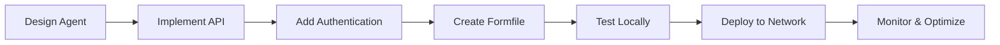

# Building AI Agents on Formation

Welcome to Formation's AI Agent development guide! This section provides everything you need to build, deploy, and monetize AI agents on the Formation decentralized network.

## What are Formation AI Agents?

Formation AI agents are autonomous, containerized applications that:

- **Execute Tasks**: Process tasks assigned by Formation's Proof of Claim (PoC) system
- **Earn Revenue**: Generate income through task completion and usage-based billing
- **Scale Automatically**: Distribute across the Formation network for high availability
- **Integrate Seamlessly**: Work with existing AI models, APIs, and services

## Agent Architecture Overview

Formation agents follow a standardized architecture that ensures compatibility with the network:

```
┌─────────────────────────────────────────┐
│              Formation Agent            │
├─────────────────────────────────────────┤
│  HTTP API Layer                         │
│  ├── POST /run_task                     │
│  ├── GET /health                        │
│  └── GET /capabilities                  │
├─────────────────────────────────────────┤
│  Business Logic Layer                   │
│  ├── Task Processing                    │
│  ├── AI Model Integration               │
│  └── External API Calls                 │
├─────────────────────────────────────────┤
│  Formation Integration Layer            │
│  ├── ECDSA Authentication               │
│  ├── Usage Metrics Tracking             │
│  └── Error Handling & Logging           │
└─────────────────────────────────────────┘
```

## Quick Start

### 1. Choose Your Agent Type

Formation supports various agent types:

- **🔤 Text Processing Agents**: Summarization, translation, content generation
- **🧠 AI Model Agents**: Custom model inference and fine-tuning
- **🔗 Integration Agents**: API orchestration and data processing
- **🤖 Autonomous Agents**: Multi-step workflow execution
- **📊 Analysis Agents**: Data analysis and reporting

### 2. Development Path



### 3. Time Investment

- **Simple Agent**: 2-4 hours
- **AI Model Agent**: 4-8 hours  
- **Complex Multi-step Agent**: 1-2 days

## Documentation Structure

### 📖 [Building Agents](building-agents.md)
**Essential Reading** - Core requirements and architecture patterns
- Agent architecture requirements
- Required API endpoints (`/run_task`, `/health`)
- Request/Response format specifications
- Usage reporting requirements

### 🚀 [Deployment Guide](deployment.md)
**Step-by-Step Process** - From code to running agent
- Packaging with `form-pack` (Formfile creation)
- Registration with `form-state` (`/agents/create`)
- Instance deployment via task system
- Testing and verification steps

### 💡 [Examples](examples.md)
**Working Code** - Complete, runnable examples
- Simple echo agent example
- LLM-powered agent example
- Multi-step workflow agent example

## Core Agent Concepts

### Task Execution Model

Formation agents operate on a task-based execution model:

1. **Task Assignment**: Formation's PoC system assigns tasks to capable agents
2. **Task Processing**: Agent receives task via `/run_task` endpoint
3. **Result Return**: Agent returns results with usage metrics
4. **Billing**: Formation tracks usage for automatic billing

### Required Capabilities

Every Formation agent must implement:

#### 1. HTTP API Endpoints
```python
# Required endpoints
POST /run_task      # Execute assigned tasks
GET  /health        # Health check for monitoring
GET  /capabilities  # Declare agent capabilities
```

#### 2. Authentication Integration
```python
# Verify task requests using ECDSA signatures
def verify_task_request(request_data, signature, recovery_id):
    # Verify signature matches requester
    return verify_ecdsa_signature(request_data, signature, recovery_id)
```

#### 3. Usage Metrics Reporting
```python
# Report accurate usage for billing
def get_usage_metrics(task_execution):
    return {
        "compute_units": calculate_compute_usage(),
        "tokens_processed": count_tokens(),
        "duration_seconds": execution_time,
        "memory_mb": peak_memory_usage
    }
```

### Agent Lifecycle

#### 1. Development Phase
- Design agent capabilities and API
- Implement business logic
- Add Formation integration layer
- Create comprehensive tests

#### 2. Packaging Phase
- Create Formfile with metadata
- Build container with `form-pack`
- Specify resource requirements
- Configure pricing model

#### 3. Deployment Phase
- Register agent with `form-state`
- Deploy instances across network
- Configure monitoring and alerts
- Verify task assignment works

#### 4. Operation Phase
- Monitor performance metrics
- Handle task assignments
- Track revenue and usage
- Scale based on demand

## Development Best Practices

### Security
- **Validate All Inputs**: Never trust external data
- **Verify Signatures**: Always authenticate task requests
- **Secure Secrets**: Use environment variables for sensitive data
- **Rate Limiting**: Implement protection against abuse

### Performance
- **Optimize Response Time**: Fast task execution improves PoC scores
- **Efficient Resource Usage**: Lower costs increase profitability
- **Graceful Error Handling**: Robust error handling improves reliability
- **Comprehensive Logging**: Detailed logs aid debugging and optimization

### Scalability
- **Stateless Design**: Agents should not rely on local state
- **Resource Efficiency**: Optimize for Formation's resource allocation
- **Horizontal Scaling**: Design for multiple concurrent instances
- **Load Testing**: Validate performance under realistic loads

## Popular Agent Frameworks

Formation supports agents built with any framework or technology stack. Your agent runs in a Linux VM and serves its API via HTTP endpoints. Here are examples of popular agent frameworks that work well with Formation:

### 1. LangChain (Python)
```python
# LangChain agent with Formation integration
from langchain.agents import AgentExecutor, create_openai_functions_agent
from langchain_openai import ChatOpenAI
from langchain.tools import Tool
from flask import Flask, request, jsonify

app = Flask(__name__)

# Initialize LangChain agent
llm = ChatOpenAI(model="gpt-4")
tools = [
    Tool(
        name="calculator",
        description="Useful for math calculations",
        func=lambda x: eval(x)
    )
]

agent = create_openai_functions_agent(llm, tools, prompt)
agent_executor = AgentExecutor(agent=agent, tools=tools)

@app.route('/run_task', methods=['POST'])
def run_task():
    task_data = request.json
    
    # Execute LangChain agent
    result = agent_executor.invoke({
        "input": task_data["parameters"]["prompt"]
    })
    
    return jsonify({
        "task_id": task_data["task_id"],
        "status": "completed",
        "result": {"output": result["output"]},
        "usage_metrics": {
            "tokens_processed": len(result["output"].split()),
            "duration_seconds": 2.5
        }
    })

@app.route('/health', methods=['GET'])
def health():
    return jsonify({"status": "healthy", "framework": "langchain"})

if __name__ == '__main__':
    app.run(host='0.0.0.0', port=8080)
```

### 2. LangChain.js (JavaScript/TypeScript)
```javascript
// LangChain.js agent with Formation integration
import { ChatOpenAI } from "@langchain/openai";
import { AgentExecutor, createOpenAIFunctionsAgent } from "langchain/agents";
import { Calculator } from "langchain/tools/calculator";
import express from 'express';

const app = express();
app.use(express.json());

// Initialize LangChain.js agent
const model = new ChatOpenAI({ modelName: "gpt-4" });
const tools = [new Calculator()];

const agent = await createOpenAIFunctionsAgent({
  llm: model,
  tools,
  prompt: "You are a helpful assistant"
});

const agentExecutor = new AgentExecutor({
  agent,
  tools,
});

app.post('/run_task', async (req, res) => {
  const taskData = req.body;
  
  try {
    // Execute LangChain.js agent
    const result = await agentExecutor.invoke({
      input: taskData.parameters.prompt
    });
    
    res.json({
      task_id: taskData.task_id,
      status: "completed",
      result: { output: result.output },
      usage_metrics: {
        tokens_processed: result.output.split(' ').length,
        duration_seconds: 1.8
      }
    });
  } catch (error) {
    res.status(500).json({
      task_id: taskData.task_id,
      status: "failed",
      error: error.message
    });
  }
});

app.get('/health', (req, res) => {
  res.json({ status: "healthy", framework: "langchain.js" });
});

app.listen(8080, '0.0.0.0', () => {
  console.log('LangChain.js agent running on port 8080');
});
```

### 3. Agno Framework
```python
# Agno agent with Formation integration
from agno import Agent, Model
from agno.tools import DuckDuckGoSearch, FileTools
from flask import Flask, request, jsonify

app = Flask(__name__)

# Initialize Agno agent
agent = Agent(
    model=Model.GPT4,
    tools=[DuckDuckGoSearch(), FileTools()],
    instructions="You are a helpful research assistant",
    storage_id="formation_agent_storage"
)

@app.route('/run_task', methods=['POST'])
def run_task():
    task_data = request.json
    
    # Execute Agno agent
    response = agent.run(
        message=task_data["parameters"]["prompt"],
        session_id=task_data.get("session_id", "default")
    )
    
    return jsonify({
        "task_id": task_data["task_id"],
        "status": "completed",
        "result": {"output": response.content},
        "usage_metrics": {
            "tokens_processed": response.metrics.get("tokens", 0),
            "duration_seconds": response.metrics.get("response_time", 0)
        }
    })

@app.route('/health', methods=['GET'])
def health():
    return jsonify({
        "status": "healthy", 
        "framework": "agno",
        "capabilities": ["research", "file_operations", "web_search"]
    })

if __name__ == '__main__':
    app.run(host='0.0.0.0', port=8080)
```

### 4. Custom Framework Integration
```python
# Custom agent framework with Formation integration
import asyncio
from fastapi import FastAPI
from pydantic import BaseModel

app = FastAPI()

class TaskRequest(BaseModel):
    task_id: str
    parameters: dict

class CustomAgent:
    def __init__(self):
        self.capabilities = ["text_processing", "analysis"]
    
    async def process_task(self, prompt: str):
        # Your custom agent logic here
        # This could integrate with any AI service, model, or framework
        result = f"Processed: {prompt}"
        return result

agent = CustomAgent()

@app.post("/run_task")
async def run_task(task: TaskRequest):
    result = await agent.process_task(task.parameters["prompt"])
    
    return {
        "task_id": task.task_id,
        "status": "completed",
        "result": {"output": result},
        "usage_metrics": {
            "compute_units": 1.0,
            "duration_seconds": 0.5
        }
    }

@app.get("/health")
async def health():
    return {
        "status": "healthy",
        "framework": "custom",
        "capabilities": agent.capabilities
    }

if __name__ == "__main__":
    import uvicorn
    uvicorn.run(app, host="0.0.0.0", port=8080)
```

### Framework-Agnostic Deployment

The key requirement is that your agent exposes HTTP endpoints that Formation can interact with:

- **POST /run_task**: Execute tasks assigned by Formation
- **GET /health**: Health check for monitoring
- **Any framework**: LangChain, Agno, AutoGPT, CrewAI, or custom solutions

Your agent gets packaged into a Docker container and deployed to Formation's VM infrastructure, where it can scale automatically based on demand.

## Monetization Strategies

### Pricing Models
- **Per-Task**: Fixed price per task execution
- **Per-Token**: Price based on input/output tokens
- **Subscription**: Subscription services that come with fixed number of agents you can hire + credits for LLM tokens 

### Revenue Optimization
- **Efficient Processing**: Faster execution = more tasks = more revenue
- **Quality Service**: Higher quality improves PoC scores and task assignment
- **Specialized Capabilities**: Unique capabilities command premium pricing
- **Resource Optimization**: Lower costs increase profit margins

## Getting Started Checklist

Ready to build your first Formation agent? Follow this checklist:

- [ ] **Read [Building Agents](building-agents.md)** - Understand requirements
- [ ] **Choose Agent Type** - Decide what your agent will do
- [ ] **Set Up Development Environment** - Install tools and dependencies
- [ ] **Implement Core API** - Create `/run_task` and `/health` endpoints
- [ ] **Add Authentication** - Integrate ECDSA signature verification
- [ ] **Create Formfile** - Define container and metadata
- [ ] **Test Locally** - Verify agent works correctly
- [ ] **Follow [Deployment Guide](deployment.md)** - Deploy to Formation network
- [ ] **Monitor Performance** - Track metrics and optimize
- [ ] **Scale and Iterate** - Improve based on real-world usage

## Support and Resources

### Documentation
- **[Building Agents](building-agents.md)**: Technical requirements and specifications
- **[Deployment Guide](deployment.md)**: Step-by-step deployment process
- **[Examples](examples.md)**: Working code examples and templates

### Tools and APIs
- **form-pack**: Container building and packaging
- **form-state API**: Agent registration and management
- **form-vmm API**: Instance deployment and monitoring

### Community
- **Developer Forums**: Connect with other agent builders
- **Code Examples**: Share and discover agent implementations
- **Best Practices**: Learn from experienced developers

## Next Steps

Choose your next action based on your experience level:

### 🆕 **New to Formation**
Start with **[Building Agents](building-agents.md)** to understand the fundamentals

### 🔧 **Ready to Build**
Jump to **[Examples](examples.md)** for working code templates

### 🚀 **Ready to Deploy**
Follow the **[Deployment Guide](deployment.md)** for step-by-step instructions

### 💰 **Focus on Revenue**
Check out **[Monetization Strategies](../monetization/)** for pricing optimization

---

**Ready to build the future of decentralized AI?** Let's create your first Formation agent! 