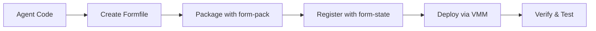

# Deploying AI Agents on Formation

This guide walks you through the complete process of deploying your AI agent to the Formation network, from packaging to running instances.

## Deployment Overview

Formation agent deployment follows a structured pipeline:



### Deployment Components

- **form-pack**: Packages your agent into deployable VM images
- **form-state**: Manages agent registration and metadata
- **form-vmm**: Handles VM instance deployment and lifecycle
- **formnet**: Provides secure networking between instances

## Prerequisites

Before deploying, ensure you have:

- ✅ **Agent Code**: Working agent with required HTTP endpoints
- ✅ **Formfile**: Deployment configuration (see [Building Agents](building-agents.md))
- ✅ **Formation Access**: Active node on Formation network
- ✅ **ECDSA Keys**: For signing deployment requests

## Step 1: Packaging with form-pack

### 1.1 Create Your Formfile

Every agent needs a `Formfile` in its root directory. Formation supports multiple deployment patterns:

#### Option 1: Docker Container Deployment (Recommended)

```
NAME my-langchain-agent
DESCRIPTION "LangChain-powered AI agent for text processing"

# System Resources
VCPU 2
MEM 4096
DISK 20

# User Configuration
USER username:agent passwd:securepass sudo:true ssh_authorized_keys:"ssh-rsa AAAAB3NzaC1yc2E..."

# Base System
FROM ubuntu:22.04

# Install Docker
RUN apt-get update && apt-get install -y docker.io curl
RUN systemctl enable docker

# Copy Agent Container and Configuration
COPY ./agent-container /app/agent-container
COPY ./docker-compose.yml /app/docker-compose.yml

# Set Working Directory
WORKDIR /app

# Start Docker service and run agent container
ENTRYPOINT ["sh", "-c", "service docker start && docker-compose up -d"]
```

#### Option 2: GitHub Repository with Docker Compose

```
NAME github-agent
DESCRIPTION "Agent deployed from GitHub repository"

# System Resources
VCPU 2
MEM 4096
DISK 20

# User Configuration
USER username:agent passwd:securepass sudo:true ssh_authorized_keys:"ssh-rsa AAAAB3NzaC1yc2E..."

# Base System
FROM ubuntu:22.04

# Install Docker and Git
RUN apt-get update && apt-get install -y docker.io docker-compose git curl
RUN systemctl enable docker

# Clone repository and deploy
WORKDIR /app
RUN git clone https://github.com/your-org/your-agent-repo.git .

# Start Docker and run agent
ENTRYPOINT ["sh", "-c", "service docker start && docker-compose up -d"]
```

#### Option 3: Native Python Deployment

```
NAME native-python-agent
DESCRIPTION "Agent deployed natively with Python"

# System Resources
VCPU 2
MEM 4096
DISK 20

# User Configuration
USER username:agent passwd:securepass sudo:true ssh_authorized_keys:"ssh-rsa AAAAB3NzaC1yc2E..."

# Base System
FROM ubuntu:22.04

# Install Python and dependencies
RUN apt-get update && apt-get install -y python3 python3-pip curl
COPY ./agent /app/agent
COPY ./requirements.txt /app/requirements.txt

WORKDIR /app
RUN pip3 install -r requirements.txt

# Expose port and start agent
EXPOSE 8080
ENTRYPOINT ["python3", "agent/main.py"]
```

### 1.2 Prepare Your Project Structure

Organize your project directory for containerized deployment:

```
my-agent/
├── Formfile                 # Deployment configuration
├── docker-compose.yml       # Container orchestration
├── agent-container/         # Agent Docker container
│   ├── Dockerfile          # Container build instructions
│   ├── agent/
│   │   ├── main.py         # Agent entry point
│   │   ├── handlers.py     # HTTP endpoint handlers
│   │   └── utils.py        # Utility functions
│   └── requirements.txt    # Python dependencies
└── README.md               # Agent documentation
```

#### Example Dockerfile for Agent Container

```dockerfile
# agent-container/Dockerfile
FROM python:3.9-slim

WORKDIR /app

# Install dependencies
COPY requirements.txt .
RUN pip install --no-cache-dir -r requirements.txt

# Copy agent code
COPY agent/ ./agent/

# Expose port
EXPOSE 8080

# Health check
HEALTHCHECK --interval=30s --timeout=10s --start-period=5s --retries=3 \
  CMD curl -f http://localhost:8080/health || exit 1

# Run agent
CMD ["python", "agent/main.py"]
```

#### Example docker-compose.yml

```yaml
# docker-compose.yml
version: '3.8'

services:
  agent:
    build: ./agent-container
    container_name: my-langchain-agent
    ports:
      - "8080:8080"
    environment:
      - FORMATION_API_URL=http://formation-api:3004
      - LOG_LEVEL=info
    restart: unless-stopped
    healthcheck:
      test: ["CMD", "curl", "-f", "http://localhost:8080/health"]
      interval: 30s
      timeout: 10s
      retries: 3
      start_period: 40s
```

### 1.3 Build with form-pack

#### Using form-cli (Recommended)

```bash
# Navigate to your agent directory
cd my-agent/

# Build the agent package
form pack build

# Check build status
form pack status --build-id <your-build-id>
```

#### Using the Interactive Wizard

```bash
# Launch the deployment wizard
form pack wizard

# Follow the prompts to:
# 1. Configure agent details
# 2. Set resource requirements
# 3. Choose deployment method
# 4. Build and deploy automatically
```

#### Manual API Call

```bash
# Create build request
curl -X POST http://localhost:3003/build \
  -H "Content-Type: application/json" \
  -d '{
    "formfile": "NAME my-agent\nDESCRIPTION \"My AI agent\"\n...",
    "context": {},
    "user_id": "0x1234567890abcdef...",
    "signature": "signature_hex",
    "recovery_id": "0",
    "message": "build_message"
  }'
```

### 1.4 Build Process Details

The form-pack build process:

1. **Validates Formfile**: Checks syntax and requirements
2. **Creates Build Context**: Packages your code and dependencies
3. **Generates Build ID**: Unique identifier for your agent build
4. **Builds VM Image**: Creates bootable VM image with your agent
5. **Registers with form-state**: Automatically creates agent entry

## Step 2: Registration with form-state

### 2.1 Automatic Registration

When you build with form-pack, your agent is automatically registered with form-state. The registration includes:

```json
{
  "agent_id": "build_id_hash",
  "name": "my-langchain-agent",
  "owner_id": "0x1234567890abcdef...",
  "description": "LangChain-powered AI agent for text processing",
  "formfile_template": "base64_encoded_formfile",
  "resource_requirements": {
    "min_vcpus": 2,
    "min_memory_mb": 4096,
    "min_disk_gb": 20,
    "requires_gpu": false
  },
  "capabilities": ["text_generation", "summarization"],
  "framework": "LangChain",
  "runtime": "Python"
}
```

### 2.2 Manual Registration (Advanced)

For custom registration scenarios:

```bash
# Create agent manually
curl -X POST http://localhost:3004/agents/create \
  -H "Content-Type: application/json" \
  -H "Authorization: Signature <signature>.<recovery_id>.<message_hex>" \
  -d '{
    "agent_id": "my-custom-agent-id",
    "name": "My Custom Agent",
    "owner_id": "0x1234567890abcdef...",
    "description": "Custom agent description",
    "formfile_template": "base64_encoded_formfile",
    "resource_requirements": {
      "min_vcpus": 2,
      "min_memory_mb": 4096,
      "min_disk_gb": 20
    }
  }'
```

### 2.3 Verify Registration

Check that your agent was registered successfully:

```bash
# Get agent details
curl http://localhost:3004/agents/<agent_id>

# List all your agents
curl -H "Authorization: Signature <signature>.<recovery_id>.<message_hex>" \
     http://localhost:3004/agents
```

## Step 3: Instance Deployment via VMM

### 3.1 Deploy with form-cli

```bash
# Deploy your built agent
form pack ship

# This will:
# 1. Create VM instance from your build
# 2. Start the VM on available nodes
# 3. Configure networking (formnet)
# 4. Start your agent service
```

### 3.2 Manual Deployment

```bash
# Create VM instance
curl -X POST http://localhost:3002/vm/create \
  -H "Content-Type: application/json" \
  -d '{
    "name": "my-agent-instance",
    "formfile": "base64_encoded_formfile",
    "signature": "signature_hex",
    "recovery_id": 0
  }'
```

### 3.3 Deployment Process

The VMM deployment process:

1. **VM Creation**: Creates VM from your build image
2. **Resource Allocation**: Assigns CPU, memory, and disk
3. **Network Setup**: Configures formnet networking
4. **Service Start**: Boots VM and starts your agent
5. **Health Checks**: Verifies agent is responding
6. **DNS Registration**: Creates DNS records for access

### 3.4 Monitor Deployment

```bash
# Check VM status
curl http://localhost:3002/vms/<vm_id>/status

# Check instance status in form-state
curl http://localhost:3004/instance/<instance_id>/get

# Get instance IP addresses
form manage get-ips <build_id>
```

## Step 4: Testing and Verification

### 4.1 Health Check Verification

Verify your agent is responding:

```bash
# Check agent health via formnet IP
curl http://<formnet_ip>:8080/health

# Expected response:
{
  "status": "healthy",
  "version": "1.0.0",
  "capabilities": ["text_generation"],
  "uptime_seconds": 3600
}
```

### 4.2 Functional Testing

Test your agent's core functionality:

```bash
# Test /run_task endpoint
curl -X POST http://<formnet_ip>:8080/run_task \
  -H "Content-Type: application/json" \
  -d '{
    "task_id": "test_123",
    "task_type": "text_generation",
    "parameters": {
      "prompt": "Hello, world!"
    }
  }'

# Expected response:
{
  "task_id": "test_123",
  "status": "completed",
  "result": {
    "output": "Hello! How can I help you today?"
  },
  "usage_metrics": {
    "duration_seconds": 1.2,
    "tokens_processed": 15
  }
}
```

### 4.3 Formation Integration Testing

Test integration with Formation's systems:

```bash
# Test agent hiring via form-state
curl -X POST http://localhost:3004/agents/<agent_id>/hire \
  -H "Content-Type: application/json" \
  -H "Authorization: Signature <signature>.<recovery_id>.<message_hex>" \
  -d '{
    "duration": "1h",
    "max_cost": 10.0
  }'

# Test task execution via form-state
curl -X POST http://localhost:3004/agents/<agent_id>/run_task \
  -H "Content-Type: application/json" \
  -H "Authorization: Signature <signature>.<recovery_id>.<message_hex>" \
  -d '{
    "task_type": "text_generation",
    "parameters": {
      "prompt": "Explain quantum computing"
    }
  }'
```

### 4.4 Performance Testing

Verify your agent meets performance requirements:

```bash
# Test response time
time curl -X POST http://<formnet_ip>:8080/run_task \
  -H "Content-Type: application/json" \
  -d '{"task_id": "perf_test", "task_type": "simple_task", "parameters": {}}'

# Test concurrent requests
for i in {1..10}; do
  curl -X POST http://<formnet_ip>:8080/run_task \
    -H "Content-Type: application/json" \
    -d "{\"task_id\": \"concurrent_$i\", \"task_type\": \"test\", \"parameters\": {}}" &
done
wait
```

### 4.5 Resource Monitoring

Monitor resource usage:

```bash
# Check instance metrics
curl http://localhost:3004/instance/<instance_id>/metrics

# SSH into instance for detailed monitoring
ssh agent@<formnet_ip>

# Inside the instance:
htop                    # CPU and memory usage
df -h                   # Disk usage
netstat -tulpn         # Network connections
journalctl -f          # System logs
```

## Troubleshooting Common Issues

### Build Failures

**Issue**: Formfile validation errors
```bash
# Check Formfile syntax
form pack validate

# Common fixes:
# - Ensure all required fields are present
# - Check resource limits are reasonable
# - Verify COPY paths exist
```

**Issue**: Dependency installation failures
```bash
# Check build logs
form pack status --build-id <build_id>

# Common fixes:
# - Update package repositories in Formfile
# - Use specific package versions
# - Add missing system dependencies
```

### Deployment Failures

**Issue**: VM fails to start
```bash
# Check VMM logs
docker logs formation-vmm

# Check instance status
curl http://localhost:3004/instance/<instance_id>/get

# Common fixes:
# - Increase resource allocation
# - Check formnet connectivity
# - Verify image integrity
```

**Issue**: Agent not responding
```bash
# SSH into instance
ssh agent@<formnet_ip>

# Check agent process
ps aux | grep python
systemctl status agent  # if using systemd

# Check agent logs
tail -f /var/log/agent.log
journalctl -u agent -f

# Common fixes:
# - Check port binding (0.0.0.0 vs localhost)
# - Verify dependencies are installed
# - Check file permissions
```

### Network Issues

**Issue**: Cannot reach agent via formnet IP
```bash
# Check formnet status
form manage formnet-status

# Check DNS resolution
nslookup <agent_domain>

# Check firewall rules
iptables -L

# Common fixes:
# - Ensure formnet is running
# - Check agent binds to 0.0.0.0, not localhost
# - Verify EXPOSE directive in Formfile
```

### Authentication Issues

**Issue**: ECDSA signature verification fails
```bash
# Verify your keys
form manage list-keys

# Check signature format
# Signature format: <hex_signature>.<recovery_id>.<hex_message>

# Common fixes:
# - Regenerate signature with correct message
# - Verify recovery ID (0 or 1)
# - Check message encoding (hex)
```

## Best Practices

### 🔒 Security

- **Never hardcode secrets** in your Formfile or code
- **Use environment variables** for sensitive configuration
- **Implement proper input validation** in your agent
- **Keep dependencies updated** to avoid vulnerabilities

### ⚡ Performance

- **Optimize Docker layers** in your Formfile
- **Use specific package versions** for reproducible builds
- **Implement health checks** with appropriate timeouts
- **Monitor resource usage** and adjust allocations

### 🔄 Reliability

- **Implement graceful shutdown** handling
- **Add comprehensive error handling** in your agent
- **Use structured logging** for better debugging
- **Test thoroughly** before deploying to production

### 📊 Monitoring

- **Implement detailed usage metrics** reporting
- **Add custom health check logic** beyond basic HTTP response
- **Log important events** for debugging and analytics
- **Monitor resource consumption** trends

## Next Steps

Once your agent is successfully deployed:

1. **Monitor Performance**: Track usage metrics and optimize as needed
2. **Scale Deployment**: Deploy multiple instances for high availability
3. **Update Agent**: Use the same process to deploy new versions
4. **Monetize**: Configure pricing and billing for your agent
5. **Promote**: List your agent in Formation's marketplace

## Related Documentation

- **[Building Agents](building-agents.md)**: Technical requirements and architecture
- **[Examples](examples.md)**: Complete working examples
- **[Monetization Guide](../monetization/)**: Pricing and billing configuration
- **[Troubleshooting](../../operators/troubleshooting.md)**: Network and system issues

---

**Ready to deploy?** Start with the [form-pack wizard](https://docs.formation.ai/cli/pack-wizard) for an interactive deployment experience! 