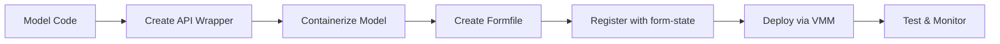
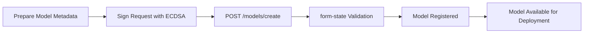

# Deploying AI Models on Formation

This guide walks you through the complete process of deploying your AI model to the Formation network, from containerization to production deployment.

## Deployment Overview

Formation model deployment follows a structured pipeline:



### Deployment Components

- **Docker Container**: Packages your model and dependencies
- **OpenAI-Compatible API**: Provides standard inference endpoints
- **Formfile**: Defines deployment configuration and resources
- **form-state**: Manages model registration and metadata
- **form-vmm**: Handles VM instance deployment and lifecycle
- **formnet**: Provides secure networking between instances

## Prerequisites

Before deploying, ensure you have:

- ✅ **Trained Model**: Working AI model ready for inference
- ✅ **API Wrapper**: OpenAI-compatible HTTP endpoints (see [Model Requirements](model-requirements.md))
- ✅ **Formation Access**: Active node on Formation network
- ✅ **ECDSA Keys**: For signing deployment requests
- ✅ **Docker**: For containerization and testing

---

## Step 1: Containerization Best Practices

### 1.1 Container Architecture

Formation models should follow a layered container architecture:

```
┌─────────────────────────────────────────┐
│            Formation Model              │
├─────────────────────────────────────────┤
│  HTTP API Layer (Port 8080)             │
│  ├── /v1/chat/completions               │
│  ├── /v1/completions                    │
│  ├── /v1/models                         │
│  └── /health                            │
├─────────────────────────────────────────┤
│  Model Inference Engine                 │
│  ├── Model Loading                      │
│  ├── Request Processing                 │
│  ├── Response Generation                │
│  └── Usage Tracking                     │
├─────────────────────────────────────────┤
│  Base Container Environment             │
│  ├── Python/Runtime                     │
│  ├── ML Framework (PyTorch/TF)          │
│  ├── System Dependencies                │
│  └── Formation Integration              │
└─────────────────────────────────────────┘
```

### 1.2 Dockerfile Best Practices

#### Multi-Stage Build Example

```dockerfile
# Multi-stage Dockerfile for efficient model deployment
FROM python:3.9-slim as base

# Install system dependencies
RUN apt-get update && apt-get install -y \
    curl \
    wget \
    git \
    build-essential \
    && rm -rf /var/lib/apt/lists/*

# Create app directory
WORKDIR /app

# Install Python dependencies
COPY requirements.txt .
RUN pip install --no-cache-dir -r requirements.txt

# Model preparation stage
FROM base as model-prep

# Download or copy model weights
COPY model/ ./model/
# Alternative: Download from remote
# RUN wget -O model/weights.bin https://example.com/model-weights.bin

# Optimize model (quantization, etc.)
RUN python scripts/optimize_model.py

# Production stage
FROM base as production

# Copy optimized model from prep stage
COPY --from=model-prep /app/model/ ./model/

# Copy application code
COPY src/ ./src/
COPY config/ ./config/

# Create non-root user for security
RUN useradd --create-home --shell /bin/bash modeluser
RUN chown -R modeluser:modeluser /app
USER modeluser

# Expose port
EXPOSE 8080

# Health check
HEALTHCHECK --interval=30s --timeout=10s --start-period=60s --retries=3 \
  CMD curl -f http://localhost:8080/health || exit 1

# Start model server
CMD ["python", "src/server.py"]
```

#### Optimized Single-Stage Example

```dockerfile
# Single-stage Dockerfile for simpler models
FROM python:3.9-slim

# Install system dependencies in one layer
RUN apt-get update && apt-get install -y \
    curl \
    && rm -rf /var/lib/apt/lists/* \
    && apt-get clean

# Set working directory
WORKDIR /app

# Copy and install Python dependencies
COPY requirements.txt .
RUN pip install --no-cache-dir -r requirements.txt

# Copy model and application code
COPY model/ ./model/
COPY src/ ./src/

# Create non-root user
RUN useradd --create-home modeluser && \
    chown -R modeluser:modeluser /app
USER modeluser

# Expose port and add health check
EXPOSE 8080
HEALTHCHECK --interval=30s --timeout=10s --start-period=30s --retries=3 \
  CMD curl -f http://localhost:8080/health || exit 1

# Start server
CMD ["python", "src/server.py"]
```

### 1.3 Container Optimization Techniques

#### Memory Optimization

```dockerfile
# Use slim base images
FROM python:3.9-slim

# Install only required packages
RUN pip install --no-cache-dir torch torchvision --index-url https://download.pytorch.org/whl/cpu

# Use multi-stage builds to reduce final image size
FROM python:3.9-slim as final
COPY --from=builder /usr/local/lib/python3.9/site-packages /usr/local/lib/python3.9/site-packages

# Clean up unnecessary files
RUN rm -rf /var/lib/apt/lists/* /tmp/* /var/tmp/*
```

#### Startup Time Optimization

```python
# src/server.py - Optimized model loading
import os
import time
import logging
from flask import Flask
import torch

# Configure logging
logging.basicConfig(level=logging.INFO)
logger = logging.getLogger(__name__)

class ModelServer:
    def __init__(self):
        self.model = None
        self.tokenizer = None
        self.model_loaded = False
        
    def load_model(self):
        """Load model with optimization for faster startup"""
        start_time = time.time()
        logger.info("Loading model...")
        
        try:
            # Load model with optimizations
            self.model = torch.jit.load('model/optimized_model.pt')
            self.model.eval()
            
            # Warm up model with dummy input
            dummy_input = torch.randn(1, 512)
            with torch.no_grad():
                _ = self.model(dummy_input)
            
            self.model_loaded = True
            load_time = time.time() - start_time
            logger.info(f"Model loaded successfully in {load_time:.2f}s")
            
        except Exception as e:
            logger.error(f"Failed to load model: {e}")
            raise

# Initialize model server
model_server = ModelServer()
model_server.load_model()

app = Flask(__name__)

@app.route('/health')
def health():
    return {
        "status": "healthy" if model_server.model_loaded else "unhealthy",
        "model_loaded": model_server.model_loaded
    }

if __name__ == '__main__':
    app.run(host='0.0.0.0', port=8080)
```

### 1.4 Security Best Practices

#### Secure Container Configuration

```dockerfile
# Security-hardened Dockerfile
FROM python:3.9-slim

# Update packages and install security updates
RUN apt-get update && \
    apt-get upgrade -y && \
    apt-get install -y --no-install-recommends \
    curl \
    ca-certificates \
    && rm -rf /var/lib/apt/lists/*

# Create non-root user with minimal privileges
RUN groupadd -r modelgroup && \
    useradd -r -g modelgroup -d /app -s /bin/bash modeluser

# Set up application directory with proper permissions
WORKDIR /app
COPY --chown=modeluser:modelgroup . .

# Install dependencies as root, then switch to non-root
RUN pip install --no-cache-dir -r requirements.txt

# Switch to non-root user
USER modeluser

# Use specific port and disable debug mode
EXPOSE 8080
ENV FLASK_ENV=production
ENV FLASK_DEBUG=0

# Health check with timeout
HEALTHCHECK --interval=30s --timeout=5s --start-period=30s --retries=3 \
  CMD curl -f http://localhost:8080/health || exit 1

CMD ["python", "src/server.py"]
```

### 1.5 Framework-Specific Examples

#### Hugging Face Transformers

```dockerfile
FROM python:3.9-slim

WORKDIR /app

# Install system dependencies
RUN apt-get update && apt-get install -y \
    curl \
    git \
    && rm -rf /var/lib/apt/lists/*

# Install Python dependencies
COPY requirements.txt .
RUN pip install --no-cache-dir -r requirements.txt

# Copy model and code
COPY model/ ./model/
COPY src/ ./src/

# Download model if not included
# RUN python -c "from transformers import AutoModel; AutoModel.from_pretrained('microsoft/DialoGPT-medium')"

EXPOSE 8080

HEALTHCHECK --interval=30s --timeout=10s --start-period=60s --retries=3 \
  CMD curl -f http://localhost:8080/health || exit 1

CMD ["python", "src/hf_server.py"]
```

#### vLLM High-Performance Inference

```dockerfile
FROM nvidia/cuda:11.8-devel-ubuntu20.04

# Install Python and system dependencies
RUN apt-get update && apt-get install -y \
    python3 \
    python3-pip \
    curl \
    && rm -rf /var/lib/apt/lists/*

WORKDIR /app

# Install vLLM and dependencies
COPY requirements.txt .
RUN pip3 install --no-cache-dir -r requirements.txt

# Copy model configuration
COPY src/ ./src/
COPY model_config.json .

EXPOSE 8080

# Health check for GPU-enabled container
HEALTHCHECK --interval=30s --timeout=15s --start-period=120s --retries=3 \
  CMD curl -f http://localhost:8080/health || exit 1

CMD ["python3", "src/vllm_server.py"]
```

#### Ollama Integration

```dockerfile
FROM ollama/ollama:latest

# Install additional dependencies
RUN apt-get update && apt-get install -y \
    python3 \
    python3-pip \
    curl \
    && rm -rf /var/lib/apt/lists/*

WORKDIR /app

# Install Python API wrapper
COPY requirements.txt .
RUN pip3 install --no-cache-dir -r requirements.txt

# Copy API wrapper and configuration
COPY src/ ./src/
COPY models/ ./models/

# Pull model
RUN ollama pull llama2:7b

EXPOSE 8080

HEALTHCHECK --interval=30s --timeout=10s --start-period=60s --retries=3 \
  CMD curl -f http://localhost:8080/health || exit 1

CMD ["python3", "src/ollama_wrapper.py"]
```

---

## Step 2: Resource Requirements Specification

### 2.1 Understanding Resource Requirements

Formation uses detailed resource specifications to ensure optimal model deployment and performance:

```rust
// Resource requirements structure (from form-state/src/model.rs)
pub struct ModelResourceRequirements {
    pub min_vcpus: u8,                    // Minimum CPU cores
    pub recommended_vcpus: u8,            // Optimal CPU cores
    pub min_memory_mb: u64,               // Minimum RAM (MB)
    pub recommended_memory_mb: u64,       // Optimal RAM (MB)
    pub min_disk_gb: u64,                 // Minimum storage (GB)
    pub recommended_disk_gb: u64,         // Optimal storage (GB)
    pub requires_gpu: bool,               // GPU requirement
    pub min_vram_gb: Option<u64>,         // Minimum VRAM (GB)
    pub recommended_vram_gb: Option<u64>, // Optimal VRAM (GB)
    pub cuda_cores: Option<u32>,          // Required CUDA cores
    pub tensor_cores: Option<u32>,        // Required Tensor cores
    pub required_cpu_extensions: Vec<String>, // CPU extensions (AVX, etc.)
    pub required_cuda_version: Option<String>, // CUDA version
}
```

### 2.2 Resource Calculation Guidelines

#### CPU Requirements

```python
# Example resource calculation for different model sizes
def calculate_cpu_requirements(model_size_params):
    """Calculate CPU requirements based on model parameters"""
    
    if model_size_params <= 1e9:  # < 1B parameters
        return {
            "min_vcpus": 2,
            "recommended_vcpus": 4,
            "description": "Small model - CPU inference suitable"
        }
    elif model_size_params <= 7e9:  # 1B - 7B parameters
        return {
            "min_vcpus": 4,
            "recommended_vcpus": 8,
            "description": "Medium model - Multi-core CPU recommended"
        }
    elif model_size_params <= 13e9:  # 7B - 13B parameters
        return {
            "min_vcpus": 8,
            "recommended_vcpus": 16,
            "description": "Large model - High-core CPU or GPU recommended"
        }
    else:  # > 13B parameters
        return {
            "min_vcpus": 16,
            "recommended_vcpus": 32,
            "description": "Very large model - GPU strongly recommended"
        }
```

#### Memory Requirements

```python
def calculate_memory_requirements(model_size_params, precision="fp16"):
    """Calculate memory requirements based on model size and precision"""
    
    # Base memory calculation (parameters * bytes per parameter)
    precision_multiplier = {
        "fp32": 4,  # 4 bytes per parameter
        "fp16": 2,  # 2 bytes per parameter
        "int8": 1,  # 1 byte per parameter
        "int4": 0.5 # 0.5 bytes per parameter
    }
    
    model_memory_gb = (model_size_params * precision_multiplier[precision]) / (1024**3)
    
    # Add overhead for inference (activations, KV cache, etc.)
    overhead_multiplier = 2.5  # 2.5x overhead is typical
    total_memory_gb = model_memory_gb * overhead_multiplier
    
    # Convert to MB and add system overhead
    min_memory_mb = int(total_memory_gb * 1024) + 1024  # +1GB system overhead
    recommended_memory_mb = int(min_memory_mb * 1.5)    # 50% buffer
    
    return {
        "min_memory_mb": min_memory_mb,
        "recommended_memory_mb": recommended_memory_mb,
        "model_memory_gb": round(model_memory_gb, 2),
        "total_memory_gb": round(total_memory_gb, 2)
    }
```

#### GPU Requirements

```python
def calculate_gpu_requirements(model_size_params, precision="fp16"):
    """Calculate GPU requirements for model inference"""
    
    memory_req = calculate_memory_requirements(model_size_params, precision)
    model_memory_gb = memory_req["model_memory_gb"]
    
    if model_size_params <= 1e9:  # < 1B parameters
        return {
            "requires_gpu": False,
            "min_vram_gb": None,
            "recommended_vram_gb": None,
            "description": "CPU inference sufficient"
        }
    elif model_size_params <= 7e9:  # 1B - 7B parameters
        return {
            "requires_gpu": True,
            "min_vram_gb": max(8, int(model_memory_gb * 1.5)),
            "recommended_vram_gb": max(16, int(model_memory_gb * 2)),
            "cuda_cores": 2048,
            "description": "Mid-range GPU recommended"
        }
    elif model_size_params <= 13e9:  # 7B - 13B parameters
        return {
            "requires_gpu": True,
            "min_vram_gb": max(16, int(model_memory_gb * 1.5)),
            "recommended_vram_gb": max(24, int(model_memory_gb * 2)),
            "cuda_cores": 4096,
            "tensor_cores": 320,
            "description": "High-end GPU required"
        }
    else:  # > 13B parameters
        return {
            "requires_gpu": True,
            "min_vram_gb": max(24, int(model_memory_gb * 1.5)),
            "recommended_vram_gb": max(48, int(model_memory_gb * 2)),
            "cuda_cores": 8192,
            "tensor_cores": 640,
            "description": "Enterprise GPU or multi-GPU setup required"
        }
```

### 2.3 Resource Specification Examples

#### Small Language Model (1B parameters)

```json
{
  "resource_requirements": {
    "min_vcpus": 2,
    "recommended_vcpus": 4,
    "min_memory_mb": 4096,
    "recommended_memory_mb": 8192,
    "min_disk_gb": 10,
    "recommended_disk_gb": 20,
    "requires_gpu": false,
    "min_vram_gb": null,
    "recommended_vram_gb": null,
    "cuda_cores": null,
    "tensor_cores": null,
    "required_cpu_extensions": ["AVX2"],
    "required_cuda_version": null
  }
}
```

#### Medium Language Model (7B parameters)

```json
{
  "resource_requirements": {
    "min_vcpus": 4,
    "recommended_vcpus": 8,
    "min_memory_mb": 16384,
    "recommended_memory_mb": 32768,
    "min_disk_gb": 20,
    "recommended_disk_gb": 50,
    "requires_gpu": true,
    "min_vram_gb": 16,
    "recommended_vram_gb": 24,
    "cuda_cores": 2048,
    "tensor_cores": 320,
    "required_cpu_extensions": ["AVX2", "FMA"],
    "required_cuda_version": "11.8"
  }
}
```

#### Large Language Model (13B+ parameters)

```json
{
  "resource_requirements": {
    "min_vcpus": 8,
    "recommended_vcpus": 16,
    "min_memory_mb": 32768,
    "recommended_memory_mb": 65536,
    "min_disk_gb": 50,
    "recommended_disk_gb": 100,
    "requires_gpu": true,
    "min_vram_gb": 24,
    "recommended_vram_gb": 48,
    "cuda_cores": 4096,
    "tensor_cores": 640,
    "required_cpu_extensions": ["AVX2", "FMA", "AVX512"],
    "required_cuda_version": "12.0"
  }
}
```

#### Image Generation Model

```json
{
  "resource_requirements": {
    "min_vcpus": 4,
    "recommended_vcpus": 8,
    "min_memory_mb": 8192,
    "recommended_memory_mb": 16384,
    "min_disk_gb": 30,
    "recommended_disk_gb": 60,
    "requires_gpu": true,
    "min_vram_gb": 12,
    "recommended_vram_gb": 24,
    "cuda_cores": 2048,
    "tensor_cores": 320,
    "required_cpu_extensions": ["AVX2"],
    "required_cuda_version": "11.8"
  }
}
```

### 2.4 Dynamic Resource Calculation

```python
# src/resource_calculator.py
import json
import os
from typing import Dict, Any

class ResourceCalculator:
    """Calculate optimal resource requirements for models"""
    
    def __init__(self, model_path: str):
        self.model_path = model_path
        self.model_info = self._analyze_model()
    
    def _analyze_model(self) -> Dict[str, Any]:
        """Analyze model to determine characteristics"""
        # This would analyze your specific model
        # For example, counting parameters, checking precision, etc.
        
        return {
            "parameters": 7e9,  # 7B parameters
            "precision": "fp16",
            "model_type": "language_model",
            "framework": "pytorch"
        }
    
    def calculate_requirements(self) -> Dict[str, Any]:
        """Calculate complete resource requirements"""
        
        params = self.model_info["parameters"]
        precision = self.model_info["precision"]
        
        cpu_req = calculate_cpu_requirements(params)
        memory_req = calculate_memory_requirements(params, precision)
        gpu_req = calculate_gpu_requirements(params, precision)
        
        return {
            "min_vcpus": cpu_req["min_vcpus"],
            "recommended_vcpus": cpu_req["recommended_vcpus"],
            "min_memory_mb": memory_req["min_memory_mb"],
            "recommended_memory_mb": memory_req["recommended_memory_mb"],
            "min_disk_gb": 20,  # Base disk requirement
            "recommended_disk_gb": 50,
            "requires_gpu": gpu_req["requires_gpu"],
            "min_vram_gb": gpu_req.get("min_vram_gb"),
            "recommended_vram_gb": gpu_req.get("recommended_vram_gb"),
            "cuda_cores": gpu_req.get("cuda_cores"),
            "tensor_cores": gpu_req.get("tensor_cores"),
            "required_cpu_extensions": ["AVX2", "FMA"],
            "required_cuda_version": "11.8" if gpu_req["requires_gpu"] else None
        }
    
    def save_requirements(self, output_path: str):
        """Save requirements to JSON file"""
        requirements = self.calculate_requirements()
        
        with open(output_path, 'w') as f:
            json.dump({"resource_requirements": requirements}, f, indent=2)
        
        print(f"Resource requirements saved to {output_path}")

# Usage example
if __name__ == "__main__":
    calculator = ResourceCalculator("./model")
    calculator.save_requirements("resource_requirements.json")
```

---

## Step 3: Registration with form-state

### 3.1 Model Registration Overview

Formation uses the `form-state` service to manage model registration and metadata. Models are registered via the `/models/create` endpoint with comprehensive metadata.

#### Registration Flow



### 3.2 Model Metadata Structure

```json
{
  "model_id": "my-llm-model-v1",
  "name": "My Custom Language Model",
  "owner_id": "0x1234567890abcdef...",
  "version": "1.0.0",
  "description": "A fine-tuned language model for specific domain tasks",
  "documentation": "# Model Documentation\n\nThis model is trained for...",
  "license": "MIT",
  "model_type": "LLM",
  "framework": "PyTorch",
  "io_modes": ["TextToText"],
  "parameters": 7000000000,
  "quantization": "FP16",
  "context_length": 4096,
  "input_tokens_per_second": 150,
  "output_tokens_per_second": 50,
  "tags": ["language-model", "chat", "instruction-following"],
  "created_at": 1703123456,
  "updated_at": 1703123456,
  "formfile_template": "base64_encoded_formfile",
  "weights_url": "https://example.com/model-weights.bin",
  "weights_checksum": "sha256:abc123...",
  "weights_size_bytes": 14000000000,
  "resource_requirements": {
    "min_vcpus": 4,
    "recommended_vcpus": 8,
    "min_memory_mb": 16384,
    "recommended_memory_mb": 32768,
    "min_disk_gb": 20,
    "recommended_disk_gb": 50,
    "requires_gpu": true,
    "min_vram_gb": 16,
    "recommended_vram_gb": 24,
    "cuda_cores": 2048,
    "tensor_cores": 320,
    "required_cpu_extensions": ["AVX2", "FMA"],
    "required_cuda_version": "11.8"
  },
  "capabilities": [
    "text_generation",
    "chat_completion",
    "instruction_following",
    "code_generation"
  ],
  "average_rating": null,
  "deployment_count": 0,
  "usage_count": 0,
  "is_featured": false,
  "is_private": false,
  "metadata": {
    "training_data": "Custom dataset",
    "fine_tuning_method": "LoRA",
    "base_model": "llama-2-7b"
  },
  "repository_url": "https://github.com/user/my-model",
  "demo_url": "https://demo.example.com",
  "paper_url": "https://arxiv.org/abs/2301.00000",
  "price_per_1m_tokens": 1000,
  "usage_tracking": {
    "track_tokens": true,
    "track_requests": true,
    "enable_royalties": true,
    "royalty_percentage": 10,
    "custom_metrics": ["latency", "quality_score"]
  }
}
```

### 3.3 Automatic Registration with form-pack

When you build with `form-pack`, your model can be automatically registered:

#### Formfile with Auto-Registration

```
NAME my-llm-model
DESCRIPTION "Custom language model for domain-specific tasks"

# System Resources
VCPU 8
MEM 32768
DISK 50

# User Configuration
USER username:modeluser passwd:securepass sudo:true ssh_authorized_keys:"ssh-rsa AAAAB3NzaC1yc2E..."

# Base System
FROM ubuntu:22.04

# Install Docker
RUN apt-get update && apt-get install -y docker.io curl
RUN systemctl enable docker

# Copy model container and configuration
COPY ./model-container /app/model-container
COPY ./docker-compose.yml /app/docker-compose.yml
COPY ./model-metadata.json /app/model-metadata.json

# Set working directory
WORKDIR /app

# Register model with form-state (automatic)
ENV AUTO_REGISTER_MODEL=true
ENV MODEL_METADATA_PATH=/app/model-metadata.json

# Start Docker service and run model container
ENTRYPOINT ["sh", "-c", "service docker start && docker-compose up -d"]
```

### 3.4 Manual Registration

For custom registration scenarios or when you need more control:

#### Registration Script

```python
#!/usr/bin/env python3
"""
Model registration script for Formation
"""

import json
import time
import base64
import hashlib
import requests
from eth_account import Account
from eth_account.messages import encode_defunct

class ModelRegistrar:
    def __init__(self, private_key: str, form_state_url: str = "http://localhost:3004"):
        self.private_key = private_key
        self.form_state_url = form_state_url
        self.account = Account.from_key(private_key)
        
    def create_signature(self, message: str) -> tuple:
        """Create ECDSA signature for authentication"""
        message_hash = encode_defunct(text=message)
        signed_message = self.account.sign_message(message_hash)
        
        return (
            signed_message.signature.hex(),
            signed_message.v - 27,  # Recovery ID
            message.encode().hex()
        )
    
    def register_model(self, model_metadata: dict) -> dict:
        """Register model with form-state"""
        
        # Ensure owner_id matches the signing account
        model_metadata["owner_id"] = self.account.address.lower()
        model_metadata["created_at"] = int(time.time())
        model_metadata["updated_at"] = int(time.time())
        
        # Create authentication message
        message = f"register_model_{model_metadata['model_id']}_{int(time.time())}"
        signature, recovery_id, message_hex = self.create_signature(message)
        
        # Prepare request
        headers = {
            "Content-Type": "application/json",
            "Authorization": f"Signature {signature}.{recovery_id}.{message_hex}"
        }
        
        # Send registration request
        response = requests.post(
            f"{self.form_state_url}/models/create",
            headers=headers,
            json=model_metadata
        )
        
        if response.status_code == 201:
            print(f"✅ Model '{model_metadata['model_id']}' registered successfully")
            return response.json()
        else:
            print(f"❌ Registration failed: {response.status_code}")
            print(f"Error: {response.text}")
            raise Exception(f"Registration failed: {response.text}")
    
    def update_model(self, model_metadata: dict) -> dict:
        """Update existing model registration"""
        
        model_metadata["updated_at"] = int(time.time())
        
        # Create authentication message
        message = f"update_model_{model_metadata['model_id']}_{int(time.time())}"
        signature, recovery_id, message_hex = self.create_signature(message)
        
        # Prepare request
        headers = {
            "Content-Type": "application/json",
            "Authorization": f"Signature {signature}.{recovery_id}.{message_hex}"
        }
        
        # Send update request
        response = requests.post(
            f"{self.form_state_url}/models/update",
            headers=headers,
            json=model_metadata
        )
        
        if response.status_code == 200:
            print(f"✅ Model '{model_metadata['model_id']}' updated successfully")
            return response.json()
        else:
            print(f"❌ Update failed: {response.status_code}")
            print(f"Error: {response.text}")
            raise Exception(f"Update failed: {response.text}")

def load_formfile_template(formfile_path: str) -> str:
    """Load and encode Formfile template"""
    with open(formfile_path, 'r') as f:
        formfile_content = f.read()
    
    return base64.b64encode(formfile_content.encode()).decode()

def calculate_file_checksum(file_path: str) -> str:
    """Calculate SHA-256 checksum of file"""
    sha256_hash = hashlib.sha256()
    with open(file_path, "rb") as f:
        for chunk in iter(lambda: f.read(4096), b""):
            sha256_hash.update(chunk)
    return f"sha256:{sha256_hash.hexdigest()}"

def main():
    """Main registration function"""
    
    # Configuration
    PRIVATE_KEY = "0x1234567890abcdef..."  # Your ECDSA private key
    FORM_STATE_URL = "http://localhost:3004"
    
    # Initialize registrar
    registrar = ModelRegistrar(PRIVATE_KEY, FORM_STATE_URL)
    
    # Load Formfile template
    formfile_template = load_formfile_template("Formfile")
    
    # Calculate model weights checksum (if applicable)
    weights_checksum = None
    weights_size = None
    if os.path.exists("model/weights.bin"):
        weights_checksum = calculate_file_checksum("model/weights.bin")
        weights_size = os.path.getsize("model/weights.bin")
    
    # Model metadata
    model_metadata = {
        "model_id": "my-custom-llm-v1",
        "name": "My Custom Language Model",
        "version": "1.0.0",
        "description": "A fine-tuned language model for specific domain tasks",
        "documentation": "# Model Documentation\n\nThis model is trained for domain-specific tasks...",
        "license": "MIT",
        "model_type": "LLM",
        "framework": "PyTorch",
        "io_modes": ["TextToText"],
        "parameters": 7000000000,
        "quantization": "FP16",
        "context_length": 4096,
        "input_tokens_per_second": 150,
        "output_tokens_per_second": 50,
        "tags": ["language-model", "chat", "instruction-following"],
        "formfile_template": formfile_template,
        "weights_url": "https://example.com/model-weights.bin",
        "weights_checksum": weights_checksum,
        "weights_size_bytes": weights_size,
        "resource_requirements": {
            "min_vcpus": 4,
            "recommended_vcpus": 8,
            "min_memory_mb": 16384,
            "recommended_memory_mb": 32768,
            "min_disk_gb": 20,
            "recommended_disk_gb": 50,
            "requires_gpu": True,
            "min_vram_gb": 16,
            "recommended_vram_gb": 24,
            "cuda_cores": 2048,
            "tensor_cores": 320,
            "required_cpu_extensions": ["AVX2", "FMA"],
            "required_cuda_version": "11.8"
        },
        "capabilities": [
            "text_generation",
            "chat_completion",
            "instruction_following"
        ],
        "is_private": False,
        "metadata": {
            "training_data": "Custom dataset",
            "fine_tuning_method": "LoRA",
            "base_model": "llama-2-7b"
        },
        "repository_url": "https://github.com/user/my-model",
        "price_per_1m_tokens": 1000,
        "usage_tracking": {
            "track_tokens": True,
            "track_requests": True,
            "enable_royalties": True,
            "royalty_percentage": 10,
            "custom_metrics": ["latency", "quality_score"]
        }
    }
    
    try:
        # Register the model
        result = registrar.register_model(model_metadata)
        print(f"Registration successful: {result}")
        
    except Exception as e:
        print(f"Registration failed: {e}")
        return 1
    
    return 0

if __name__ == "__main__":
    import os
    import sys
    sys.exit(main())
```

### 3.5 Registration Verification

After registration, verify your model was registered correctly:

```bash
# Check model registration
curl -H "Authorization: Signature <signature>.<recovery_id>.<message_hex>" \
     http://localhost:3004/models/my-custom-llm-v1

# List all your models
curl -H "Authorization: Signature <signature>.<recovery_id>.<message_hex>" \
     http://localhost:3004/models/list
```

#### Verification Script

```python
def verify_registration(registrar: ModelRegistrar, model_id: str):
    """Verify model registration"""
    
    # Create authentication for GET request
    message = f"get_model_{model_id}_{int(time.time())}"
    signature, recovery_id, message_hex = registrar.create_signature(message)
    
    headers = {
        "Authorization": f"Signature {signature}.{recovery_id}.{message_hex}"
    }
    
    response = requests.get(
        f"{registrar.form_state_url}/models/{model_id}",
        headers=headers
    )
    
    if response.status_code == 200:
        model_data = response.json()
        print(f"✅ Model verification successful")
        print(f"Model ID: {model_data['model']['model_id']}")
        print(f"Name: {model_data['model']['name']}")
        print(f"Owner: {model_data['model']['owner_id']}")
        print(f"Status: Registered")
        return True
    else:
        print(f"❌ Model verification failed: {response.status_code}")
        print(f"Error: {response.text}")
        return False
```

---

## Step 4: Testing Inference Endpoints

### 4.1 Local Testing Setup

Before deploying to Formation, thoroughly test your model locally:

#### Test Environment Setup

```bash
# Build and run your model container locally
docker build -t my-model:latest .
docker run -p 8080:8080 my-model:latest

# Wait for model to load
sleep 30

# Run test suite
python test_model_api.py
```

### 4.2 Comprehensive API Testing

#### Test Suite Implementation

```python
#!/usr/bin/env python3
"""
Comprehensive test suite for Formation model API
"""

import json
import time
import requests
import threading
from typing import Dict, Any, List
import concurrent.futures

class ModelAPITester:
    def __init__(self, base_url: str = "http://localhost:8080"):
        self.base_url = base_url
        self.session = requests.Session()
        self.test_results = []
    
    def test_health_endpoint(self) -> bool:
        """Test health check endpoint"""
        print("🔍 Testing health endpoint...")
        
        try:
            response = self.session.get(f"{self.base_url}/health", timeout=10)
            
            assert response.status_code == 200, f"Expected 200, got {response.status_code}"
            
            data = response.json()
            assert "status" in data, "Health response missing 'status' field"
            assert data["status"] in ["healthy", "degraded", "unhealthy"], f"Invalid status: {data['status']}"
            
            print(f"✅ Health check passed - Status: {data['status']}")
            return True
            
        except Exception as e:
            print(f"❌ Health check failed: {e}")
            return False
    
    def test_models_endpoint(self) -> bool:
        """Test models list endpoint"""
        print("🔍 Testing models endpoint...")
        
        try:
            response = self.session.get(f"{self.base_url}/v1/models", timeout=10)
            
            assert response.status_code == 200, f"Expected 200, got {response.status_code}"
            
            data = response.json()
            assert "object" in data, "Models response missing 'object' field"
            assert data["object"] == "list", f"Expected 'list', got {data['object']}"
            assert "data" in data, "Models response missing 'data' field"
            assert isinstance(data["data"], list), "Models data should be a list"
            assert len(data["data"]) > 0, "No models found"
            
            model = data["data"][0]
            assert "id" in model, "Model missing 'id' field"
            assert "object" in model, "Model missing 'object' field"
            assert model["object"] == "model", f"Expected 'model', got {model['object']}"
            
            print(f"✅ Models endpoint passed - Found {len(data['data'])} model(s)")
            return True
            
        except Exception as e:
            print(f"❌ Models endpoint failed: {e}")
            return False
    
    def test_chat_completions(self) -> bool:
        """Test chat completions endpoint"""
        print("🔍 Testing chat completions endpoint...")
        
        test_payload = {
            "model": "test-model",
            "messages": [
                {"role": "system", "content": "You are a helpful assistant."},
                {"role": "user", "content": "Hello, how are you?"}
            ],
            "max_tokens": 100,
            "temperature": 0.7
        }
        
        try:
            start_time = time.time()
            response = self.session.post(
                f"{self.base_url}/v1/chat/completions",
                json=test_payload,
                timeout=30
            )
            response_time = time.time() - start_time
            
            assert response.status_code == 200, f"Expected 200, got {response.status_code}"
            
            data = response.json()
            
            # Validate response structure
            assert "id" in data, "Response missing 'id' field"
            assert "object" in data, "Response missing 'object' field"
            assert data["object"] == "chat.completion", f"Expected 'chat.completion', got {data['object']}"
            assert "choices" in data, "Response missing 'choices' field"
            assert "usage" in data, "Response missing 'usage' field"
            
            # Validate choices
            choices = data["choices"]
            assert len(choices) > 0, "No choices in response"
            
            choice = choices[0]
            assert "index" in choice, "Choice missing 'index' field"
            assert "message" in choice, "Choice missing 'message' field"
            assert "finish_reason" in choice, "Choice missing 'finish_reason' field"
            
            message = choice["message"]
            assert "role" in message, "Message missing 'role' field"
            assert "content" in message, "Message missing 'content' field"
            assert message["role"] == "assistant", f"Expected 'assistant', got {message['role']}"
            assert len(message["content"]) > 0, "Empty message content"
            
            # Validate usage
            usage = data["usage"]
            assert "prompt_tokens" in usage, "Usage missing 'prompt_tokens' field"
            assert "completion_tokens" in usage, "Usage missing 'completion_tokens' field"
            assert "total_tokens" in usage, "Usage missing 'total_tokens' field"
            assert usage["total_tokens"] == usage["prompt_tokens"] + usage["completion_tokens"], "Token count mismatch"
            
            print(f"✅ Chat completions passed - Response time: {response_time:.2f}s")
            print(f"   Tokens: {usage['prompt_tokens']} + {usage['completion_tokens']} = {usage['total_tokens']}")
            return True
            
        except Exception as e:
            print(f"❌ Chat completions failed: {e}")
            return False
    
    def test_streaming_completions(self) -> bool:
        """Test streaming chat completions"""
        print("🔍 Testing streaming completions...")
        
        test_payload = {
            "model": "test-model",
            "messages": [
                {"role": "user", "content": "Count from 1 to 5"}
            ],
            "max_tokens": 50,
            "stream": True
        }
        
        try:
            response = self.session.post(
                f"{self.base_url}/v1/chat/completions",
                json=test_payload,
                stream=True,
                timeout=30
            )
            
            assert response.status_code == 200, f"Expected 200, got {response.status_code}"
            
            chunks_received = 0
            content_received = ""
            
            for line in response.iter_lines():
                if line:
                    line_str = line.decode('utf-8')
                    if line_str.startswith('data: '):
                        data_str = line_str[6:]  # Remove 'data: ' prefix
                        
                        if data_str.strip() == '[DONE]':
                            break
                        
                        try:
                            chunk_data = json.loads(data_str)
                            chunks_received += 1
                            
                            # Validate chunk structure
                            assert "choices" in chunk_data, "Chunk missing 'choices' field"
                            if chunk_data["choices"] and "delta" in chunk_data["choices"][0]:
                                delta = chunk_data["choices"][0]["delta"]
                                if "content" in delta:
                                    content_received += delta["content"]
                                    
                        except json.JSONDecodeError:
                            continue
            
            assert chunks_received > 0, "No chunks received"
            assert len(content_received) > 0, "No content received"
            
            print(f"✅ Streaming completions passed - Received {chunks_received} chunks")
            return True
            
        except Exception as e:
            print(f"❌ Streaming completions failed: {e}")
            return False
    
    def test_error_handling(self) -> bool:
        """Test error handling scenarios"""
        print("🔍 Testing error handling...")
        
        test_cases = [
            {
                "name": "Empty request",
                "payload": {},
                "expected_status": 400
            },
            {
                "name": "Missing messages",
                "payload": {"model": "test-model"},
                "expected_status": 400
            },
            {
                "name": "Invalid messages format",
                "payload": {"model": "test-model", "messages": "invalid"},
                "expected_status": 400
            },
            {
                "name": "Empty messages array",
                "payload": {"model": "test-model", "messages": []},
                "expected_status": 400
            }
        ]
        
        for test_case in test_cases:
            try:
                response = self.session.post(
                    f"{self.base_url}/v1/chat/completions",
                    json=test_case["payload"],
                    timeout=10
                )
                
                assert response.status_code == test_case["expected_status"], \
                    f"Test '{test_case['name']}': Expected {test_case['expected_status']}, got {response.status_code}"
                
                # Validate error response format
                if response.status_code >= 400:
                    data = response.json()
                    assert "error" in data, f"Error response missing 'error' field for test '{test_case['name']}'"
                    error = data["error"]
                    assert "message" in error, f"Error missing 'message' field for test '{test_case['name']}'"
                
                print(f"   ✅ {test_case['name']}: Correct error handling")
                
            except Exception as e:
                print(f"   ❌ {test_case['name']}: {e}")
                return False
        
        print("✅ Error handling tests passed")
        return True
    
    def test_concurrent_requests(self, num_requests: int = 10) -> bool:
        """Test concurrent request handling"""
        print(f"🔍 Testing concurrent requests ({num_requests} requests)...")
        
        def make_request():
            payload = {
                "model": "test-model",
                "messages": [{"role": "user", "content": "Hello"}],
                "max_tokens": 50
            }
            
            try:
                response = requests.post(
                    f"{self.base_url}/v1/chat/completions",
                    json=payload,
                    timeout=30
                )
                return response.status_code == 200
            except:
                return False
        
        try:
            start_time = time.time()
            
            with concurrent.futures.ThreadPoolExecutor(max_workers=num_requests) as executor:
                futures = [executor.submit(make_request) for _ in range(num_requests)]
                results = [future.result() for future in concurrent.futures.as_completed(futures)]
            
            end_time = time.time()
            
            successful_requests = sum(results)
            success_rate = successful_requests / num_requests * 100
            avg_time = (end_time - start_time) / num_requests
            
            assert success_rate >= 80, f"Success rate too low: {success_rate}%"
            
            print(f"✅ Concurrent requests passed - {successful_requests}/{num_requests} successful ({success_rate:.1f}%)")
            print(f"   Average time per request: {avg_time:.2f}s")
            return True
            
        except Exception as e:
            print(f"❌ Concurrent requests failed: {e}")
            return False
    
    def test_performance_benchmarks(self) -> bool:
        """Test performance benchmarks"""
        print("🔍 Testing performance benchmarks...")
        
        # Test response time requirements
        test_cases = [
            {
                "endpoint": "/health",
                "method": "GET",
                "max_time": 0.1,  # 100ms
                "payload": None
            },
            {
                "endpoint": "/v1/models",
                "method": "GET", 
                "max_time": 0.2,  # 200ms
                "payload": None
            },
            {
                "endpoint": "/v1/chat/completions",
                "method": "POST",
                "max_time": 30.0,  # 30 seconds
                "payload": {
                    "model": "test-model",
                    "messages": [{"role": "user", "content": "Hello"}],
                    "max_tokens": 100
                }
            }
        ]
        
        for test_case in test_cases:
            try:
                start_time = time.time()
                
                if test_case["method"] == "GET":
                    response = self.session.get(f"{self.base_url}{test_case['endpoint']}", timeout=test_case["max_time"] + 5)
                else:
                    response = self.session.post(f"{self.base_url}{test_case['endpoint']}", json=test_case["payload"], timeout=test_case["max_time"] + 5)
                
                response_time = time.time() - start_time
                
                assert response.status_code == 200, f"Request failed with status {response.status_code}"
                assert response_time <= test_case["max_time"], f"Response time {response_time:.2f}s exceeds limit {test_case['max_time']}s"
                
                print(f"   ✅ {test_case['endpoint']}: {response_time:.2f}s (limit: {test_case['max_time']}s)")
                
            except Exception as e:
                print(f"   ❌ {test_case['endpoint']}: {e}")
                return False
        
        print("✅ Performance benchmarks passed")
        return True
    
    def run_all_tests(self) -> bool:
        """Run complete test suite"""
        print("🚀 Starting comprehensive model API tests...\n")
        
        tests = [
            ("Health Endpoint", self.test_health_endpoint),
            ("Models Endpoint", self.test_models_endpoint),
            ("Chat Completions", self.test_chat_completions),
            ("Streaming Completions", self.test_streaming_completions),
            ("Error Handling", self.test_error_handling),
            ("Concurrent Requests", self.test_concurrent_requests),
            ("Performance Benchmarks", self.test_performance_benchmarks)
        ]
        
        passed_tests = 0
        total_tests = len(tests)
        
        for test_name, test_func in tests:
            print(f"\n{'='*50}")
            print(f"Running: {test_name}")
            print('='*50)
            
            try:
                if test_func():
                    passed_tests += 1
                    print(f"✅ {test_name} PASSED")
                else:
                    print(f"❌ {test_name} FAILED")
            except Exception as e:
                print(f"❌ {test_name} FAILED with exception: {e}")
        
        print(f"\n{'='*50}")
        print(f"TEST SUMMARY")
        print('='*50)
        print(f"Passed: {passed_tests}/{total_tests}")
        print(f"Success Rate: {passed_tests/total_tests*100:.1f}%")
        
        if passed_tests == total_tests:
            print("🎉 All tests passed! Model is ready for deployment.")
            return True
        else:
            print("⚠️  Some tests failed. Please fix issues before deployment.")
            return False

def main():
    """Main test function"""
    import argparse
    
    parser = argparse.ArgumentParser(description="Test Formation model API")
    parser.add_argument("--url", default="http://localhost:8080", help="Model API base URL")
    parser.add_argument("--concurrent", type=int, default=10, help="Number of concurrent requests to test")
    
    args = parser.parse_args()
    
    tester = ModelAPITester(args.url)
    
    # Wait for model to be ready
    print("Waiting for model to be ready...")
    for i in range(30):  # Wait up to 30 seconds
        try:
            response = requests.get(f"{args.url}/health", timeout=5)
            if response.status_code == 200:
                data = response.json()
                if data.get("status") == "healthy":
                    print("✅ Model is ready!")
                    break
        except:
            pass
        
        time.sleep(1)
        print(f"   Waiting... ({i+1}/30)")
    else:
        print("❌ Model failed to become ready within 30 seconds")
        return 1
    
    # Run tests
    success = tester.run_all_tests()
    return 0 if success else 1

if __name__ == "__main__":
    import sys
    sys.exit(main())
```

### 4.3 Load Testing

#### Load Test Script

```python
#!/usr/bin/env python3
"""
Load testing script for Formation models
"""

import time
import json
import statistics
import concurrent.futures
import requests
from typing import List, Dict, Any

class LoadTester:
    def __init__(self, base_url: str):
        self.base_url = base_url
        self.results = []
    
    def single_request(self, payload: Dict[str, Any]) -> Dict[str, Any]:
        """Make a single request and measure performance"""
        start_time = time.time()
        
        try:
            response = requests.post(
                f"{self.base_url}/v1/chat/completions",
                json=payload,
                timeout=60
            )
            
            end_time = time.time()
            response_time = end_time - start_time
            
            success = response.status_code == 200
            
            if success:
                data = response.json()
                tokens = data.get("usage", {}).get("total_tokens", 0)
            else:
                tokens = 0
            
            return {
                "success": success,
                "response_time": response_time,
                "status_code": response.status_code,
                "tokens": tokens,
                "timestamp": start_time
            }
            
        except Exception as e:
            end_time = time.time()
            return {
                "success": False,
                "response_time": end_time - start_time,
                "status_code": 0,
                "tokens": 0,
                "error": str(e),
                "timestamp": start_time
            }
    
    def run_load_test(self, 
                     num_requests: int = 100,
                     concurrent_users: int = 10,
                     payload: Dict[str, Any] = None) -> Dict[str, Any]:
        """Run load test with specified parameters"""
        
        if payload is None:
            payload = {
                "model": "test-model",
                "messages": [
                    {"role": "user", "content": "Generate a short response about AI."}
                ],
                "max_tokens": 100
            }
        
        print(f"🚀 Starting load test:")
        print(f"   Requests: {num_requests}")
        print(f"   Concurrent users: {concurrent_users}")
        print(f"   Payload: {json.dumps(payload, indent=2)}")
        
        start_time = time.time()
        
        with concurrent.futures.ThreadPoolExecutor(max_workers=concurrent_users) as executor:
            futures = [executor.submit(self.single_request, payload) for _ in range(num_requests)]
            results = [future.result() for future in concurrent.futures.as_completed(futures)]
        
        end_time = time.time()
        total_time = end_time - start_time
        
        # Analyze results
        successful_requests = [r for r in results if r["success"]]
        failed_requests = [r for r in results if not r["success"]]
        
        response_times = [r["response_time"] for r in successful_requests]
        total_tokens = sum(r["tokens"] for r in successful_requests)
        
        # Calculate statistics
        stats = {
            "total_requests": num_requests,
            "successful_requests": len(successful_requests),
            "failed_requests": len(failed_requests),
            "success_rate": len(successful_requests) / num_requests * 100,
            "total_time": total_time,
            "requests_per_second": num_requests / total_time,
            "total_tokens": total_tokens,
            "tokens_per_second": total_tokens / total_time if total_time > 0 else 0,
        }
        
        if response_times:
            stats.update({
                "avg_response_time": statistics.mean(response_times),
                "min_response_time": min(response_times),
                "max_response_time": max(response_times),
                "median_response_time": statistics.median(response_times),
                "p95_response_time": self.percentile(response_times, 95),
                "p99_response_time": self.percentile(response_times, 99),
            })
        
        return stats
    
    def percentile(self, data: List[float], percentile: float) -> float:
        """Calculate percentile of data"""
        sorted_data = sorted(data)
        index = int(len(sorted_data) * percentile / 100)
        return sorted_data[min(index, len(sorted_data) - 1)]
    
    def print_results(self, stats: Dict[str, Any]):
        """Print formatted test results"""
        print("\n" + "="*60)
        print("LOAD TEST RESULTS")
        print("="*60)
        
        print(f"Total Requests:      {stats['total_requests']}")
        print(f"Successful:          {stats['successful_requests']}")
        print(f"Failed:              {stats['failed_requests']}")
        print(f"Success Rate:        {stats['success_rate']:.1f}%")
        print(f"Total Time:          {stats['total_time']:.2f}s")
        print(f"Requests/Second:     {stats['requests_per_second']:.2f}")
        print(f"Total Tokens:        {stats['total_tokens']}")
        print(f"Tokens/Second:       {stats['tokens_per_second']:.2f}")
        
        if "avg_response_time" in stats:
            print("\nResponse Time Statistics:")
            print(f"Average:             {stats['avg_response_time']:.3f}s")
            print(f"Minimum:             {stats['min_response_time']:.3f}s")
            print(f"Maximum:             {stats['max_response_time']:.3f}s")
            print(f"Median:              {stats['median_response_time']:.3f}s")
            print(f"95th Percentile:     {stats['p95_response_time']:.3f}s")
            print(f"99th Percentile:     {stats['p99_response_time']:.3f}s")
        
        # Performance assessment
        print("\nPerformance Assessment:")
        if stats['success_rate'] >= 99:
            print("✅ Excellent reliability")
        elif stats['success_rate'] >= 95:
            print("✅ Good reliability")
        elif stats['success_rate'] >= 90:
            print("⚠️  Acceptable reliability")
        else:
            print("❌ Poor reliability - needs improvement")
        
        if "avg_response_time" in stats:
            if stats['avg_response_time'] <= 1.0:
                print("✅ Excellent response time")
            elif stats['avg_response_time'] <= 5.0:
                print("✅ Good response time")
            elif stats['avg_response_time'] <= 15.0:
                print("⚠️  Acceptable response time")
            else:
                print("❌ Poor response time - needs optimization")

def main():
    """Main load testing function"""
    import argparse
    
    parser = argparse.ArgumentParser(description="Load test Formation model API")
    parser.add_argument("--url", default="http://localhost:8080", help="Model API base URL")
    parser.add_argument("--requests", type=int, default=100, help="Total number of requests")
    parser.add_argument("--concurrent", type=int, default=10, help="Number of concurrent users")
    parser.add_argument("--max-tokens", type=int, default=100, help="Max tokens per request")
    
    args = parser.parse_args()
    
    # Test payload
    payload = {
        "model": "test-model",
        "messages": [
            {"role": "user", "content": "Generate a short response about artificial intelligence and its applications."}
        ],
        "max_tokens": args.max_tokens,
        "temperature": 0.7
    }
    
    # Initialize load tester
    tester = LoadTester(args.url)
    
    # Run load test
    stats = tester.run_load_test(
        num_requests=args.requests,
        concurrent_users=args.concurrent,
        payload=payload
    )
    
    # Print results
    tester.print_results(stats)
    
    # Return exit code based on performance
    if stats['success_rate'] >= 95 and stats.get('avg_response_time', 0) <= 30:
        print("\n🎉 Load test passed! Model is ready for production.")
        return 0
    else:
        print("\n⚠️  Load test indicates performance issues. Consider optimization.")
        return 1

if __name__ == "__main__":
    import sys
    sys.exit(main())
```

### 4.4 Integration Testing with Formation Network

#### Formation Integration Test

```bash
#!/bin/bash
# integration_test.sh - Test model deployment on Formation network

set -e

echo "🚀 Starting Formation model integration test..."

# Configuration
MODEL_ID="my-test-model-v1"
FORM_STATE_URL="http://localhost:3004"
BUILD_DIR="./build"

# Step 1: Build model container
echo "📦 Building model container..."
docker build -t $MODEL_ID:latest .

# Step 2: Test container locally
echo "🧪 Testing container locally..."
docker run -d --name test-model -p 8080:8080 $MODEL_ID:latest

# Wait for model to start
sleep 30

# Run API tests
python test_model_api.py --url http://localhost:8080

# Stop test container
docker stop test-model
docker rm test-model

# Step 3: Build with form-pack
echo "📦 Building with form-pack..."
form pack build

# Step 4: Deploy to Formation
echo "🚀 Deploying to Formation..."
form pack ship

# Step 5: Test deployed model
echo "🧪 Testing deployed model..."
# Get deployment IP from form-state
DEPLOYMENT_IP=$(curl -s $FORM_STATE_URL/models/$MODEL_ID | jq -r '.deployment.ip')

if [ "$DEPLOYMENT_IP" != "null" ]; then
    echo "Testing deployed model at $DEPLOYMENT_IP..."
    python test_model_api.py --url http://$DEPLOYMENT_IP:8080
    
    # Run load test on deployed model
    python load_test.py --url http://$DEPLOYMENT_IP:8080 --requests 50 --concurrent 5
    
    echo "✅ Integration test completed successfully!"
else
    echo "❌ Failed to get deployment IP"
    exit 1
fi
```

---

## Step 5: Deployment Monitoring and Optimization

### 5.1 Monitoring Setup

#### Health Monitoring Script

```python
#!/usr/bin/env python3
"""
Model deployment monitoring script
"""

import time
import json
import requests
import logging
from typing import Dict, Any, List

class ModelMonitor:
    def __init__(self, model_endpoints: List[str]):
        self.endpoints = model_endpoints
        self.logger = self._setup_logging()
        
    def _setup_logging(self):
        logging.basicConfig(
            level=logging.INFO,
            format='%(asctime)s - %(levelname)s - %(message)s',
            handlers=[
                logging.FileHandler('model_monitor.log'),
                logging.StreamHandler()
            ]
        )
        return logging.getLogger(__name__)
    
    def check_health(self, endpoint: str) -> Dict[str, Any]:
        """Check health of a single endpoint"""
        try:
            start_time = time.time()
            response = requests.get(f"{endpoint}/health", timeout=10)
            response_time = time.time() - start_time
            
            if response.status_code == 200:
                data = response.json()
                return {
                    "endpoint": endpoint,
                    "status": "healthy",
                    "response_time": response_time,
                    "model_status": data.get("status", "unknown"),
                    "model_loaded": data.get("model_loaded", False),
                    "memory_usage": data.get("memory_usage", {}),
                    "timestamp": time.time()
                }
            else:
                return {
                    "endpoint": endpoint,
                    "status": "unhealthy",
                    "response_time": response_time,
                    "error": f"HTTP {response.status_code}",
                    "timestamp": time.time()
                }
                
        except Exception as e:
            return {
                "endpoint": endpoint,
                "status": "error",
                "error": str(e),
                "timestamp": time.time()
            }
    
    def monitor_continuously(self, interval: int = 60):
        """Monitor endpoints continuously"""
        self.logger.info(f"Starting continuous monitoring of {len(self.endpoints)} endpoints")
        
        while True:
            try:
                for endpoint in self.endpoints:
                    health = self.check_health(endpoint)
                    
                    if health["status"] == "healthy":
                        self.logger.info(f"✅ {endpoint}: {health['model_status']} ({health['response_time']:.2f}s)")
                    else:
                        self.logger.error(f"❌ {endpoint}: {health.get('error', 'unhealthy')}")
                
                time.sleep(interval)
                
            except KeyboardInterrupt:
                self.logger.info("Monitoring stopped by user")
                break
            except Exception as e:
                self.logger.error(f"Monitoring error: {e}")
                time.sleep(interval)

if __name__ == "__main__":
    endpoints = [
        "http://model-instance-1:8080",
        "http://model-instance-2:8080",
        # Add your model endpoints here
    ]
    
    monitor = ModelMonitor(endpoints)
    monitor.monitor_continuously(interval=30)
```

### 5.2 Performance Optimization

#### Model Optimization Checklist

```python
#!/usr/bin/env python3
"""
Model optimization analyzer and recommendations
"""

import psutil
import torch
import time
import json
from typing import Dict, Any, List

class ModelOptimizer:
    def __init__(self):
        self.recommendations = []
    
    def analyze_memory_usage(self) -> Dict[str, Any]:
        """Analyze current memory usage"""
        memory = psutil.virtual_memory()
        
        analysis = {
            "total_memory_gb": memory.total / (1024**3),
            "used_memory_gb": memory.used / (1024**3),
            "available_memory_gb": memory.available / (1024**3),
            "memory_percent": memory.percent
        }
        
        if memory.percent > 90:
            self.recommendations.append({
                "type": "memory",
                "severity": "high",
                "message": "Memory usage is very high (>90%). Consider model quantization or increasing instance memory."
            })
        elif memory.percent > 75:
            self.recommendations.append({
                "type": "memory", 
                "severity": "medium",
                "message": "Memory usage is high (>75%). Monitor for potential issues."
            })
        
        return analysis
    
    def analyze_gpu_usage(self) -> Dict[str, Any]:
        """Analyze GPU usage if available"""
        if not torch.cuda.is_available():
            return {"gpu_available": False}
        
        gpu_memory = torch.cuda.get_device_properties(0).total_memory
        gpu_memory_allocated = torch.cuda.memory_allocated(0)
        gpu_memory_cached = torch.cuda.memory_reserved(0)
        
        analysis = {
            "gpu_available": True,
            "gpu_name": torch.cuda.get_device_name(0),
            "total_vram_gb": gpu_memory / (1024**3),
            "allocated_vram_gb": gpu_memory_allocated / (1024**3),
            "cached_vram_gb": gpu_memory_cached / (1024**3),
            "vram_utilization": gpu_memory_allocated / gpu_memory * 100
        }
        
        if analysis["vram_utilization"] > 90:
            self.recommendations.append({
                "type": "gpu",
                "severity": "high", 
                "message": "GPU memory usage is very high (>90%). Consider model quantization or batch size reduction."
            })
        
        return analysis
    
    def analyze_model_performance(self, model_path: str = None) -> Dict[str, Any]:
        """Analyze model performance characteristics"""
        # This would analyze your specific model
        # For demonstration, we'll use placeholder values
        
        analysis = {
            "model_size_gb": 14.0,  # Example: 7B parameter model in FP16
            "estimated_parameters": 7e9,
            "precision": "fp16",
            "quantization_possible": True,
            "batch_processing_capable": True
        }
        
        # Recommendations based on model characteristics
        if analysis["model_size_gb"] > 10:
            self.recommendations.append({
                "type": "model",
                "severity": "medium",
                "message": "Large model detected. Consider quantization (INT8/INT4) to reduce memory usage."
            })
        
        if not analysis["batch_processing_capable"]:
            self.recommendations.append({
                "type": "performance",
                "severity": "medium",
                "message": "Model doesn't support batch processing. Consider implementing batching for better throughput."
            })
        
        return analysis
    
    def benchmark_inference_speed(self, endpoint: str = "http://localhost:8080") -> Dict[str, Any]:
        """Benchmark inference speed"""
        import requests
        
        test_payload = {
            "model": "test-model",
            "messages": [{"role": "user", "content": "Hello"}],
            "max_tokens": 100
        }
        
        response_times = []
        
        # Warm up
        for _ in range(3):
            try:
                requests.post(f"{endpoint}/v1/chat/completions", json=test_payload, timeout=30)
            except:
                pass
        
        # Benchmark
        for _ in range(10):
            try:
                start_time = time.time()
                response = requests.post(f"{endpoint}/v1/chat/completions", json=test_payload, timeout=30)
                end_time = time.time()
                
                if response.status_code == 200:
                    response_times.append(end_time - start_time)
            except:
                continue
        
        if response_times:
            avg_time = sum(response_times) / len(response_times)
            analysis = {
                "avg_response_time": avg_time,
                "min_response_time": min(response_times),
                "max_response_time": max(response_times),
                "samples": len(response_times)
            }
            
            if avg_time > 10:
                self.recommendations.append({
                    "type": "performance",
                    "severity": "high",
                    "message": f"Average response time is high ({avg_time:.2f}s). Consider model optimization or hardware upgrade."
                })
            elif avg_time > 5:
                self.recommendations.append({
                    "type": "performance",
                    "severity": "medium", 
                    "message": f"Response time could be improved ({avg_time:.2f}s). Consider optimization techniques."
                })
            
            return analysis
        else:
            return {"error": "Could not benchmark inference speed"}
    
    def generate_optimization_report(self) -> Dict[str, Any]:
        """Generate comprehensive optimization report"""
        print("🔍 Analyzing model deployment for optimization opportunities...")
        
        report = {
            "timestamp": time.time(),
            "memory_analysis": self.analyze_memory_usage(),
            "gpu_analysis": self.analyze_gpu_usage(),
            "model_analysis": self.analyze_model_performance(),
            "performance_benchmark": self.benchmark_inference_speed(),
            "recommendations": self.recommendations
        }
        
        return report
    
    def print_report(self, report: Dict[str, Any]):
        """Print formatted optimization report"""
        print("\n" + "="*60)
        print("MODEL OPTIMIZATION REPORT")
        print("="*60)
        
        # Memory Analysis
        memory = report["memory_analysis"]
        print(f"\n📊 Memory Analysis:")
        print(f"   Total Memory:     {memory['total_memory_gb']:.1f} GB")
        print(f"   Used Memory:      {memory['used_memory_gb']:.1f} GB ({memory['memory_percent']:.1f}%)")
        print(f"   Available Memory: {memory['available_memory_gb']:.1f} GB")
        
        # GPU Analysis
        gpu = report["gpu_analysis"]
        if gpu["gpu_available"]:
            print(f"\n🎮 GPU Analysis:")
            print(f"   GPU:              {gpu['gpu_name']}")
            print(f"   Total VRAM:       {gpu['total_vram_gb']:.1f} GB")
            print(f"   Allocated VRAM:   {gpu['allocated_vram_gb']:.1f} GB ({gpu['vram_utilization']:.1f}%)")
            print(f"   Cached VRAM:      {gpu['cached_vram_gb']:.1f} GB")
        else:
            print(f"\n🎮 GPU Analysis: No GPU available")
        
        # Model Analysis
        model = report["model_analysis"]
        print(f"\n🤖 Model Analysis:")
        print(f"   Model Size:       {model['model_size_gb']:.1f} GB")
        print(f"   Parameters:       {model['estimated_parameters']:.0e}")
        print(f"   Precision:        {model['precision']}")
        print(f"   Quantization:     {'Possible' if model['quantization_possible'] else 'Not applicable'}")
        
        # Performance Benchmark
        perf = report["performance_benchmark"]
        if "avg_response_time" in perf:
            print(f"\n⚡ Performance Benchmark:")
            print(f"   Avg Response Time: {perf['avg_response_time']:.2f}s")
            print(f"   Min Response Time: {perf['min_response_time']:.2f}s")
            print(f"   Max Response Time: {perf['max_response_time']:.2f}s")
            print(f"   Samples:          {perf['samples']}")
        
        # Recommendations
        recommendations = report["recommendations"]
        if recommendations:
            print(f"\n💡 Optimization Recommendations:")
            for i, rec in enumerate(recommendations, 1):
                severity_icon = {"high": "🔴", "medium": "🟡", "low": "🟢"}.get(rec["severity"], "ℹ️")
                print(f"   {i}. {severity_icon} [{rec['type'].upper()}] {rec['message']}")
        else:
            print(f"\n✅ No optimization recommendations - model is well optimized!")

def main():
    """Main optimization analysis function"""
    optimizer = ModelOptimizer()
    report = optimizer.generate_optimization_report()
    optimizer.print_report(report)
    
    # Save report to file
    with open("optimization_report.json", "w") as f:
        json.dump(report, f, indent=2)
    
    print(f"\n📄 Full report saved to optimization_report.json")

if __name__ == "__main__":
    main()
```

---

## Deployment Checklist

### Pre-Deployment Validation

- [ ] **Model Container Built**: Docker container builds successfully
- [ ] **API Endpoints Working**: All required endpoints respond correctly
- [ ] **Resource Requirements Calculated**: Accurate resource specifications defined
- [ ] **Local Testing Passed**: Comprehensive API tests pass locally
- [ ] **Load Testing Completed**: Model handles expected concurrent load
- [ ] **Error Handling Verified**: Proper error responses for all failure cases
- [ ] **Health Checks Working**: Health endpoint returns accurate status
- [ ] **Usage Metrics Implemented**: Accurate token counting and resource tracking
- [ ] **Security Configured**: Non-root user, minimal privileges, secure defaults

### Registration Validation

- [ ] **Model Metadata Complete**: All required fields populated accurately
- [ ] **Formfile Created**: Valid Formfile with correct resource specifications
- [ ] **ECDSA Keys Ready**: Private key available for signing requests
- [ ] **form-state Accessible**: Can connect to form-state service
- [ ] **Registration Successful**: Model registered without errors
- [ ] **Registration Verified**: Can retrieve model details from form-state

### Deployment Validation

- [ ] **form-pack Build Successful**: Package builds without errors
- [ ] **VM Deployment Working**: Instance deploys and starts correctly
- [ ] **Network Connectivity**: Model accessible via formnet
- [ ] **Health Monitoring Active**: Health checks passing consistently
- [ ] **Performance Acceptable**: Response times meet requirements
- [ ] **Billing Integration Working**: Usage metrics being tracked correctly

### Post-Deployment Monitoring

- [ ] **Continuous Health Monitoring**: Automated health checks running
- [ ] **Performance Monitoring**: Response time and throughput tracking
- [ ] **Resource Monitoring**: Memory and CPU usage tracking
- [ ] **Error Rate Monitoring**: Error rates within acceptable limits
- [ ] **Usage Analytics**: Request patterns and user behavior tracking
- [ ] **Cost Monitoring**: Resource costs and revenue tracking

---

## Troubleshooting Common Issues

### Container Issues

**Problem**: Container fails to start
```bash
# Check container logs
docker logs <container-id>

# Check resource usage
docker stats <container-id>

# Test container locally
docker run -it --entrypoint /bin/bash <image-name>
```

**Problem**: Model loading fails
```python
# Add detailed logging to model loading
import logging
logging.basicConfig(level=logging.DEBUG)

# Check model file integrity
import hashlib
def verify_model_checksum(file_path, expected_checksum):
    with open(file_path, 'rb') as f:
        actual_checksum = hashlib.sha256(f.read()).hexdigest()
    return actual_checksum == expected_checksum
```

### API Issues

**Problem**: Endpoints not responding
```bash
# Check if service is listening on correct port
netstat -tlnp | grep 8080

# Test endpoints directly
curl -v http://localhost:8080/health
curl -v http://localhost:8080/v1/models
```

**Problem**: Invalid response format
```python
# Validate response against OpenAI schema
import jsonschema

openai_chat_schema = {
    "type": "object",
    "required": ["id", "object", "created", "model", "choices", "usage"],
    "properties": {
        "id": {"type": "string"},
        "object": {"type": "string", "enum": ["chat.completion"]},
        "created": {"type": "integer"},
        "model": {"type": "string"},
        "choices": {"type": "array"},
        "usage": {"type": "object"}
    }
}

# Validate your response
jsonschema.validate(response_data, openai_chat_schema)
```

### Performance Issues

**Problem**: High response times
```python
# Profile your inference code
import cProfile
import pstats

def profile_inference():
    # Your inference code here
    pass

cProfile.run('profile_inference()', 'profile_stats')
stats = pstats.Stats('profile_stats')
stats.sort_stats('cumulative').print_stats(10)
```

**Problem**: Memory leaks
```python
# Monitor memory usage
import tracemalloc
import gc

tracemalloc.start()

# Your code here

current, peak = tracemalloc.get_traced_memory()
print(f"Current memory usage: {current / 1024 / 1024:.1f} MB")
print(f"Peak memory usage: {peak / 1024 / 1024:.1f} MB")

# Force garbage collection
gc.collect()
```

### Registration Issues

**Problem**: Authentication failures
```python
# Verify ECDSA signature generation
from eth_account import Account
from eth_account.messages import encode_defunct

def test_signature():
    private_key = "0x..."
    account = Account.from_key(private_key)
    
    message = "test_message"
    message_hash = encode_defunct(text=message)
    signed_message = account.sign_message(message_hash)
    
    print(f"Address: {account.address}")
    print(f"Signature: {signed_message.signature.hex()}")
    print(f"Recovery ID: {signed_message.v - 27}")
```

**Problem**: Model registration rejected
```bash
# Check form-state logs
curl http://localhost:3004/health

# Verify model metadata format
python -m json.tool model_metadata.json

# Test with minimal metadata first
curl -X POST http://localhost:3004/models/create \
  -H "Content-Type: application/json" \
  -H "Authorization: Signature <sig>.<recovery>.<message>" \
  -d '{"model_id": "test", "name": "Test Model", "owner_id": "0x..."}'
```

---

## Next Steps

Once your model is successfully deployed:

1. **[Monitor Performance](../monitoring/)**: Set up comprehensive monitoring and alerting
2. **[Configure Pricing](../monetization/pricing-models.md)**: Set up pricing and billing for your model
3. **[Scale Deployment](../scaling/)**: Learn how to scale your model across multiple instances
4. **[Optimize Performance](../optimization/)**: Advanced optimization techniques for better performance

---

## Support and Resources

### Documentation
- **[Model Requirements](model-requirements.md)**: Technical specifications and API requirements
- **[Model Examples](examples.md)**: Complete working deployment examples
- **[Troubleshooting Guide](../../operators/troubleshooting.md)**: Common issues and solutions

### Tools and APIs
- **form-pack**: Container building and packaging
- **form-state API**: Model registration and management
- **form-vmm API**: Instance deployment and monitoring

### Community
- **Formation Discord**: Get help from the community
- **GitHub Issues**: Report bugs and request features
- **Developer Forum**: Share experiences and best practices

---

**Ready to monetize?** Continue to the [Monetization Guide](../monetization/) to configure pricing and billing for your deployed model! 💰 