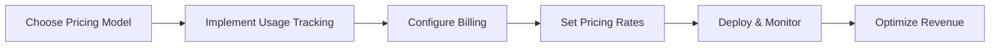

# Monetizing AI Solutions on Formation

Welcome to Formation's monetization guide! This section provides everything you need to understand, implement, and optimize revenue generation from your AI agents and models on the Formation decentralized network.

## What is Formation Monetization?

Formation's monetization system enables developers to:

- **Earn Revenue Automatically**: Generate income from AI agent tasks and model inference requests
- **Flexible Pricing Models**: Choose from multiple pricing strategies that fit your solution
- **Usage-Based Billing**: Automatic tracking and billing based on actual resource consumption
- **Global Market Access**: Reach users worldwide through Formation's decentralized marketplace

## Monetization Overview

Formation's monetization system operates on a transparent, usage-based model:

```
┌─────────────────────────────────────────┐
│         Formation Monetization          │
├─────────────────────────────────────────┤
│  Revenue Streams                        │
│  ├── Agent Task Execution               │
│  ├── Model Inference Requests           │
│  ├── Specialized Services               │
│  └── Premium Features                   │
├─────────────────────────────────────────┤
│  Pricing Models                         │
│  ├── Per-Token Pricing                  │
│  ├── Per-Request Pricing                │
│  ├── Time-Based Pricing                 │
│  └── Subscription Tiers                 │
├─────────────────────────────────────────┤
│  Billing & Payments                     │
│  ├── Automatic Usage Tracking           │
│  ├── Real-Time Revenue Monitoring       │
│  ├── Transparent Fee Structure          │
│  └── Automated Payouts                  │
└─────────────────────────────────────────┘
```

## Quick Start

### 1. Choose Your Revenue Model

Formation supports multiple monetization approaches:

- **💰 Usage-Based**: Charge per token, request, or compute unit consumed
- **⏱️ Time-Based**: Charge per minute or hour of service usage
- **📦 Subscription**: Offer tiered access with monthly/yearly billing
- **🎯 Value-Based**: Premium pricing for specialized or high-quality services
- **🔄 Hybrid**: Combine multiple models for optimal revenue

### 2. Implementation Path



### 3. Time to Revenue

- **Basic Setup**: 30 minutes - 1 hour
- **Advanced Pricing**: 1-2 hours
- **Custom Billing Logic**: 2-4 hours

## Documentation Structure

### 📊 [Pricing Models](pricing-models.md)
**Essential Reading** - Comprehensive pricing strategies and implementation
- Token-based pricing configuration
- Fixed-rate pricing options
- Subscription tier integration
- Dynamic pricing strategies

### 💳 [Billing Integration](billing-integration.md)
**Technical Implementation** - Usage tracking and payment processing
- Usage tracking implementation
- Revenue sharing configuration
- Payment processing integration
- Billing API reference

## Core Monetization Concepts

### Revenue Streams

Formation provides multiple ways to generate revenue:

#### 1. Agent Task Revenue
```python
# Example: Task-based pricing
{
    "task_id": "task_12345",
    "pricing": {
        "model": "per_task",
        "base_rate": 0.10,  # $0.10 per task
        "complexity_multiplier": 1.5,  # 50% more for complex tasks
        "total_cost": 0.15
    },
    "usage_metrics": {
        "compute_units": 2.5,
        "duration_seconds": 45,
        "tokens_processed": 1200
    }
}
```

#### 2. Model Inference Revenue
```python
# Example: Token-based pricing
{
    "inference_id": "inf_67890",
    "pricing": {
        "model": "per_token",
        "input_rate": 0.001,   # $0.001 per input token
        "output_rate": 0.002,  # $0.002 per output token
        "total_cost": 0.35
    },
    "usage_metrics": {
        "prompt_tokens": 150,
        "completion_tokens": 100,
        "total_tokens": 250
    }
}
```

#### 3. Specialized Service Revenue
```python
# Example: Value-based pricing
{
    "service_id": "svc_analysis",
    "pricing": {
        "model": "value_based",
        "service_type": "financial_analysis",
        "base_rate": 5.00,  # $5.00 per analysis
        "premium_features": 2.00,  # Additional features
        "total_cost": 7.00
    }
}
```

### Pricing Models Deep Dive

#### 1. Per-Token Pricing
**Best for**: Language models, text processing agents
```python
class TokenBasedPricing:
    def __init__(self, input_rate=0.001, output_rate=0.002):
        self.input_rate = input_rate    # $ per input token
        self.output_rate = output_rate  # $ per output token
    
    def calculate_cost(self, prompt_tokens, completion_tokens):
        input_cost = prompt_tokens * self.input_rate
        output_cost = completion_tokens * self.output_rate
        return input_cost + output_cost
    
    def get_usage_metrics(self, request, response):
        return {
            "prompt_tokens": len(request.split()),
            "completion_tokens": len(response.split()),
            "input_cost": len(request.split()) * self.input_rate,
            "output_cost": len(response.split()) * self.output_rate
        }
```

#### 2. Per-Request Pricing
**Best for**: Image generation, specialized analysis, fixed-cost services
```python
class RequestBasedPricing:
    def __init__(self, base_rate=0.50, complexity_tiers=None):
        self.base_rate = base_rate
        self.complexity_tiers = complexity_tiers or {
            "simple": 1.0,
            "medium": 1.5,
            "complex": 2.0
        }
    
    def calculate_cost(self, request_complexity="simple"):
        multiplier = self.complexity_tiers.get(request_complexity, 1.0)
        return self.base_rate * multiplier
    
    def get_usage_metrics(self, request_data):
        complexity = self.assess_complexity(request_data)
        return {
            "request_complexity": complexity,
            "base_rate": self.base_rate,
            "multiplier": self.complexity_tiers[complexity],
            "total_cost": self.calculate_cost(complexity)
        }
```

#### 3. Time-Based Pricing
**Best for**: Long-running tasks, real-time services, streaming
```python
class TimeBasedPricing:
    def __init__(self, rate_per_minute=0.10):
        self.rate_per_minute = rate_per_minute
    
    def calculate_cost(self, duration_seconds):
        duration_minutes = duration_seconds / 60.0
        return duration_minutes * self.rate_per_minute
    
    def get_usage_metrics(self, start_time, end_time):
        duration_seconds = end_time - start_time
        return {
            "duration_seconds": duration_seconds,
            "duration_minutes": duration_seconds / 60.0,
            "rate_per_minute": self.rate_per_minute,
            "total_cost": self.calculate_cost(duration_seconds)
        }
```

#### 4. Subscription Pricing
**Best for**: Regular users, enterprise clients, predictable usage
```python
class SubscriptionPricing:
    def __init__(self):
        self.tiers = {
            "basic": {
                "monthly_cost": 29.99,
                "included_tokens": 100000,
                "overage_rate": 0.002
            },
            "pro": {
                "monthly_cost": 99.99,
                "included_tokens": 500000,
                "overage_rate": 0.0015
            },
            "enterprise": {
                "monthly_cost": 299.99,
                "included_tokens": 2000000,
                "overage_rate": 0.001
            }
        }
    
    def calculate_monthly_cost(self, tier, tokens_used):
        tier_config = self.tiers[tier]
        base_cost = tier_config["monthly_cost"]
        
        if tokens_used <= tier_config["included_tokens"]:
            return base_cost
        
        overage_tokens = tokens_used - tier_config["included_tokens"]
        overage_cost = overage_tokens * tier_config["overage_rate"]
        
        return base_cost + overage_cost
```

## Revenue Optimization Strategies

### 1. Dynamic Pricing
```python
class DynamicPricing:
    def __init__(self):
        self.base_rates = {"default": 0.001}
        self.demand_multipliers = {
            "low": 0.8,     # 20% discount during low demand
            "normal": 1.0,   # Standard pricing
            "high": 1.3,     # 30% premium during high demand
            "peak": 1.5      # 50% premium during peak hours
        }
    
    def get_current_rate(self, service_type="default"):
        base_rate = self.base_rates[service_type]
        demand_level = self.assess_current_demand()
        multiplier = self.demand_multipliers[demand_level]
        
        return base_rate * multiplier
    
    def assess_current_demand(self):
        # Implement demand assessment logic
        # Could be based on queue length, time of day, etc.
        pass
```

### 2. Quality-Based Pricing
```python
class QualityBasedPricing:
    def __init__(self):
        self.quality_tiers = {
            "standard": {"rate": 0.001, "sla": "best_effort"},
            "premium": {"rate": 0.0015, "sla": "99.9%_uptime"},
            "enterprise": {"rate": 0.002, "sla": "99.99%_uptime"}
        }
    
    def calculate_cost(self, tokens, quality_tier="standard"):
        tier_config = self.quality_tiers[quality_tier]
        return tokens * tier_config["rate"]
```

### 3. Bundle Pricing
```python
class BundlePricing:
    def __init__(self):
        self.bundles = {
            "ai_suite": {
                "services": ["text_generation", "image_analysis", "summarization"],
                "discount": 0.15,  # 15% discount for bundle
                "monthly_fee": 49.99
            },
            "enterprise_ai": {
                "services": ["all_services"],
                "discount": 0.25,  # 25% discount
                "monthly_fee": 199.99,
                "priority_support": True
            }
        }
    
    def calculate_bundle_savings(self, usage_data, bundle_type):
        bundle = self.bundles[bundle_type]
        individual_cost = sum(usage_data.values())
        bundle_cost = individual_cost * (1 - bundle["discount"]) + bundle["monthly_fee"]
        
        return max(0, individual_cost - bundle_cost)
```

## Implementation Examples

### 1. Agent Monetization Integration
```python
# Formation agent with monetization
from flask import Flask, request, jsonify
import time

app = Flask(__name__)

class MonetizedAgent:
    def __init__(self):
        self.pricing = TokenBasedPricing(input_rate=0.001, output_rate=0.002)
    
    @app.route('/run_task', methods=['POST'])
    def run_task(self):
        task_data = request.json
        start_time = time.time()
        
        # Process the task
        result = self.process_task(task_data["parameters"]["prompt"])
        
        end_time = time.time()
        
        # Calculate usage metrics and cost
        usage_metrics = self.pricing.get_usage_metrics(
            task_data["parameters"]["prompt"], 
            result
        )
        usage_metrics.update({
            "duration_seconds": end_time - start_time,
            "compute_units": self.calculate_compute_units(task_data)
        })
        
        return jsonify({
            "task_id": task_data["task_id"],
            "status": "completed",
            "result": {"output": result},
            "usage_metrics": usage_metrics,
            "billing": {
                "cost_usd": usage_metrics["input_cost"] + usage_metrics["output_cost"],
                "pricing_model": "per_token"
            }
        })
```

### 2. Model Monetization Integration
```python
# Formation model with monetization
from flask import Flask, request, jsonify

app = Flask(__name__)

class MonetizedModel:
    def __init__(self):
        self.pricing = RequestBasedPricing(base_rate=0.05)
    
    @app.route('/v1/chat/completions', methods=['POST'])
    def chat_completions(self):
        data = request.json
        
        # Generate response
        response = self.generate_response(data["messages"])
        
        # Calculate usage and cost
        usage_metrics = {
            "prompt_tokens": sum(len(msg["content"].split()) for msg in data["messages"]),
            "completion_tokens": len(response.split()),
            "total_tokens": sum(len(msg["content"].split()) for msg in data["messages"]) + len(response.split())
        }
        
        cost = self.pricing.calculate_cost("medium")  # Assess complexity
        
        return jsonify({
            "choices": [{
                "message": {
                    "role": "assistant",
                    "content": response
                }
            }],
            "usage": usage_metrics,
            "billing": {
                "cost_usd": cost,
                "pricing_model": "per_request"
            }
        })
```

## Revenue Analytics and Monitoring

### Key Metrics to Track
```python
class RevenueAnalytics:
    def __init__(self):
        self.metrics = {
            "total_revenue": 0.0,
            "requests_served": 0,
            "average_revenue_per_request": 0.0,
            "top_revenue_services": [],
            "customer_lifetime_value": {},
            "churn_rate": 0.0
        }
    
    def track_request(self, request_data, revenue):
        self.metrics["total_revenue"] += revenue
        self.metrics["requests_served"] += 1
        self.metrics["average_revenue_per_request"] = (
            self.metrics["total_revenue"] / self.metrics["requests_served"]
        )
    
    def get_revenue_report(self, period="daily"):
        return {
            "period": period,
            "total_revenue": self.metrics["total_revenue"],
            "request_volume": self.metrics["requests_served"],
            "average_revenue_per_request": self.metrics["average_revenue_per_request"],
            "growth_rate": self.calculate_growth_rate(period)
        }
```

## Best Practices

### Pricing Strategy
- **Start Conservative**: Begin with competitive pricing and adjust based on demand
- **Value-Based Pricing**: Price based on the value you provide, not just costs
- **Market Research**: Study competitor pricing and positioning
- **A/B Testing**: Test different pricing models with different user segments

### Customer Experience
- **Transparent Pricing**: Make costs clear and predictable
- **Usage Dashboards**: Provide real-time usage and cost visibility
- **Billing Alerts**: Notify users before they hit spending limits
- **Flexible Plans**: Offer multiple options to suit different needs

### Revenue Optimization
- **Monitor Metrics**: Track revenue per user, churn rate, and lifetime value
- **Optimize Performance**: Faster services can command premium pricing
- **Upselling**: Offer premium features and higher-tier services
- **Customer Retention**: Focus on keeping existing customers happy

## Getting Started Checklist

Ready to monetize your Formation solution? Follow this checklist:

- [ ] **Read [Pricing Models](pricing-models.md)** - Choose your pricing strategy
- [ ] **Implement Usage Tracking** - Add metrics collection to your service
- [ ] **Configure Billing** - Set up pricing rates and billing logic
- [ ] **Test Pricing Logic** - Verify calculations work correctly
- [ ] **Set Up Analytics** - Implement revenue tracking and reporting
- [ ] **Deploy with Monitoring** - Launch with real-time monitoring
- [ ] **Optimize Based on Data** - Adjust pricing based on actual usage
- [ ] **Scale Revenue Streams** - Expand to additional monetization models

## Support and Resources

### Documentation
- **[Pricing Models](pricing-models.md)**: Detailed pricing strategies and implementation
- **[Billing Integration](billing-integration.md)**: Technical billing and payment processing

### Tools and APIs
- **Formation Billing API**: Automated usage tracking and billing
- **Analytics Dashboard**: Revenue monitoring and optimization tools
- **Payment Processing**: Integrated payment handling and payouts

### Community
- **Revenue Optimization**: Share strategies with other developers
- **Pricing Discussions**: Learn from successful monetization cases
- **Market Insights**: Stay updated on pricing trends and opportunities

## Next Steps

Choose your monetization path:

### 💰 **Start Simple**
Begin with **[Pricing Models](pricing-models.md)** for basic per-token or per-request pricing

### 📊 **Advanced Strategy**
Explore **[Billing Integration](billing-integration.md)** for sophisticated billing logic

### 🚀 **Scale Revenue**
Implement multiple pricing models and optimize based on analytics

### 🎯 **Enterprise Focus**
Develop subscription tiers and value-based pricing for enterprise customers

---

**Ready to turn your AI innovation into sustainable revenue?** Let's build your monetization strategy! 