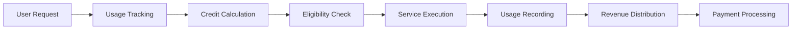
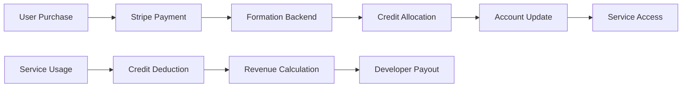

# Billing Integration for Formation AI Solutions

This guide provides comprehensive technical implementation details for integrating billing and payment processing into your AI agents and models on the Formation network.

## Billing Integration Overview

Formation's billing system provides automatic usage tracking, credit management, and revenue distribution:



### Key Components

- **Usage Tracking**: Automatic measurement of tokens, requests, and compute time
- **Credit System**: Formation's internal currency for billing (1 credit = $0.01)
- **Eligibility Enforcement**: Real-time checking of user quotas and credits
- **Revenue Sharing**: Automatic distribution between developers and Formation
- **Payment Processing**: Integrated Stripe-based payment handling

---

## 1. Usage Tracking Implementation

### 1.1 Formation's Built-in Usage Tracking

Formation automatically tracks usage for all agents and models through the billing middleware:

```rust
// Formation's usage tracking structure (from form-state)
pub struct UsageMetrics {
    pub prompt_tokens: u64,
    pub completion_tokens: u64,
    pub total_tokens: u64,
    pub duration_ms: u64,
    pub billable_duration_ms: u64,
    pub request_count: u64,
}
```

### 1.2 Agent Usage Tracking Integration

#### Basic Usage Reporting

```python
# Python agent with Formation usage tracking
from flask import Flask, request, jsonify
import time
import json

app = Flask(__name__)

class FormationUsageTracker:
    def __init__(self):
        self.session_start = None
        self.token_count = 0
    
    def start_session(self):
        """Start tracking a new session"""
        self.session_start = time.time()
        self.token_count = 0
    
    def track_tokens(self, prompt_tokens, completion_tokens):
        """Track token usage"""
        self.token_count += prompt_tokens + completion_tokens
        return {
            "prompt_tokens": prompt_tokens,
            "completion_tokens": completion_tokens,
            "total_tokens": prompt_tokens + completion_tokens
        }
    
    def end_session(self):
        """End session and calculate final metrics"""
        if self.session_start is None:
            return None
        
        duration_ms = int((time.time() - self.session_start) * 1000)
        
        return {
            "prompt_tokens": self.token_count // 2,  # Estimate
            "completion_tokens": self.token_count // 2,  # Estimate
            "total_tokens": self.token_count,
            "duration_ms": duration_ms,
            "billable_duration_ms": max(duration_ms, 1000),  # Minimum 1 second
            "request_count": 1
        }

# Usage in agent endpoints
tracker = FormationUsageTracker()

@app.route('/run_task', methods=['POST'])
def run_task():
    data = request.json
    tracker.start_session()
    
    try:
        # Process the task
        prompt = data["parameters"]["prompt"]
        response = generate_response(prompt)
        
        # Track token usage
        prompt_tokens = len(prompt.split())  # Simple tokenization
        completion_tokens = len(response.split())
        token_metrics = tracker.track_tokens(prompt_tokens, completion_tokens)
        
        # End session and get final metrics
        usage_metrics = tracker.end_session()
        
        return jsonify({
            "task_id": data["task_id"],
            "status": "completed",
            "result": {"output": response},
            "usage_metrics": usage_metrics
        })
    
    except Exception as e:
        # Still report usage even on error
        usage_metrics = tracker.end_session()
        return jsonify({
            "task_id": data["task_id"],
            "status": "error",
            "error": str(e),
            "usage_metrics": usage_metrics
        }), 500
```

#### Advanced Token Counting

```python
# More accurate token counting using tiktoken
import tiktoken

class AccurateTokenTracker:
    def __init__(self, model_name="gpt-3.5-turbo"):
        try:
            self.encoding = tiktoken.encoding_for_model(model_name)
        except KeyError:
            # Fallback to cl100k_base encoding
            self.encoding = tiktoken.get_encoding("cl100k_base")
    
    def count_tokens(self, text):
        """Count tokens accurately using tiktoken"""
        return len(self.encoding.encode(text))
    
    def count_message_tokens(self, messages):
        """Count tokens for chat completion messages"""
        total_tokens = 0
        
        for message in messages:
            # Add tokens for message structure
            total_tokens += 4  # Every message has role, content, name, function_call
            
            for key, value in message.items():
                if isinstance(value, str):
                    total_tokens += self.count_tokens(value)
        
        total_tokens += 2  # Every reply is primed with assistant
        return total_tokens
    
    def get_usage_metrics(self, messages, response_text):
        """Get comprehensive usage metrics"""
        prompt_tokens = self.count_message_tokens(messages)
        completion_tokens = self.count_tokens(response_text)
        
        return {
            "prompt_tokens": prompt_tokens,
            "completion_tokens": completion_tokens,
            "total_tokens": prompt_tokens + completion_tokens,
            "model": "accurate_count"
        }

# Usage in model endpoints
token_tracker = AccurateTokenTracker()

@app.route('/v1/chat/completions', methods=['POST'])
def chat_completions():
    data = request.json
    start_time = time.time()
    
    # Generate response
    response_text = generate_chat_response(data["messages"])
    
    # Calculate accurate usage metrics
    usage_metrics = token_tracker.get_usage_metrics(
        data["messages"], 
        response_text
    )
    
    # Add timing information
    duration_ms = int((time.time() - start_time) * 1000)
    usage_metrics.update({
        "duration_ms": duration_ms,
        "billable_duration_ms": duration_ms
    })
    
    return jsonify({
        "choices": [{
            "message": {
                "role": "assistant",
                "content": response_text
            },
            "finish_reason": "stop"
        }],
        "usage": usage_metrics,
        "model": data.get("model", "default")
    })
```

### 1.3 Model Usage Tracking Integration

#### OpenAI-Compatible Usage Reporting

```python
# Model with Formation-compatible usage tracking
class FormationModelWrapper:
    def __init__(self, model, pricing_config):
        self.model = model
        self.pricing = pricing_config
        self.token_tracker = AccurateTokenTracker()
    
    def generate_completion(self, messages, **kwargs):
        """Generate completion with usage tracking"""
        start_time = time.time()
        
        # Generate response using your model
        response = self.model.generate(messages, **kwargs)
        
        # Calculate usage metrics
        usage_metrics = self.token_tracker.get_usage_metrics(messages, response)
        
        # Add timing and cost information
        duration_ms = int((time.time() - start_time) * 1000)
        cost_credits = self.pricing.calculate_credits(
            usage_metrics["prompt_tokens"],
            usage_metrics["completion_tokens"]
        )
        
        usage_metrics.update({
            "duration_ms": duration_ms,
            "billable_duration_ms": duration_ms,
            "cost_credits": cost_credits,
            "cost_usd": cost_credits * 0.01
        })
        
        return {
            "response": response,
            "usage": usage_metrics
        }
    
    def stream_completion(self, messages, **kwargs):
        """Stream completion with usage tracking"""
        start_time = time.time()
        accumulated_response = ""
        
        for chunk in self.model.stream_generate(messages, **kwargs):
            accumulated_response += chunk
            yield {
                "choices": [{
                    "delta": {"content": chunk},
                    "finish_reason": None
                }]
            }
        
        # Final usage calculation
        usage_metrics = self.token_tracker.get_usage_metrics(messages, accumulated_response)
        duration_ms = int((time.time() - start_time) * 1000)
        cost_credits = self.pricing.calculate_credits(
            usage_metrics["prompt_tokens"],
            usage_metrics["completion_tokens"]
        )
        
        usage_metrics.update({
            "duration_ms": duration_ms,
            "billable_duration_ms": duration_ms,
            "cost_credits": cost_credits
        })
        
        # Send final chunk with usage
        yield {
            "choices": [{
                "delta": {},
                "finish_reason": "stop"
            }],
            "usage": usage_metrics
        }
```

---

## 2. Credit System Integration

### 2.1 Understanding Formation Credits

Formation uses a credit-based billing system where:
- **1 credit = $0.01 USD**
- Credits are deducted in real-time during service usage
- Users can purchase credits or use subscription allocations
- Developers earn credits based on usage of their services

### 2.2 Credit Calculation Implementation

```python
class FormationCreditCalculator:
    def __init__(self):
        # Default pricing (can be overridden per agent/model)
        self.default_rates = {
            "input_tokens_per_1k": 1.0,    # 1 credit per 1K input tokens
            "output_tokens_per_1k": 1.5,   # 1.5 credits per 1K output tokens
            "per_request": 0,              # No base request fee by default
            "per_minute": 0                # No time-based fee by default
        }
    
    def calculate_token_credits(self, input_tokens, output_tokens, custom_rates=None):
        """Calculate credits for token usage"""
        rates = custom_rates or self.default_rates
        
        input_credits = (input_tokens / 1000.0) * rates["input_tokens_per_1k"]
        output_credits = (output_tokens / 1000.0) * rates["output_tokens_per_1k"]
        
        return {
            "input_credits": int(input_credits),
            "output_credits": int(output_credits),
            "total_credits": int(input_credits + output_credits)
        }
    
    def calculate_request_credits(self, complexity="standard", custom_rates=None):
        """Calculate credits for request-based pricing"""
        rates = custom_rates or self.default_rates
        base_credits = rates["per_request"]
        
        complexity_multipliers = {
            "simple": 0.5,
            "standard": 1.0,
            "complex": 2.0,
            "premium": 3.0
        }
        
        multiplier = complexity_multipliers.get(complexity, 1.0)
        return int(base_credits * multiplier)
    
    def calculate_time_credits(self, duration_minutes, custom_rates=None):
        """Calculate credits for time-based pricing"""
        rates = custom_rates or self.default_rates
        return int(duration_minutes * rates["per_minute"])
    
    def calculate_total_credits(self, usage_metrics, pricing_config):
        """Calculate total credits for comprehensive usage"""
        total_credits = 0
        
        # Token-based credits
        if usage_metrics.get("prompt_tokens") or usage_metrics.get("completion_tokens"):
            token_credits = self.calculate_token_credits(
                usage_metrics.get("prompt_tokens", 0),
                usage_metrics.get("completion_tokens", 0),
                pricing_config
            )
            total_credits += token_credits["total_credits"]
        
        # Request-based credits
        if pricing_config.get("per_request", 0) > 0:
            request_credits = self.calculate_request_credits(
                usage_metrics.get("complexity", "standard"),
                pricing_config
            )
            total_credits += request_credits
        
        # Time-based credits
        if pricing_config.get("per_minute", 0) > 0 and usage_metrics.get("duration_ms"):
            duration_minutes = usage_metrics["duration_ms"] / 60000.0
            time_credits = self.calculate_time_credits(duration_minutes, pricing_config)
            total_credits += time_credits
        
        # Ensure minimum charge
        minimum_credits = pricing_config.get("minimum_credits", 1)
        return max(total_credits, minimum_credits)

# Usage in your service
credit_calculator = FormationCreditCalculator()

def process_request_with_billing(request_data, usage_metrics, pricing_config):
    """Process request and calculate billing"""
    
    # Calculate credits required
    credits_required = credit_calculator.calculate_total_credits(
        usage_metrics, 
        pricing_config
    )
    
    return {
        "usage_metrics": usage_metrics,
        "billing": {
            "credits_required": credits_required,
            "cost_usd": credits_required * 0.01,
            "pricing_breakdown": {
                "token_cost": usage_metrics.get("token_credits", 0),
                "request_cost": pricing_config.get("per_request", 0),
                "time_cost": usage_metrics.get("time_credits", 0)
            }
        }
    }
```

### 2.3 Real-Time Credit Checking

```python
class FormationCreditChecker:
    def __init__(self, formation_api_client):
        self.api_client = formation_api_client
    
    def check_user_eligibility(self, user_address, estimated_credits):
        """Check if user has sufficient credits for operation"""
        try:
            # Query Formation API for user account
            account_info = self.api_client.get_account(user_address)
            
            # Check subscription benefits
            if account_info.get("subscription"):
                subscription = account_info["subscription"]
                
                # Check if within subscription limits
                if self.is_within_subscription_limits(account_info, estimated_credits):
                    return {
                        "eligible": True,
                        "reason": "subscription_covered",
                        "remaining_quota": self.get_remaining_quota(account_info)
                    }
            
            # Check pay-as-you-go credits
            available_credits = account_info.get("available_credits", 0)
            if available_credits >= estimated_credits:
                return {
                    "eligible": True,
                    "reason": "sufficient_credits",
                    "available_credits": available_credits,
                    "cost": estimated_credits
                }
            
            return {
                "eligible": False,
                "reason": "insufficient_credits",
                "available_credits": available_credits,
                "required_credits": estimated_credits,
                "shortfall": estimated_credits - available_credits
            }
            
        except Exception as e:
            return {
                "eligible": False,
                "reason": "api_error",
                "error": str(e)
            }
    
    def is_within_subscription_limits(self, account_info, estimated_credits):
        """Check if request is within subscription limits"""
        subscription = account_info.get("subscription", {})
        usage = account_info.get("usage", {})
        
        # Check token limits
        if subscription.get("daily_token_limit"):
            daily_usage = usage.get("daily_tokens", 0)
            estimated_tokens = estimated_credits * 1000  # Rough estimate
            
            if daily_usage + estimated_tokens > subscription["daily_token_limit"]:
                return False
        
        # Check credit allocation
        period_credits_used = usage.get("current_period_credits_used", 0)
        period_credits_limit = subscription.get("inference_credits_per_period", 0)
        
        if period_credits_used + estimated_credits <= period_credits_limit:
            return True
        
        return False
    
    def get_remaining_quota(self, account_info):
        """Get remaining quota information"""
        subscription = account_info.get("subscription", {})
        usage = account_info.get("usage", {})
        
        remaining = {}
        
        # Remaining credits in current period
        period_credits_used = usage.get("current_period_credits_used", 0)
        period_credits_limit = subscription.get("inference_credits_per_period", 0)
        remaining["credits"] = max(0, period_credits_limit - period_credits_used)
        
        # Remaining daily tokens
        if subscription.get("daily_token_limit"):
            daily_usage = usage.get("daily_tokens", 0)
            remaining["daily_tokens"] = max(0, subscription["daily_token_limit"] - daily_usage)
        
        return remaining
```

---

## 3. Revenue Sharing Configuration

### 3.1 Formation Revenue Sharing Model

Formation implements automatic revenue sharing between developers and the platform:

```python
class FormationRevenueSharing:
    def __init__(self):
        # Default revenue sharing rates
        self.default_sharing = {
            "developer_percentage": 70,    # Developer gets 70%
            "formation_percentage": 30,    # Formation gets 30%
            "minimum_payout": 1000         # Minimum 1000 credits ($10) for payout
        }
    
    def calculate_revenue_split(self, total_credits, custom_rates=None):
        """Calculate revenue split between developer and Formation"""
        rates = custom_rates or self.default_sharing
        
        developer_credits = int(total_credits * rates["developer_percentage"] / 100)
        formation_credits = total_credits - developer_credits
        
        return {
            "total_credits": total_credits,
            "developer_credits": developer_credits,
            "formation_credits": formation_credits,
            "developer_usd": developer_credits * 0.01,
            "formation_usd": formation_credits * 0.01,
            "split_percentage": {
                "developer": rates["developer_percentage"],
                "formation": rates["formation_percentage"]
            }
        }
    
    def track_developer_earnings(self, developer_id, credits_earned):
        """Track earnings for a developer"""
        # This would integrate with Formation's accounting system
        return {
            "developer_id": developer_id,
            "credits_earned": credits_earned,
            "usd_earned": credits_earned * 0.01,
            "timestamp": time.time(),
            "payout_eligible": credits_earned >= self.default_sharing["minimum_payout"]
        }

# Usage in agent/model registration
revenue_sharing = FormationRevenueSharing()

def register_service_with_revenue_sharing(service_config):
    """Register service with custom revenue sharing"""
    
    # Custom revenue sharing for premium services
    if service_config.get("tier") == "premium":
        custom_rates = {
            "developer_percentage": 80,  # Premium services get higher share
            "formation_percentage": 20,
            "minimum_payout": 500
        }
    else:
        custom_rates = None
    
    service_config["revenue_sharing"] = custom_rates
    
    return service_config
```

### 3.2 Agent Revenue Sharing Implementation

```python
# Agent metadata with revenue sharing configuration
agent_metadata = {
    "agent_id": "my-premium-agent",
    "pricing": {
        "cost_per_1k_input_tokens": "2.0",
        "cost_per_1k_output_tokens": "3.0",
        "minimum_credits": "1"
    },
    "revenue_sharing": {
        "developer_percentage": 75,
        "formation_percentage": 25,
        "royalty_recipients": [
            {
                "address": "0x1234...",  # Developer address
                "percentage": 70
            },
            {
                "address": "0x5678...",  # Collaborator address
                "percentage": 5
            }
        ]
    },
    "usage_tracking": {
        "track_tokens": True,
        "track_requests": True,
        "enable_royalties": True,
        "custom_metrics": ["quality_score", "user_satisfaction"]
    }
}
```

### 3.3 Model Revenue Sharing Implementation

```python
# Model registration with revenue sharing
model_registration = {
    "model_id": "my-custom-llm",
    "price_per_1m_tokens": 1500,  # 1500 credits per 1M tokens
    "usage_tracking": {
        "track_tokens": True,
        "track_requests": True,
        "enable_royalties": True,
        "royalty_percentage": 15,  # 15% to original model creator
        "custom_metrics": ["inference_speed", "accuracy_score"]
    },
    "revenue_distribution": {
        "model_developer": 60,     # 60% to model developer
        "base_model_creator": 15,  # 15% to base model creator
        "formation_platform": 25   # 25% to Formation
    }
}
```

---

## 4. Payment Processing Integration

### 4.1 Formation Payment Flow

Formation handles payment processing through Stripe integration:



### 4.2 Credit Purchase Integration

```python
class FormationPaymentIntegration:
    def __init__(self, stripe_client, formation_api):
        self.stripe = stripe_client
        self.formation_api = formation_api
    
    def create_credit_purchase_session(self, user_address, credit_amount):
        """Create Stripe checkout session for credit purchase"""
        
        # Calculate USD amount (1 credit = $0.01)
        usd_amount = credit_amount * 0.01
        stripe_amount = int(usd_amount * 100)  # Stripe uses cents
        
        try:
            session = self.stripe.checkout.Session.create(
                payment_method_types=['card'],
                line_items=[{
                    'price_data': {
                        'currency': 'usd',
                        'product_data': {
                            'name': f'Formation Credits ({credit_amount} credits)',
                            'description': f'Credits for Formation AI services'
                        },
                        'unit_amount': stripe_amount,
                    },
                    'quantity': 1,
                }],
                mode='payment',
                success_url='https://formation.ai/payment/success?session_id={CHECKOUT_SESSION_ID}',
                cancel_url='https://formation.ai/payment/cancel',
                metadata={
                    'user_address': user_address,
                    'credit_amount': str(credit_amount),
                    'purchase_type': 'credits'
                }
            )
            
            return {
                "success": True,
                "checkout_url": session.url,
                "session_id": session.id
            }
            
        except Exception as e:
            return {
                "success": False,
                "error": str(e)
            }
    
    def handle_payment_success(self, session_id):
        """Handle successful payment and allocate credits"""
        
        try:
            # Retrieve session from Stripe
            session = self.stripe.checkout.Session.retrieve(session_id)
            
            if session.payment_status == 'paid':
                user_address = session.metadata['user_address']
                credit_amount = int(session.metadata['credit_amount'])
                
                # Allocate credits to user account
                result = self.formation_api.add_credits(user_address, credit_amount)
                
                if result["success"]:
                    return {
                        "success": True,
                        "credits_added": credit_amount,
                        "new_balance": result["new_balance"]
                    }
                else:
                    # Payment succeeded but credit allocation failed
                    # This should trigger a manual review
                    return {
                        "success": False,
                        "error": "Credit allocation failed",
                        "requires_manual_review": True,
                        "session_id": session_id
                    }
            
            return {
                "success": False,
                "error": "Payment not completed"
            }
            
        except Exception as e:
            return {
                "success": False,
                "error": str(e)
            }
```

### 4.3 Subscription Management Integration

```python
class FormationSubscriptionManager:
    def __init__(self, stripe_client, formation_api):
        self.stripe = stripe_client
        self.formation_api = formation_api
        
        # Formation subscription products in Stripe
        self.subscription_products = {
            "pro": "price_1234567890",
            "pro_plus": "price_0987654321",
            "power": "price_1122334455",
            "power_plus": "price_5544332211"
        }
    
    def create_subscription(self, user_address, tier, payment_method_id):
        """Create a new subscription for a user"""
        
        try:
            # Create or retrieve Stripe customer
            customer = self.get_or_create_customer(user_address)
            
            # Attach payment method to customer
            self.stripe.PaymentMethod.attach(
                payment_method_id,
                customer=customer.id
            )
            
            # Set as default payment method
            self.stripe.Customer.modify(
                customer.id,
                invoice_settings={'default_payment_method': payment_method_id}
            )
            
            # Create subscription
            subscription = self.stripe.Subscription.create(
                customer=customer.id,
                items=[{
                    'price': self.subscription_products[tier]
                }],
                metadata={
                    'user_address': user_address,
                    'formation_tier': tier
                }
            )
            
            # Update Formation account with subscription info
            self.formation_api.update_subscription(
                user_address,
                {
                    "stripe_customer_id": customer.id,
                    "stripe_subscription_id": subscription.id,
                    "tier": tier,
                    "status": subscription.status
                }
            )
            
            return {
                "success": True,
                "subscription_id": subscription.id,
                "status": subscription.status
            }
            
        except Exception as e:
            return {
                "success": False,
                "error": str(e)
            }
    
    def get_or_create_customer(self, user_address):
        """Get existing Stripe customer or create new one"""
        
        # Try to find existing customer
        customers = self.stripe.Customer.list(
            email=f"{user_address}@formation.ai",  # Use address as email
            limit=1
        )
        
        if customers.data:
            return customers.data[0]
        
        # Create new customer
        return self.stripe.Customer.create(
            email=f"{user_address}@formation.ai",
            metadata={'formation_address': user_address}
        )
    
    def handle_subscription_webhook(self, event):
        """Handle Stripe subscription webhooks"""
        
        if event['type'] == 'customer.subscription.updated':
            subscription = event['data']['object']
            user_address = subscription['metadata']['user_address']
            
            # Update Formation account
            self.formation_api.update_subscription(
                user_address,
                {
                    "status": subscription['status'],
                    "current_period_start": subscription['current_period_start'],
                    "current_period_end": subscription['current_period_end']
                }
            )
        
        elif event['type'] == 'customer.subscription.deleted':
            subscription = event['data']['object']
            user_address = subscription['metadata']['user_address']
            
            # Cancel subscription in Formation
            self.formation_api.cancel_subscription(user_address)
        
        elif event['type'] == 'invoice.payment_failed':
            invoice = event['data']['object']
            subscription_id = invoice['subscription']
            
            # Handle failed payment
            self.formation_api.handle_payment_failure(subscription_id)
```

---

## 5. Advanced Billing Features

### 5.1 Usage-Based Billing with Stripe

```python
class FormationUsageBilling:
    def __init__(self, stripe_client):
        self.stripe = stripe_client
    
    def report_usage_to_stripe(self, subscription_item_id, usage_quantity, timestamp=None):
        """Report usage to Stripe for metered billing"""
        
        try:
            usage_record = self.stripe.UsageRecord.create(
                subscription_item=subscription_item_id,
                quantity=usage_quantity,
                timestamp=timestamp or int(time.time()),
                action='increment'
            )
            
            return {
                "success": True,
                "usage_record_id": usage_record.id,
                "quantity": usage_quantity
            }
            
        except Exception as e:
            return {
                "success": False,
                "error": str(e)
            }
    
    def batch_report_usage(self, usage_records):
        """Report multiple usage records in batch"""
        
        results = []
        
        for record in usage_records:
            result = self.report_usage_to_stripe(
                record["subscription_item_id"],
                record["quantity"],
                record.get("timestamp")
            )
            results.append(result)
        
        return {
            "total_records": len(usage_records),
            "successful": len([r for r in results if r["success"]]),
            "failed": len([r for r in results if not r["success"]]),
            "results": results
        }
```

### 5.2 Custom Billing Cycles

```python
class FormationBillingCycles:
    def __init__(self):
        self.billing_periods = {
            "daily": 1,
            "weekly": 7,
            "monthly": 30,
            "quarterly": 90,
            "annual": 365
        }
    
    def calculate_prorated_usage(self, usage_start, usage_end, billing_period_start, billing_period_end):
        """Calculate prorated usage for partial billing periods"""
        
        # Ensure usage is within billing period
        actual_start = max(usage_start, billing_period_start)
        actual_end = min(usage_end, billing_period_end)
        
        if actual_start >= actual_end:
            return 0.0
        
        # Calculate proration factor
        usage_duration = actual_end - actual_start
        billing_duration = billing_period_end - billing_period_start
        
        proration_factor = usage_duration / billing_duration
        
        return proration_factor
    
    def generate_billing_summary(self, user_address, period_start, period_end):
        """Generate comprehensive billing summary for a period"""
        
        # This would query Formation's usage database
        usage_data = self.get_usage_data(user_address, period_start, period_end)
        
        summary = {
            "user_address": user_address,
            "billing_period": {
                "start": period_start,
                "end": period_end,
                "duration_days": (period_end - period_start) / 86400
            },
            "usage_summary": {
                "total_tokens": usage_data.get("total_tokens", 0),
                "total_requests": usage_data.get("total_requests", 0),
                "total_duration_minutes": usage_data.get("total_duration_ms", 0) / 60000,
                "unique_services_used": len(usage_data.get("services", []))
            },
            "cost_breakdown": self.calculate_cost_breakdown(usage_data),
            "payment_summary": self.calculate_payment_summary(usage_data)
        }
        
        return summary
    
    def calculate_cost_breakdown(self, usage_data):
        """Calculate detailed cost breakdown"""
        
        breakdown = {
            "subscription_cost": 0.0,
            "overage_cost": 0.0,
            "pay_as_you_go_cost": 0.0,
            "total_cost": 0.0
        }
        
        # Calculate costs based on usage data
        for service_usage in usage_data.get("services", []):
            service_cost = self.calculate_service_cost(service_usage)
            
            if service_usage.get("covered_by_subscription"):
                breakdown["subscription_cost"] += service_cost["subscription_portion"]
                breakdown["overage_cost"] += service_cost["overage_portion"]
            else:
                breakdown["pay_as_you_go_cost"] += service_cost["total_cost"]
        
        breakdown["total_cost"] = (
            breakdown["subscription_cost"] + 
            breakdown["overage_cost"] + 
            breakdown["pay_as_you_go_cost"]
        )
        
        return breakdown
```

---

## 6. Billing API Reference

### 6.1 Formation Billing API Endpoints

```python
# Formation Billing API client
class FormationBillingAPI:
    def __init__(self, api_base_url, api_key):
        self.base_url = api_base_url
        self.api_key = api_key
        self.session = requests.Session()
        self.session.headers.update({
            'Authorization': f'Bearer {api_key}',
            'Content-Type': 'application/json'
        })
    
    def get_account_balance(self, user_address):
        """Get current account balance and usage"""
        response = self.session.get(f"{self.base_url}/accounts/{user_address}/balance")
        return response.json()
    
    def add_credits(self, user_address, credit_amount, transaction_id=None):
        """Add credits to user account"""
        data = {
            "credit_amount": credit_amount,
            "transaction_id": transaction_id,
            "source": "stripe_payment"
        }
        response = self.session.post(f"{self.base_url}/accounts/{user_address}/credits", json=data)
        return response.json()
    
    def deduct_credits(self, user_address, credit_amount, service_id, usage_details):
        """Deduct credits for service usage"""
        data = {
            "credit_amount": credit_amount,
            "service_id": service_id,
            "usage_details": usage_details,
            "timestamp": int(time.time())
        }
        response = self.session.post(f"{self.base_url}/accounts/{user_address}/deduct", json=data)
        return response.json()
    
    def get_usage_history(self, user_address, start_date=None, end_date=None):
        """Get usage history for an account"""
        params = {}
        if start_date:
            params['start_date'] = start_date
        if end_date:
            params['end_date'] = end_date
        
        response = self.session.get(f"{self.base_url}/accounts/{user_address}/usage", params=params)
        return response.json()
    
    def update_subscription(self, user_address, subscription_data):
        """Update subscription information"""
        response = self.session.put(f"{self.base_url}/accounts/{user_address}/subscription", json=subscription_data)
        return response.json()
    
    def get_developer_earnings(self, developer_address, period=None):
        """Get earnings for a developer"""
        params = {}
        if period:
            params['period'] = period
        
        response = self.session.get(f"{self.base_url}/developers/{developer_address}/earnings", params=params)
        return response.json()
    
    def request_payout(self, developer_address, amount=None):
        """Request payout of accumulated earnings"""
        data = {}
        if amount:
            data['amount'] = amount
        
        response = self.session.post(f"{self.base_url}/developers/{developer_address}/payout", json=data)
        return response.json()
```

### 6.2 Usage Recording API

```python
# Usage recording for agents and models
class FormationUsageRecorder:
    def __init__(self, billing_api):
        self.billing_api = billing_api
    
    def record_agent_usage(self, user_address, agent_id, usage_metrics):
        """Record usage for an agent"""
        
        usage_details = {
            "service_type": "agent",
            "service_id": agent_id,
            "metrics": usage_metrics,
            "timestamp": int(time.time())
        }
        
        # Calculate credits based on usage
        credits_required = self.calculate_agent_credits(usage_metrics)
        
        return self.billing_api.deduct_credits(
            user_address,
            credits_required,
            agent_id,
            usage_details
        )
    
    def record_model_usage(self, user_address, model_id, usage_metrics):
        """Record usage for a model"""
        
        usage_details = {
            "service_type": "model",
            "service_id": model_id,
            "metrics": usage_metrics,
            "timestamp": int(time.time())
        }
        
        # Calculate credits based on token usage
        credits_required = self.calculate_model_credits(usage_metrics)
        
        return self.billing_api.deduct_credits(
            user_address,
            credits_required,
            model_id,
            usage_details
        )
    
    def calculate_agent_credits(self, usage_metrics):
        """Calculate credits for agent usage"""
        # Implementation based on agent pricing model
        base_credits = 1  # Minimum charge
        
        # Token-based calculation
        if usage_metrics.get("total_tokens"):
            token_credits = (usage_metrics["total_tokens"] / 1000) * 1.5
            base_credits += int(token_credits)
        
        # Time-based calculation
        if usage_metrics.get("duration_ms"):
            duration_minutes = usage_metrics["duration_ms"] / 60000
            time_credits = duration_minutes * 0.1
            base_credits += int(time_credits)
        
        return max(base_credits, 1)
    
    def calculate_model_credits(self, usage_metrics):
        """Calculate credits for model usage"""
        input_tokens = usage_metrics.get("prompt_tokens", 0)
        output_tokens = usage_metrics.get("completion_tokens", 0)
        
        # Standard rates: 1 credit per 1K input tokens, 1.5 credits per 1K output tokens
        input_credits = (input_tokens / 1000) * 1.0
        output_credits = (output_tokens / 1000) * 1.5
        
        total_credits = int(input_credits + output_credits)
        return max(total_credits, 1)  # Minimum 1 credit
```

---

## 7. Testing and Validation

### 7.1 Billing Integration Testing

```python
import unittest
from unittest.mock import Mock, patch

class TestFormationBilling(unittest.TestCase):
    def setUp(self):
        self.billing_api = Mock()
        self.usage_recorder = FormationUsageRecorder(self.billing_api)
        self.credit_calculator = FormationCreditCalculator()
    
    def test_credit_calculation_tokens(self):
        """Test credit calculation for token usage"""
        usage_metrics = {
            "prompt_tokens": 1000,
            "completion_tokens": 500,
            "total_tokens": 1500
        }
        
        credits = self.credit_calculator.calculate_token_credits(
            usage_metrics["prompt_tokens"],
            usage_metrics["completion_tokens"]
        )
        
        # Expected: (1000/1000 * 1.0) + (500/1000 * 1.5) = 1.0 + 0.75 = 1.75 ≈ 2 credits
        self.assertEqual(credits["total_credits"], 2)
    
    def test_minimum_credit_enforcement(self):
        """Test minimum credit charge"""
        usage_metrics = {
            "prompt_tokens": 1,
            "completion_tokens": 1,
            "total_tokens": 2
        }
        
        credits = self.usage_recorder.calculate_model_credits(usage_metrics)
        self.assertGreaterEqual(credits, 1)  # Should enforce minimum
    
    def test_subscription_eligibility_check(self):
        """Test subscription eligibility checking"""
        account_info = {
            "subscription": {
                "tier": "pro",
                "inference_credits_per_period": 500,
                "daily_token_limit": 500000
            },
            "usage": {
                "current_period_credits_used": 100,
                "daily_tokens": 50000
            }
        }
        
        checker = FormationCreditChecker(Mock())
        
        # Mock the account info response
        checker.api_client.get_account.return_value = account_info
        
        result = checker.check_user_eligibility("0x123", 50)
        
        self.assertTrue(result["eligible"])
        self.assertEqual(result["reason"], "subscription_covered")
    
    def test_revenue_sharing_calculation(self):
        """Test revenue sharing calculations"""
        revenue_sharing = FormationRevenueSharing()
        
        split = revenue_sharing.calculate_revenue_split(1000)  # 1000 credits
        
        self.assertEqual(split["developer_credits"], 700)  # 70%
        self.assertEqual(split["formation_credits"], 300)   # 30%
        self.assertEqual(split["total_credits"], 1000)
    
    @patch('stripe.checkout.Session.create')
    def test_credit_purchase_session(self, mock_stripe_create):
        """Test Stripe checkout session creation"""
        mock_stripe_create.return_value = Mock(
            id="cs_test_123",
            url="https://checkout.stripe.com/pay/cs_test_123"
        )
        
        payment_integration = FormationPaymentIntegration(Mock(), Mock())
        
        result = payment_integration.create_credit_purchase_session("0x123", 1000)
        
        self.assertTrue(result["success"])
        self.assertIn("checkout_url", result)
        
        # Verify Stripe was called with correct parameters
        mock_stripe_create.assert_called_once()
        call_args = mock_stripe_create.call_args[1]
        self.assertEqual(call_args["line_items"][0]["price_data"]["unit_amount"], 1000)  # $10.00 in cents

if __name__ == '__main__':
    unittest.main()
```

### 7.2 Load Testing Billing System

```python
import asyncio
import aiohttp
import time
from concurrent.futures import ThreadPoolExecutor

class BillingLoadTester:
    def __init__(self, api_base_url, num_concurrent_users=100):
        self.api_base_url = api_base_url
        self.num_concurrent_users = num_concurrent_users
        self.results = []
    
    async def simulate_user_session(self, session, user_id):
        """Simulate a user session with multiple requests"""
        
        user_address = f"0x{user_id:040x}"
        
        try:
            # Check account balance
            start_time = time.time()
            async with session.get(f"{self.api_base_url}/accounts/{user_address}/balance") as response:
                balance_response = await response.json()
                balance_time = time.time() - start_time
            
            # Simulate service usage
            usage_data = {
                "credit_amount": 5,
                "service_id": "test-agent",
                "usage_details": {
                    "prompt_tokens": 100,
                    "completion_tokens": 50,
                    "duration_ms": 2000
                }
            }
            
            start_time = time.time()
            async with session.post(f"{self.api_base_url}/accounts/{user_address}/deduct", json=usage_data) as response:
                deduct_response = await response.json()
                deduct_time = time.time() - start_time
            
            return {
                "user_id": user_id,
                "balance_check_time": balance_time,
                "deduct_time": deduct_time,
                "balance_success": response.status == 200,
                "deduct_success": response.status == 200
            }
            
        except Exception as e:
            return {
                "user_id": user_id,
                "error": str(e),
                "balance_success": False,
                "deduct_success": False
            }
    
    async def run_load_test(self, duration_seconds=60):
        """Run load test for specified duration"""
        
        async with aiohttp.ClientSession() as session:
            start_time = time.time()
            tasks = []
            
            while time.time() - start_time < duration_seconds:
                # Create batch of concurrent users
                batch_tasks = [
                    self.simulate_user_session(session, i)
                    for i in range(self.num_concurrent_users)
                ]
                
                # Execute batch
                batch_results = await asyncio.gather(*batch_tasks, return_exceptions=True)
                self.results.extend(batch_results)
                
                # Small delay between batches
                await asyncio.sleep(1)
        
        return self.analyze_results()
    
    def analyze_results(self):
        """Analyze load test results"""
        
        successful_balance_checks = len([r for r in self.results if r.get("balance_success")])
        successful_deductions = len([r for r in self.results if r.get("deduct_success")])
        total_requests = len(self.results)
        
        balance_times = [r["balance_check_time"] for r in self.results if "balance_check_time" in r]
        deduct_times = [r["deduct_time"] for r in self.results if "deduct_time" in r]
        
        return {
            "total_requests": total_requests,
            "successful_balance_checks": successful_balance_checks,
            "successful_deductions": successful_deductions,
            "success_rate": (successful_balance_checks + successful_deductions) / (total_requests * 2) * 100,
            "average_balance_check_time": sum(balance_times) / len(balance_times) if balance_times else 0,
            "average_deduct_time": sum(deduct_times) / len(deduct_times) if deduct_times else 0,
            "errors": [r for r in self.results if "error" in r]
        }

# Run load test
async def main():
    tester = BillingLoadTester("http://localhost:3004", num_concurrent_users=50)
    results = await tester.run_load_test(duration_seconds=30)
    
    print("Load Test Results:")
    print(f"Total Requests: {results['total_requests']}")
    print(f"Success Rate: {results['success_rate']:.2f}%")
    print(f"Average Balance Check Time: {results['average_balance_check_time']:.3f}s")
    print(f"Average Deduct Time: {results['average_deduct_time']:.3f}s")
    print(f"Errors: {len(results['errors'])}")

if __name__ == "__main__":
    asyncio.run(main())
```

---

## 8. Deployment and Monitoring

### 8.1 Billing Integration Deployment Checklist

- [ ] **Usage Tracking Implemented**: Accurate measurement of all billable activities
- [ ] **Credit Calculation Verified**: Correct pricing calculations for all service types
- [ ] **Eligibility Checking Active**: Real-time validation of user credits and quotas
- [ ] **Revenue Sharing Configured**: Proper distribution of earnings
- [ ] **Payment Integration Tested**: Stripe integration working correctly
- [ ] **Error Handling Implemented**: Graceful handling of billing failures
- [ ] **Monitoring Setup**: Comprehensive monitoring of billing operations
- [ ] **Security Validated**: Secure handling of payment and billing data

### 8.2 Billing Monitoring and Alerting

```python
class BillingMonitor:
    def __init__(self, alert_thresholds):
        self.thresholds = alert_thresholds
        self.metrics = {
            "total_revenue_today": 0.0,
            "failed_transactions": 0,
            "average_transaction_time": 0.0,
            "credit_purchase_failures": 0,
            "subscription_failures": 0
        }
    
    def check_billing_health(self, current_metrics):
        """Monitor billing system health"""
        alerts = []
        
        # Revenue monitoring
        if current_metrics["revenue_today"] < self.thresholds["min_daily_revenue"]:
            alerts.append({
                "type": "low_revenue",
                "severity": "warning",
                "message": f"Daily revenue ({current_metrics['revenue_today']}) below threshold"
            })
        
        # Transaction failure rate
        failure_rate = current_metrics["failed_transactions"] / max(current_metrics["total_transactions"], 1)
        if failure_rate > self.thresholds["max_failure_rate"]:
            alerts.append({
                "type": "high_failure_rate",
                "severity": "critical",
                "message": f"Transaction failure rate ({failure_rate:.2%}) above threshold"
            })
        
        # Transaction performance
        if current_metrics["avg_transaction_time"] > self.thresholds["max_transaction_time"]:
            alerts.append({
                "type": "slow_transactions",
                "severity": "warning",
                "message": f"Average transaction time ({current_metrics['avg_transaction_time']:.2f}s) above threshold"
            })
        
        # Credit purchase monitoring
        if current_metrics["credit_purchase_failures"] > self.thresholds["max_credit_failures"]:
            alerts.append({
                "type": "credit_purchase_issues",
                "severity": "critical",
                "message": f"Credit purchase failures ({current_metrics['credit_purchase_failures']}) above threshold"
            })
        
        return alerts
    
    def generate_billing_report(self, period="daily"):
        """Generate comprehensive billing report"""
        
        # This would query actual billing data
        report = {
            "period": period,
            "revenue_summary": {
                "total_revenue": self.metrics["total_revenue_today"],
                "developer_earnings": self.metrics["total_revenue_today"] * 0.7,
                "formation_revenue": self.metrics["total_revenue_today"] * 0.3,
                "transaction_count": 1000,  # Example
                "unique_users": 250  # Example
            },
            "performance_metrics": {
                "average_transaction_time": self.metrics["average_transaction_time"],
                "success_rate": 99.5,  # Example
                "uptime": 99.9  # Example
            },
            "top_services": [
                {"service_id": "gpt-4-agent", "revenue": 150.00, "usage_count": 500},
                {"service_id": "image-gen-model", "revenue": 120.00, "usage_count": 300},
                {"service_id": "code-assistant", "revenue": 100.00, "usage_count": 400}
            ]
        }
        
        return report
```

---

## Next Steps

### Integration Roadmap

1. **📊 Implement Usage Tracking**: Start with basic token and request counting
2. **💳 Add Credit System**: Integrate Formation's credit-based billing
3. **🔍 Enable Eligibility Checking**: Implement real-time quota validation
4. **💰 Configure Revenue Sharing**: Set up automatic earnings distribution
5. **🚀 Deploy and Monitor**: Launch with comprehensive monitoring

### Advanced Features

Ready for advanced billing features? Explore:

- **Custom Pricing Models**: Implement sophisticated pricing strategies
- **Enterprise Billing**: Set up custom contracts and billing cycles
- **Analytics Dashboard**: Build comprehensive revenue analytics
- **Automated Payouts**: Implement automatic developer payments

---

**Ready to monetize your AI services?** Start with basic usage tracking and scale up to full billing integration! 💰 