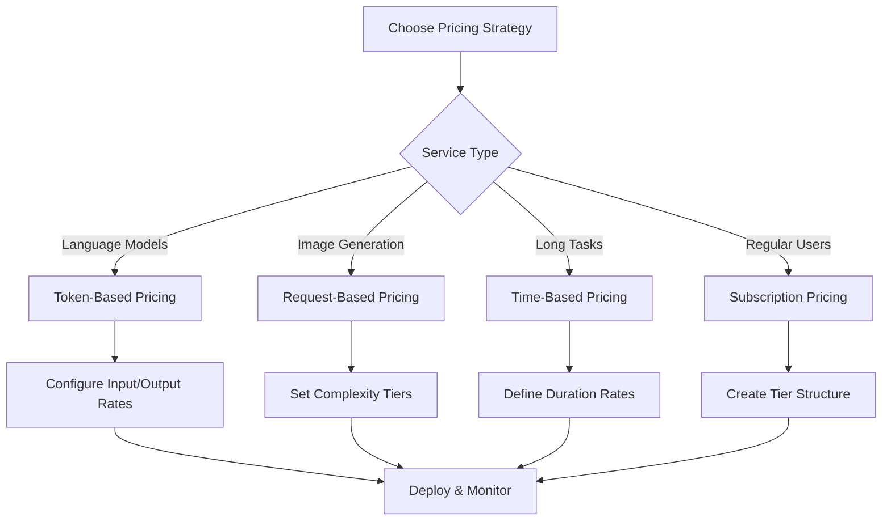

# Pricing Models for Formation AI Solutions

This guide provides comprehensive strategies for pricing your AI agents and models on the Formation network. Choose the right pricing model to maximize revenue while providing value to your users.

## Pricing Model Overview

Formation supports multiple pricing strategies that can be combined for optimal revenue generation:



### Supported Pricing Models

| Model | Best For | Revenue Predictability | Implementation Complexity |
|-------|----------|------------------------|---------------------------|
| **Token-Based** | Language models, text processing | Medium | Low |
| **Request-Based** | Image generation, analysis tasks | High | Low |
| **Time-Based** | Long-running tasks, streaming | Low | Medium |
| **Subscription** | Regular users, enterprise | High | High |
| **Hybrid** | Complex services | Medium | High |

---

## 1. Token-Based Pricing

**Best for**: Language models, text processing agents, chat completions

Token-based pricing charges users based on the number of input and output tokens processed. This is the most common pricing model for language models.

### 1.1 Basic Token Pricing Configuration

#### Agent Metadata Configuration

```json
{
  "agent_id": "my-language-agent",
  "metadata": {
    "cost_per_1k_input_tokens": "1.0",
    "cost_per_1k_output_tokens": "1.5",
    "pricing_model": "token_based",
    "currency": "credits"
  }
}
```

#### Model Registration with Token Pricing

```json
{
  "model_id": "my-llm-model",
  "price_per_1m_tokens": 1000,
  "usage_tracking": {
    "track_tokens": true,
    "track_requests": true,
    "enable_royalties": true,
    "royalty_percentage": 10
  }
}
```

### 1.2 Implementation Example

#### Python Implementation

```python
class TokenBasedPricing:
    def __init__(self, input_rate=0.001, output_rate=0.002):
        """
        Initialize token-based pricing
        
        Args:
            input_rate: Cost per input token in USD
            output_rate: Cost per output token in USD
        """
        self.input_rate = input_rate
        self.output_rate = output_rate
    
    def calculate_cost(self, prompt_tokens, completion_tokens):
        """Calculate total cost for token usage"""
        input_cost = prompt_tokens * self.input_rate
        output_cost = completion_tokens * self.output_rate
        return input_cost + output_cost
    
    def calculate_credits(self, prompt_tokens, completion_tokens):
        """Calculate cost in Formation credits (1 credit = $0.01)"""
        usd_cost = self.calculate_cost(prompt_tokens, completion_tokens)
        return int(usd_cost * 100)  # Convert to credits
    
    def get_usage_metrics(self, request_text, response_text):
        """Generate usage metrics for billing"""
        # Simple tokenization (use proper tokenizer in production)
        prompt_tokens = len(request_text.split())
        completion_tokens = len(response_text.split())
        
        return {
            "prompt_tokens": prompt_tokens,
            "completion_tokens": completion_tokens,
            "total_tokens": prompt_tokens + completion_tokens,
            "input_cost_usd": prompt_tokens * self.input_rate,
            "output_cost_usd": completion_tokens * self.output_rate,
            "total_cost_usd": self.calculate_cost(prompt_tokens, completion_tokens),
            "total_cost_credits": self.calculate_credits(prompt_tokens, completion_tokens)
        }

# Usage in your agent
pricing = TokenBasedPricing(input_rate=0.001, output_rate=0.002)

@app.route('/run_task', methods=['POST'])
def run_task():
    data = request.json
    prompt = data["parameters"]["prompt"]
    
    # Process the task
    response = generate_response(prompt)
    
    # Calculate usage and cost
    usage_metrics = pricing.get_usage_metrics(prompt, response)
    
    return jsonify({
        "task_id": data["task_id"],
        "status": "completed",
        "result": {"output": response},
        "usage_metrics": usage_metrics
    })
```

#### Rust Implementation (Formation Native)

```rust
use serde::{Deserialize, Serialize};

#[derive(Debug, Clone, Serialize, Deserialize)]
pub struct TokenPricingConfig {
    pub input_rate_per_1k: f64,
    pub output_rate_per_1k: f64,
    pub minimum_charge: u64,
}

impl TokenPricingConfig {
    pub fn new(input_rate: f64, output_rate: f64) -> Self {
        Self {
            input_rate_per_1k: input_rate,
            output_rate_per_1k: output_rate,
            minimum_charge: 1, // Minimum 1 credit
        }
    }
    
    pub fn calculate_credits(&self, input_tokens: u64, output_tokens: u64) -> u64 {
        let input_cost = (input_tokens as f64 / 1000.0) * self.input_rate_per_1k;
        let output_cost = (output_tokens as f64 / 1000.0) * self.output_rate_per_1k;
        let total_cost = (input_cost + output_cost).ceil() as u64;
        
        std::cmp::max(total_cost, self.minimum_charge)
    }
}

// Usage in agent metadata
let pricing = TokenPricingConfig::new(1.0, 1.5);
let cost = pricing.calculate_credits(150, 100); // 150 input, 100 output tokens
```

### 1.3 Advanced Token Pricing Strategies

#### Tiered Token Pricing

```python
class TieredTokenPricing:
    def __init__(self):
        self.tiers = {
            "basic": {"input": 0.0005, "output": 0.001},
            "standard": {"input": 0.001, "output": 0.002},
            "premium": {"input": 0.002, "output": 0.004},
            "enterprise": {"input": 0.003, "output": 0.006}
        }
    
    def calculate_cost(self, prompt_tokens, completion_tokens, tier="standard"):
        rates = self.tiers[tier]
        input_cost = prompt_tokens * rates["input"]
        output_cost = completion_tokens * rates["output"]
        return input_cost + output_cost
    
    def get_tier_for_user(self, user_subscription):
        """Determine pricing tier based on user subscription"""
        if user_subscription == "enterprise":
            return "enterprise"
        elif user_subscription in ["pro", "pro_plus"]:
            return "premium"
        elif user_subscription == "basic":
            return "standard"
        else:
            return "basic"
```

#### Volume-Based Discounts

```python
class VolumeDiscountPricing:
    def __init__(self, base_input_rate=0.001, base_output_rate=0.002):
        self.base_input_rate = base_input_rate
        self.base_output_rate = base_output_rate
        self.volume_discounts = {
            100000: 0.05,   # 5% discount for 100K+ tokens
            500000: 0.10,   # 10% discount for 500K+ tokens
            1000000: 0.15,  # 15% discount for 1M+ tokens
            5000000: 0.20,  # 20% discount for 5M+ tokens
        }
    
    def get_discount_rate(self, monthly_token_usage):
        """Calculate discount based on monthly usage"""
        for threshold, discount in sorted(self.volume_discounts.items(), reverse=True):
            if monthly_token_usage >= threshold:
                return discount
        return 0.0
    
    def calculate_cost(self, prompt_tokens, completion_tokens, monthly_usage=0):
        discount = self.get_discount_rate(monthly_usage)
        
        input_rate = self.base_input_rate * (1 - discount)
        output_rate = self.base_output_rate * (1 - discount)
        
        input_cost = prompt_tokens * input_rate
        output_cost = completion_tokens * output_rate
        
        return {
            "input_cost": input_cost,
            "output_cost": output_cost,
            "total_cost": input_cost + output_cost,
            "discount_applied": discount,
            "savings": (prompt_tokens * self.base_input_rate + completion_tokens * self.base_output_rate) - (input_cost + output_cost)
        }
```

---

## 2. Request-Based Pricing

**Best for**: Image generation, document analysis, fixed-complexity tasks

Request-based pricing charges a fixed amount per request, often with complexity tiers.

### 2.1 Basic Request Pricing Configuration

#### Agent Metadata Configuration

```json
{
  "agent_id": "image-generator",
  "metadata": {
    "cost_per_call": "50",
    "pricing_model": "per_request",
    "complexity_tiers": "simple:25,standard:50,complex:100",
    "currency": "credits"
  }
}
```

### 2.2 Implementation Example

```python
class RequestBasedPricing:
    def __init__(self, base_rate=0.50):
        self.base_rate = base_rate
        self.complexity_tiers = {
            "simple": 1.0,
            "standard": 1.5,
            "complex": 2.0,
            "premium": 3.0
        }
    
    def assess_complexity(self, request_data):
        """Assess request complexity based on parameters"""
        # Example complexity assessment
        if "high_resolution" in request_data.get("parameters", {}):
            return "complex"
        elif "custom_style" in request_data.get("parameters", {}):
            return "standard"
        else:
            return "simple"
    
    def calculate_cost(self, request_complexity="standard"):
        multiplier = self.complexity_tiers.get(request_complexity, 1.0)
        return self.base_rate * multiplier
    
    def get_usage_metrics(self, request_data):
        complexity = self.assess_complexity(request_data)
        cost = self.calculate_cost(complexity)
        
        return {
            "request_complexity": complexity,
            "base_rate": self.base_rate,
            "complexity_multiplier": self.complexity_tiers[complexity],
            "total_cost_usd": cost,
            "total_cost_credits": int(cost * 100)
        }

# Usage in your agent
pricing = RequestBasedPricing(base_rate=0.25)

@app.route('/run_task', methods=['POST'])
def run_task():
    data = request.json
    
    # Process the task
    result = process_image_generation(data["parameters"])
    
    # Calculate usage and cost
    usage_metrics = pricing.get_usage_metrics(data)
    
    return jsonify({
        "task_id": data["task_id"],
        "status": "completed",
        "result": result,
        "usage_metrics": usage_metrics
    })
```

### 2.3 Advanced Request Pricing

#### Quality-Based Pricing

```python
class QualityBasedPricing:
    def __init__(self):
        self.quality_tiers = {
            "draft": {"rate": 0.10, "sla": "best_effort"},
            "standard": {"rate": 0.25, "sla": "99%_uptime"},
            "premium": {"rate": 0.50, "sla": "99.9%_uptime"},
            "enterprise": {"rate": 1.00, "sla": "99.99%_uptime"}
        }
    
    def calculate_cost(self, quality_tier="standard", additional_features=None):
        base_cost = self.quality_tiers[quality_tier]["rate"]
        
        # Add cost for additional features
        feature_costs = {
            "priority_processing": 0.10,
            "custom_model": 0.25,
            "dedicated_resources": 0.50
        }
        
        additional_cost = 0
        if additional_features:
            for feature in additional_features:
                additional_cost += feature_costs.get(feature, 0)
        
        return base_cost + additional_cost
```

---

## 3. Time-Based Pricing

**Best for**: Long-running tasks, streaming services, real-time processing

Time-based pricing charges based on the duration of service usage.

### 3.1 Basic Time Pricing Configuration

#### Agent Metadata Configuration

```json
{
  "agent_id": "streaming-processor",
  "metadata": {
    "cost_per_minute": "10",
    "pricing_model": "time_based",
    "minimum_duration": "1",
    "currency": "credits"
  }
}
```

### 3.2 Implementation Example

```python
class TimeBasedPricing:
    def __init__(self, rate_per_minute=0.10, minimum_duration=60):
        self.rate_per_minute = rate_per_minute
        self.minimum_duration = minimum_duration  # seconds
    
    def calculate_cost(self, duration_seconds):
        # Apply minimum duration
        billable_duration = max(duration_seconds, self.minimum_duration)
        duration_minutes = billable_duration / 60.0
        return duration_minutes * self.rate_per_minute
    
    def get_usage_metrics(self, start_time, end_time):
        duration_seconds = end_time - start_time
        cost = self.calculate_cost(duration_seconds)
        
        return {
            "duration_seconds": duration_seconds,
            "billable_duration_seconds": max(duration_seconds, self.minimum_duration),
            "duration_minutes": duration_seconds / 60.0,
            "rate_per_minute": self.rate_per_minute,
            "total_cost_usd": cost,
            "total_cost_credits": int(cost * 100)
        }

# Usage in your agent
pricing = TimeBasedPricing(rate_per_minute=0.05)

@app.route('/run_task', methods=['POST'])
def run_task():
    data = request.json
    start_time = time.time()
    
    # Process the long-running task
    result = process_streaming_task(data["parameters"])
    
    end_time = time.time()
    
    # Calculate usage and cost
    usage_metrics = pricing.get_usage_metrics(start_time, end_time)
    
    return jsonify({
        "task_id": data["task_id"],
        "status": "completed",
        "result": result,
        "usage_metrics": usage_metrics
    })
```

### 3.3 Advanced Time Pricing

#### Peak Hours Pricing

```python
class PeakHoursPricing:
    def __init__(self, base_rate=0.10):
        self.base_rate = base_rate
        self.peak_multipliers = {
            "off_peak": 0.8,    # 20% discount (midnight-6am)
            "normal": 1.0,      # Standard rate (6am-6pm)
            "peak": 1.5,        # 50% premium (6pm-midnight)
            "weekend": 0.9      # 10% discount (weekends)
        }
    
    def get_time_tier(self, timestamp):
        """Determine pricing tier based on time"""
        import datetime
        dt = datetime.datetime.fromtimestamp(timestamp)
        
        # Weekend discount
        if dt.weekday() >= 5:  # Saturday = 5, Sunday = 6
            return "weekend"
        
        hour = dt.hour
        if 0 <= hour < 6:
            return "off_peak"
        elif 18 <= hour < 24:
            return "peak"
        else:
            return "normal"
    
    def calculate_cost(self, duration_seconds, start_timestamp):
        time_tier = self.get_time_tier(start_timestamp)
        multiplier = self.peak_multipliers[time_tier]
        
        duration_minutes = duration_seconds / 60.0
        base_cost = duration_minutes * self.base_rate
        
        return {
            "base_cost": base_cost,
            "time_tier": time_tier,
            "multiplier": multiplier,
            "total_cost": base_cost * multiplier
        }
```

---

## 4. Subscription Pricing

**Best for**: Regular users, enterprise clients, predictable usage patterns

Subscription pricing provides users with included usage quotas and overage billing.

### 4.1 Formation Subscription Tiers

Formation provides built-in subscription tiers that you can leverage:

```rust
// Formation's built-in subscription tiers
pub enum SubscriptionTier {
    Free,        // 1 agent, 100 credits, 100K tokens/day
    Pro,         // 3 agents, 500 credits, 500K tokens/day
    ProPlus,     // 5 agents, 1000 credits, unlimited tokens
    Power,       // 10 agents, 5000 credits, unlimited tokens
    PowerPlus,   // 25 agents, 10000 credits, unlimited tokens
}
```

### 4.2 Subscription-Aware Pricing

```python
class SubscriptionAwarePricing:
    def __init__(self):
        self.subscription_benefits = {
            "free": {
                "included_tokens": 100000,
                "overage_rate": 0.002,
                "discount": 0.0
            },
            "pro": {
                "included_tokens": 500000,
                "overage_rate": 0.0015,
                "discount": 0.10
            },
            "pro_plus": {
                "included_tokens": 1000000,
                "overage_rate": 0.001,
                "discount": 0.15
            },
            "power": {
                "included_tokens": 5000000,
                "overage_rate": 0.0008,
                "discount": 0.20
            },
            "power_plus": {
                "included_tokens": 10000000,
                "overage_rate": 0.0005,
                "discount": 0.25
            }
        }
    
    def calculate_cost(self, tokens_used, subscription_tier, monthly_usage=0):
        benefits = self.subscription_benefits.get(subscription_tier, self.subscription_benefits["free"])
        
        # Check if within included quota
        if monthly_usage + tokens_used <= benefits["included_tokens"]:
            return {
                "cost": 0.0,
                "reason": "within_quota",
                "remaining_quota": benefits["included_tokens"] - monthly_usage - tokens_used
            }
        
        # Calculate overage
        overage_tokens = (monthly_usage + tokens_used) - benefits["included_tokens"]
        overage_cost = overage_tokens * benefits["overage_rate"]
        
        return {
            "cost": overage_cost,
            "reason": "overage",
            "overage_tokens": overage_tokens,
            "overage_rate": benefits["overage_rate"]
        }
    
    def get_pricing_for_tier(self, subscription_tier):
        """Get pricing information for a subscription tier"""
        return self.subscription_benefits.get(subscription_tier, self.subscription_benefits["free"])
```

### 4.3 Custom Subscription Tiers

```python
class CustomSubscriptionPricing:
    def __init__(self):
        self.custom_tiers = {
            "startup": {
                "monthly_cost": 49.99,
                "included_requests": 1000,
                "overage_rate": 0.05,
                "features": ["basic_support", "api_access"]
            },
            "business": {
                "monthly_cost": 199.99,
                "included_requests": 5000,
                "overage_rate": 0.03,
                "features": ["priority_support", "api_access", "custom_models"]
            },
            "enterprise": {
                "monthly_cost": 999.99,
                "included_requests": 25000,
                "overage_rate": 0.02,
                "features": ["dedicated_support", "api_access", "custom_models", "sla_guarantee"]
            }
        }
    
    def calculate_monthly_cost(self, tier, requests_used):
        tier_config = self.custom_tiers[tier]
        base_cost = tier_config["monthly_cost"]
        
        if requests_used <= tier_config["included_requests"]:
            return {
                "base_cost": base_cost,
                "overage_cost": 0.0,
                "total_cost": base_cost,
                "requests_remaining": tier_config["included_requests"] - requests_used
            }
        
        overage_requests = requests_used - tier_config["included_requests"]
        overage_cost = overage_requests * tier_config["overage_rate"]
        
        return {
            "base_cost": base_cost,
            "overage_cost": overage_cost,
            "total_cost": base_cost + overage_cost,
            "overage_requests": overage_requests
        }
```

---

## 5. Dynamic Pricing Strategies

### 5.1 Demand-Based Pricing

```python
class DemandBasedPricing:
    def __init__(self, base_rate=0.001):
        self.base_rate = base_rate
        self.demand_multipliers = {
            "very_low": 0.7,    # 30% discount
            "low": 0.85,        # 15% discount
            "normal": 1.0,      # Standard pricing
            "high": 1.25,       # 25% premium
            "very_high": 1.5    # 50% premium
        }
    
    def assess_current_demand(self, queue_length, active_instances):
        """Assess current demand based on system metrics"""
        utilization = queue_length / max(active_instances, 1)
        
        if utilization < 0.2:
            return "very_low"
        elif utilization < 0.5:
            return "low"
        elif utilization < 0.8:
            return "normal"
        elif utilization < 1.2:
            return "high"
        else:
            return "very_high"
    
    def get_current_rate(self, queue_length=0, active_instances=1):
        demand_level = self.assess_current_demand(queue_length, active_instances)
        multiplier = self.demand_multipliers[demand_level]
        
        return {
            "base_rate": self.base_rate,
            "demand_level": demand_level,
            "multiplier": multiplier,
            "current_rate": self.base_rate * multiplier,
            "savings_or_premium": (multiplier - 1.0) * 100
        }
```

### 5.2 Performance-Based Pricing

```python
class PerformanceBasedPricing:
    def __init__(self, base_rate=0.001):
        self.base_rate = base_rate
        self.performance_tiers = {
            "economy": {"multiplier": 0.8, "sla": "best_effort"},
            "standard": {"multiplier": 1.0, "sla": "95%_availability"},
            "premium": {"multiplier": 1.3, "sla": "99%_availability"},
            "guaranteed": {"multiplier": 1.6, "sla": "99.9%_availability"}
        }
    
    def calculate_cost(self, tokens, performance_tier="standard"):
        tier_config = self.performance_tiers[performance_tier]
        rate = self.base_rate * tier_config["multiplier"]
        
        return {
            "tokens": tokens,
            "rate_per_token": rate,
            "total_cost": tokens * rate,
            "performance_tier": performance_tier,
            "sla": tier_config["sla"]
        }
```

---

## 6. Hybrid Pricing Models

### 6.1 Combined Token + Request Pricing

```python
class HybridPricing:
    def __init__(self):
        self.base_request_cost = 0.05  # Base cost per request
        self.token_rate = 0.0005       # Additional cost per token
        self.minimum_charge = 0.01     # Minimum charge per request
    
    def calculate_cost(self, tokens_used):
        request_cost = self.base_request_cost
        token_cost = tokens_used * self.token_rate
        total_cost = request_cost + token_cost
        
        return max(total_cost, self.minimum_charge)
    
    def get_usage_metrics(self, tokens_used):
        request_cost = self.base_request_cost
        token_cost = tokens_used * self.token_rate
        total_cost = self.calculate_cost(tokens_used)
        
        return {
            "tokens_used": tokens_used,
            "base_request_cost": request_cost,
            "token_cost": token_cost,
            "total_cost": total_cost,
            "cost_breakdown": {
                "request_portion": request_cost / total_cost,
                "token_portion": token_cost / total_cost
            }
        }
```

### 6.2 Freemium Model

```python
class FreemiumPricing:
    def __init__(self):
        self.free_tier_limits = {
            "daily_requests": 100,
            "monthly_tokens": 50000,
            "features": ["basic_models"]
        }
        self.premium_rates = {
            "per_request": 0.02,
            "per_token": 0.001,
            "premium_features": ["advanced_models", "priority_support"]
        }
    
    def calculate_cost(self, requests_today, tokens_this_month, is_premium_user=False):
        if not is_premium_user:
            # Free tier - check limits
            if (requests_today <= self.free_tier_limits["daily_requests"] and 
                tokens_this_month <= self.free_tier_limits["monthly_tokens"]):
                return {
                    "cost": 0.0,
                    "tier": "free",
                    "remaining_requests": self.free_tier_limits["daily_requests"] - requests_today,
                    "remaining_tokens": self.free_tier_limits["monthly_tokens"] - tokens_this_month
                }
            else:
                return {
                    "cost": "upgrade_required",
                    "tier": "free_limit_exceeded",
                    "message": "Please upgrade to continue using the service"
                }
        else:
            # Premium tier - pay per use
            cost = (requests_today * self.premium_rates["per_request"] + 
                   tokens_this_month * self.premium_rates["per_token"])
            return {
                "cost": cost,
                "tier": "premium",
                "features": self.premium_rates["premium_features"]
            }
```

---

## 7. Revenue Optimization Strategies

### 7.1 A/B Testing Pricing

```python
class PricingABTest:
    def __init__(self):
        self.test_variants = {
            "control": {"rate": 0.001, "description": "Current pricing"},
            "variant_a": {"rate": 0.0008, "description": "20% discount"},
            "variant_b": {"rate": 0.0012, "description": "20% premium"},
            "variant_c": {"rate": 0.0015, "description": "50% premium"}
        }
        self.user_assignments = {}  # user_id -> variant
    
    def assign_user_to_variant(self, user_id):
        """Assign user to a pricing variant"""
        import hashlib
        hash_value = int(hashlib.md5(user_id.encode()).hexdigest(), 16)
        variant_index = hash_value % len(self.test_variants)
        variant_names = list(self.test_variants.keys())
        
        assigned_variant = variant_names[variant_index]
        self.user_assignments[user_id] = assigned_variant
        return assigned_variant
    
    def get_rate_for_user(self, user_id):
        """Get pricing rate for a specific user"""
        if user_id not in self.user_assignments:
            self.assign_user_to_variant(user_id)
        
        variant = self.user_assignments[user_id]
        return self.test_variants[variant]["rate"]
```

### 7.2 Customer Lifetime Value Optimization

```python
class CLVOptimizedPricing:
    def __init__(self):
        self.customer_segments = {
            "new": {"discount": 0.2, "trial_period": 30},
            "regular": {"discount": 0.0, "loyalty_bonus": 0.05},
            "high_value": {"discount": 0.1, "priority_support": True},
            "enterprise": {"discount": 0.15, "custom_terms": True}
        }
    
    def classify_customer(self, usage_history, subscription_tier, total_spent):
        """Classify customer based on behavior"""
        if total_spent > 10000:
            return "enterprise"
        elif total_spent > 1000:
            return "high_value"
        elif len(usage_history) > 30:
            return "regular"
        else:
            return "new"
    
    def calculate_optimized_price(self, base_cost, customer_segment):
        """Calculate price optimized for customer lifetime value"""
        segment_config = self.customer_segments[customer_segment]
        discount = segment_config.get("discount", 0.0)
        
        optimized_price = base_cost * (1 - discount)
        
        return {
            "base_cost": base_cost,
            "customer_segment": customer_segment,
            "discount_applied": discount,
            "final_price": optimized_price,
            "additional_benefits": {k: v for k, v in segment_config.items() if k != "discount"}
        }
```

---

## 8. Implementation Best Practices

### 8.1 Pricing Configuration Management

```python
class PricingConfigManager:
    def __init__(self, config_file="pricing_config.json"):
        self.config_file = config_file
        self.config = self.load_config()
    
    def load_config(self):
        """Load pricing configuration from file"""
        try:
            with open(self.config_file, 'r') as f:
                return json.load(f)
        except FileNotFoundError:
            return self.get_default_config()
    
    def get_default_config(self):
        """Default pricing configuration"""
        return {
            "token_pricing": {
                "input_rate": 0.001,
                "output_rate": 0.002,
                "minimum_charge": 0.01
            },
            "request_pricing": {
                "base_rate": 0.25,
                "complexity_multipliers": {
                    "simple": 1.0,
                    "standard": 1.5,
                    "complex": 2.0
                }
            },
            "subscription_discounts": {
                "pro": 0.10,
                "enterprise": 0.20
            },
            "volume_discounts": {
                "100000": 0.05,
                "500000": 0.10,
                "1000000": 0.15
            }
        }
    
    def update_pricing(self, new_config):
        """Update pricing configuration"""
        self.config.update(new_config)
        self.save_config()
    
    def save_config(self):
        """Save configuration to file"""
        with open(self.config_file, 'w') as f:
            json.dump(self.config, f, indent=2)
```

### 8.2 Revenue Analytics

```python
class RevenueAnalytics:
    def __init__(self):
        self.metrics = {
            "total_revenue": 0.0,
            "requests_served": 0,
            "unique_users": set(),
            "revenue_by_model": {},
            "revenue_by_tier": {}
        }
    
    def track_transaction(self, user_id, model_id, revenue, subscription_tier):
        """Track a revenue transaction"""
        self.metrics["total_revenue"] += revenue
        self.metrics["requests_served"] += 1
        self.metrics["unique_users"].add(user_id)
        
        # Track by model
        if model_id not in self.metrics["revenue_by_model"]:
            self.metrics["revenue_by_model"][model_id] = 0
        self.metrics["revenue_by_model"][model_id] += revenue
        
        # Track by subscription tier
        if subscription_tier not in self.metrics["revenue_by_tier"]:
            self.metrics["revenue_by_tier"][subscription_tier] = 0
        self.metrics["revenue_by_tier"][subscription_tier] += revenue
    
    def get_analytics_report(self):
        """Generate analytics report"""
        return {
            "total_revenue": self.metrics["total_revenue"],
            "total_requests": self.metrics["requests_served"],
            "unique_users": len(self.metrics["unique_users"]),
            "average_revenue_per_request": (
                self.metrics["total_revenue"] / max(self.metrics["requests_served"], 1)
            ),
            "average_revenue_per_user": (
                self.metrics["total_revenue"] / max(len(self.metrics["unique_users"]), 1)
            ),
            "top_revenue_models": sorted(
                self.metrics["revenue_by_model"].items(),
                key=lambda x: x[1],
                reverse=True
            )[:5],
            "revenue_by_tier": self.metrics["revenue_by_tier"]
        }
```

---

## 9. Testing and Validation

### 9.1 Pricing Logic Testing

```python
import unittest

class TestPricingModels(unittest.TestCase):
    def setUp(self):
        self.token_pricing = TokenBasedPricing(input_rate=0.001, output_rate=0.002)
        self.request_pricing = RequestBasedPricing(base_rate=0.50)
    
    def test_token_pricing_calculation(self):
        """Test token-based pricing calculations"""
        cost = self.token_pricing.calculate_cost(1000, 500)  # 1000 input, 500 output
        expected_cost = (1000 * 0.001) + (500 * 0.002)  # 1.0 + 1.0 = 2.0
        self.assertEqual(cost, expected_cost)
    
    def test_request_pricing_complexity(self):
        """Test request-based pricing with complexity tiers"""
        simple_cost = self.request_pricing.calculate_cost("simple")
        complex_cost = self.request_pricing.calculate_cost("complex")
        
        self.assertEqual(simple_cost, 0.50)  # base rate * 1.0
        self.assertEqual(complex_cost, 1.00)  # base rate * 2.0
    
    def test_minimum_charges(self):
        """Test minimum charge enforcement"""
        # Very small usage should still incur minimum charge
        cost = self.token_pricing.calculate_cost(1, 1)  # 1 input, 1 output token
        self.assertGreaterEqual(cost, 0.01)  # Should have minimum charge

if __name__ == '__main__':
    unittest.main()
```

### 9.2 Revenue Simulation

```python
class RevenueSimulator:
    def __init__(self, pricing_model):
        self.pricing_model = pricing_model
        self.simulation_results = []
    
    def simulate_usage_patterns(self, days=30, users_per_day=100):
        """Simulate different usage patterns"""
        import random
        
        total_revenue = 0
        daily_revenues = []
        
        for day in range(days):
            daily_revenue = 0
            
            for user in range(users_per_day):
                # Simulate random usage
                tokens_used = random.randint(100, 5000)
                cost = self.pricing_model.calculate_cost(tokens_used, tokens_used // 2)
                daily_revenue += cost
            
            daily_revenues.append(daily_revenue)
            total_revenue += daily_revenue
        
        return {
            "total_revenue": total_revenue,
            "average_daily_revenue": total_revenue / days,
            "daily_revenues": daily_revenues,
            "projected_monthly_revenue": (total_revenue / days) * 30,
            "projected_annual_revenue": (total_revenue / days) * 365
        }
    
    def compare_pricing_strategies(self, strategies, simulation_params):
        """Compare multiple pricing strategies"""
        results = {}
        
        for strategy_name, pricing_model in strategies.items():
            self.pricing_model = pricing_model
            results[strategy_name] = self.simulate_usage_patterns(**simulation_params)
        
        return results
```

---

## 10. Deployment and Monitoring

### 10.1 Pricing Deployment Checklist

- [ ] **Pricing Model Selected**: Choose appropriate model for your service type
- [ ] **Rates Configured**: Set competitive and profitable pricing rates
- [ ] **Metadata Updated**: Update agent/model metadata with pricing information
- [ ] **Usage Tracking Implemented**: Ensure accurate usage measurement
- [ ] **Testing Completed**: Validate pricing calculations with test scenarios
- [ ] **Analytics Setup**: Implement revenue tracking and monitoring
- [ ] **Documentation Updated**: Document pricing for users
- [ ] **Monitoring Alerts**: Set up alerts for pricing anomalies

### 10.2 Pricing Monitoring

```python
class PricingMonitor:
    def __init__(self):
        self.alerts = []
        self.thresholds = {
            "min_revenue_per_hour": 10.0,
            "max_cost_per_request": 5.0,
            "min_profit_margin": 0.20
        }
    
    def check_pricing_health(self, hourly_metrics):
        """Monitor pricing health and generate alerts"""
        alerts = []
        
        # Check minimum revenue
        if hourly_metrics["revenue"] < self.thresholds["min_revenue_per_hour"]:
            alerts.append({
                "type": "low_revenue",
                "message": f"Hourly revenue ({hourly_metrics['revenue']}) below threshold",
                "severity": "warning"
            })
        
        # Check cost efficiency
        avg_cost = hourly_metrics["total_cost"] / max(hourly_metrics["requests"], 1)
        if avg_cost > self.thresholds["max_cost_per_request"]:
            alerts.append({
                "type": "high_cost",
                "message": f"Average cost per request ({avg_cost}) above threshold",
                "severity": "critical"
            })
        
        # Check profit margin
        profit_margin = (hourly_metrics["revenue"] - hourly_metrics["total_cost"]) / max(hourly_metrics["revenue"], 1)
        if profit_margin < self.thresholds["min_profit_margin"]:
            alerts.append({
                "type": "low_margin",
                "message": f"Profit margin ({profit_margin:.2%}) below threshold",
                "severity": "warning"
            })
        
        return alerts
```

---

## Next Steps

### Choose Your Pricing Strategy

1. **📊 Analyze Your Service**: Understand your costs, value proposition, and target market
2. **🎯 Select Primary Model**: Choose the pricing model that best fits your service type
3. **⚙️ Implement Pricing Logic**: Add pricing calculations to your agent or model
4. **🧪 Test Thoroughly**: Validate pricing calculations and edge cases
5. **📈 Deploy and Monitor**: Launch with monitoring and be ready to optimize

### Advanced Monetization

Ready for more sophisticated monetization? Continue to:

- **[Billing Integration](billing-integration.md)**: Implement advanced billing features
- **Revenue Analytics**: Set up comprehensive revenue tracking
- **Customer Segmentation**: Develop targeted pricing strategies
- **Market Optimization**: Use data to optimize pricing over time

---

**Ready to maximize your revenue?** Choose your pricing model and start implementing today! 💰 